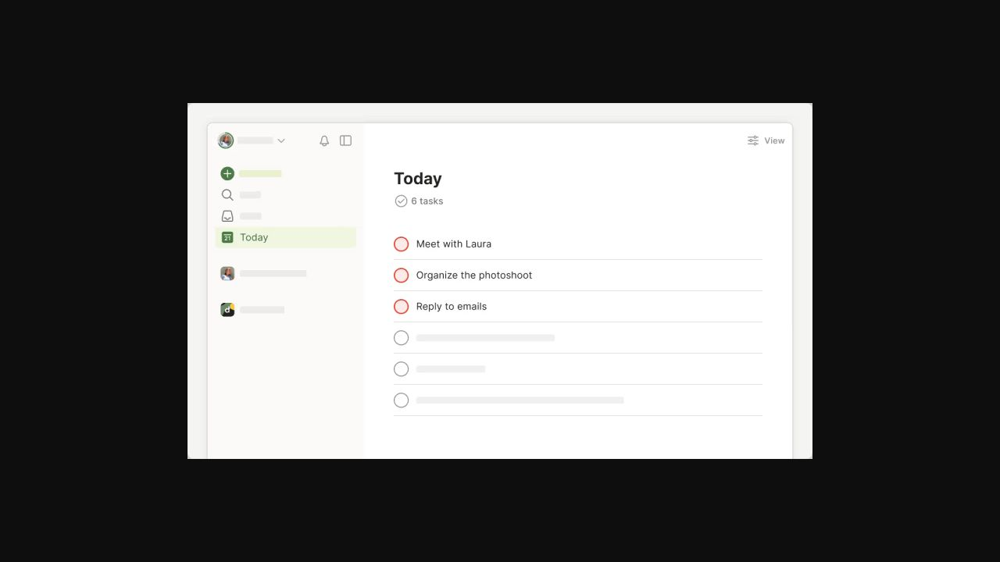
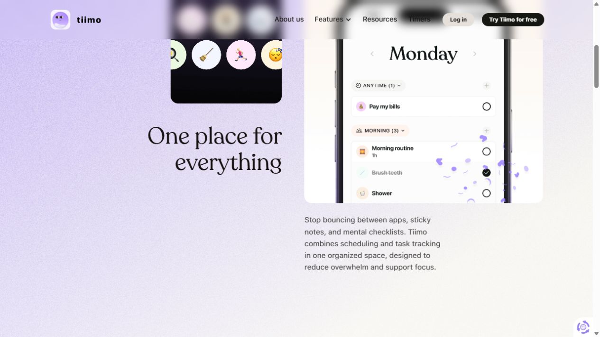

# Today and To-do — visual research, 2026-10-15

## Evidence and access

This is a competitor visual study, not an interactive app audit. Sources were opened in the Codex in-app browser on 2026-10-15. Motion, Tiimo, and Todoist each exposed a sign-in form; no account was created and no authenticated planning workflow was available. The accepted screenshots are browser captures of official published UI imagery, saved as JPEG and reopened from disk for inspection. Product imagery may predate the current authenticated UI.

1. Opened [Todoist’s Today guide](https://www.todoist.com/help/todoist/get-started/plan-your-day-with-the-today-view-UVUXaiSs), observed its dated help content, dismissed the promotional overlay, and opened the guide’s observed Today image URL. **Healthy public help access; app task editing blocked by sign-in.**
2. Opened [Todoist login](https://www.todoist.com/auth/login), inspected the email/password and provider choices, and stopped. **Account wall confirmed; no completion or rescheduling tested.**
3. Opened [Motion’s task-manager page](https://www.usemotion.com/features/ai-task-manager), inspected its published task-risk graphic, then [Motion’s app](https://app.usemotion.com/). **Marketing accessible; app sign-in required.** The first marketing media slot reported unavailable playback, so it was not accepted as visual evidence.
4. Opened [Tiimo’s visual-planning page](https://www.tiimoapp.com/product/visual-planning), declined nonessential cookies and scrolled to the day-sequence illustration. **Published product visual accessible; Tiimo app sign-in required.** Direct image-CDN navigation was blocked by browser policy. No bypass was attempted; the accepted image is the permitted official page in context.

## Observable design

Todoist’s published Today example has a white task pane, a pale left navigation column, a short bold sans-serif heading, a quiet task count, circular completion controls and thin horizontal dividers. Three red outlines distinguish selected priorities. Other source rows are deliberately blurred; this is source artwork, not evidence of loading. The useful pattern is the strong reading order and flat row hierarchy. Literal adaptation would risk copying small targets and color-only priority cues.

Tiimo’s page shows a phone plan divided into Anytime and Morning, with a routine containing smaller steps. The routine and steps have icons, completion circles and visible duration. Its surrounding marketing page uses lavender texture, serif display copy, pill navigation and large rounded imagery. Separate the app sequence pattern from that spacious marketing treatment. Celebration artwork is visible but does not prove any interaction or completion behavior in this session.

## Tempo direction

Use **an agenda desk** for Planner: cream canvas, a warm white working sheet, charcoal text, hairline rules and burnt-orange actions. Keep Georgia for page and group headings; use the existing sans-serif for task labels and controls. Proposed spacing is 24–32px between sections and 12–16px within rows; these are Tempo specifications, not measured competitor values. Prefer 10–14px corners on the containing sheet and restrained corners on controls. Avoid a separate tinted card around every task.

Today remains a direct destination with a clear date, one current action and a chronological day rail. Its secondary task/routine panel should not compete with the current item. To-do remains a searchable working list with All, Today, Next 7 days and Done filters. Preserve undated tasks and make their location apparent. Retain in-progress, carryover and future groups, but use text, count and an icon alongside any color.

Keep the established four navigation families—Planner, Daily rhythm, Food & fitness and Brain dump—with Today and Ask Tempo direct. Planner’s related subtabs should share one neutral treatment; the active tab gets an orange underline and label weight. Distinct families should differ in composition, not just tint. On mobile, stack the current action before the remaining agenda; use a horizontally scrollable, labelled subnavigation only if focus remains visible and the selected destination scrolls into view.

## Implementation brief and acceptance

- `src/app/workspace/TodayView.tsx` and `today.module.css`: preserve `todayModel`, ongoing events, current focus, routine-step handlers and calendar failure states; simplify visual containment and reduce repeated emblems.
- `PlanningViews.tsx` and `planning.module.css`: refine the existing grouped checklist rather than rewrite filtering or mutations. Keep completion, reopen, edit and focus as separate actions.
- `WorkspaceNavigation.tsx` and `navigation.module.css`: family/subtab treatment, with direct Today/Ask routes intact. Reuse `react-icons/fi`; decorative icons stay hidden from assistive technology.
- Validate 390px and desktop layouts, 200% zoom, keyboard order and visible focus; provide at least 44px activation areas. Test long titles, no tasks, many undated items, overdue tasks, completed/reopened tasks and an active focus session. A timer ending must not imply task completion.
- Run nearest `today-model`, `today-calendar`, and task-date tests, then lint/typecheck; read the relevant installed Next.js guide before editing. These are proposed acceptance checks, not validation performed during research.

Screenshot evidence cannot establish contrast compliance, focus behavior, screen-reader announcements or touch usability. Those require testing Tempo’s rendered implementation.

## Implementation status — 2026-10-15

Implemented the To-do agenda sheet in `PlanningViews.tsx` and `planning.module.css`: one cream paper surface, quiet status headings, ruled rows, clear checkboxes and restrained secondary focus actions. Existing filtering, counts and callbacks are unchanged. Illustrated goal cards remain intact; shared filter tabs use an orange underline. Today was deliberately left as approved. Nearest calendar/date tests: 17 passed; repository lint and typecheck passed. Browser inventory became unavailable to this subagent, so integrated desktop/mobile visual verification remains assigned to the parent agent.
