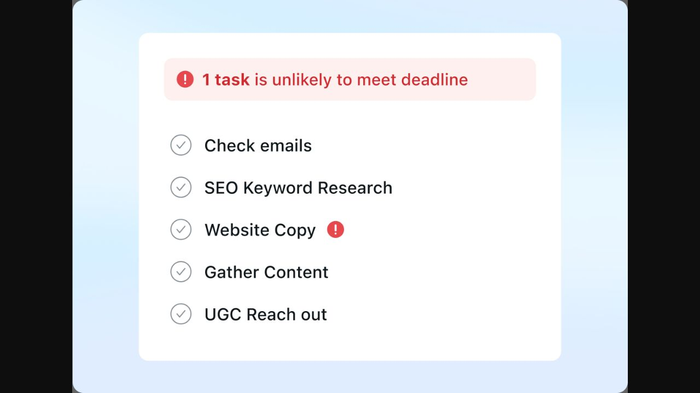
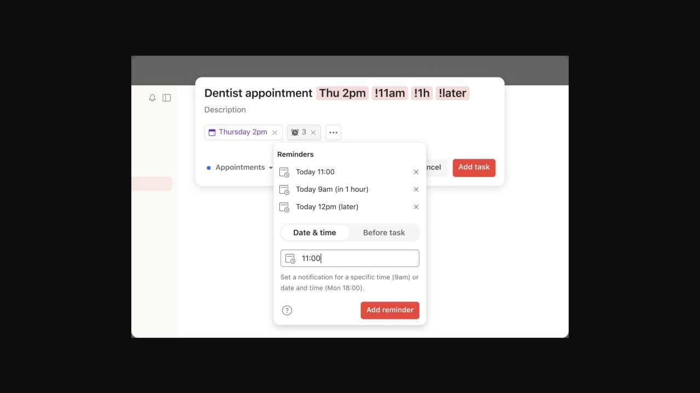

# Calendar, Goals and Reminders — visual research, 2026-10-15

## Evidence and attempted flow

All sources below were accessed on 2026-10-15. Evidence level is **official marketing/help imagery and documentation**. None is an authenticated app audit or public interactive demo. The browser showed sign-in forms at Motion, Tiimo and Todoist; no credentials, purchases, calendar connections or saved mutations were attempted.

1. Opened [Motion’s task-manager feature page](https://www.usemotion.com/features/ai-task-manager), inspected its deadline-risk graphic, and captured the observed official image in the browser. **Published evidence accessible.** The image is a task-risk illustration, not a live calendar grid.
2. Read [Motion’s current calendar feature description](https://www.usemotion.com/features/ai-calendar) and [calendar-purpose documentation](https://www.usemotion.com/help/time-management/all-things-calendars/concept-all-things-calendars/purpose). **Documentary evidence only.** Rescheduling and capacity behavior were not exercised.
3. Opened [Todoist’s reminder guide](https://www.todoist.com/help/todoist/features/introduction-to-reminders-9PezfU), observed the September 1, 2026 update marker, and captured its quick-add reminder image. **Help visual accessible; reminder creation unavailable behind login.**
4. Inspected Tiimo’s published [visual-planning page](https://www.tiimoapp.com/product/visual-planning). **Marketing illustration accessible.** No calendar event drag, task movement or goals flow was tested.

## What the evidence supports

Motion’s image uses a white rounded panel on pale blue, five broadly spaced task rows, outline completion circles and a pink warning strip. Both the warning text and the affected task carry red exclamation marks. A localized problem is legible without repainting the entire list. Motion’s documentation describes time allocation using task deadlines, duration and priority; that is a vendor-described capability, not observed scheduling accuracy.

Todoist’s image shows a task composer and a smaller anchored reminder popover. Date and reminder count appear as chips. Existing reminders are listed above a Date & time / Before task choice, an input, helper copy and an explicit Add reminder action. Gray borders and small outline icons provide hierarchy; red is reserved for the commits. The useful pattern is progressive disclosure with a clear distinction between the task’s time and notification timing. Its narrow floating panel would be cramped on a phone if copied literally. The help text also distinguishes recurring reminders from a one-occurrence date/time reminder; Tempo must describe its own supported semantics explicitly.

There is no captured competitor goal-management flow. Goal recommendations below are original Tempo design proposals grounded in the inspected existing linked-task model, not a claim that another product implements them.

## Tempo art direction

Calendar should be the **time view of Planner’s agenda sheet**. Use a date strip and an open chronological rail with a stable time column; reserve a small blue marker for external calendar events, orange for the selected day/action, and neutral surfaces for most content. A compact connection status belongs near the calendar heading or in a collapsible aside. Avoid a large integration card taking equal weight with the schedule. Do not imply drag rescheduling when existing handlers open an editor or Ask Tempo.

Goals should show a hierarchy of outcome, next step and linked-step progress. Prefer a restrained editorial list or two-column outcome grid with one subtle journey visual, rather than repeating the same large landscape on every card. Progress means linked tasks completed, not verified achievement. Keep Mark achieved explicit and keep linked tasks when removing a goal.

Reminders should be a chronological delivery list: date/time column, reminder sentence, readable state and Change with Tempo. Put future and delivered items in clearly labelled sections; preserve sending-state restrictions. Use a bell icon plus text for delivery state, not badge color alone. Creation can continue through Ask Tempo with an explicit return path. This surface remains related to Calendar and Goals through typography and toolbar rhythm while keeping its own row structure.

## Implementation brief and acceptance

- `CalendarView.tsx`: reshape presentation only; preserve `useCalendarEvents`, timezone/date navigation, reconnect, loading/error/truncated/disconnected and preview labels. Keep external edit limitations and confirmations visible when relevant.
- `PlanningViews.tsx` / `planning.module.css`: revise goal layout around linked progress and next action; retain existing achieve, add-step and remove callbacks.
- `SavedContextViews.tsx`: scope reminder-specific layout by section or a small dedicated component; avoid changing memory presentation as a side effect. `WorkspaceClient.tsx` already owns confirmation and Ask Tempo handoff.
- Use 44px targets, labelled date controls, visible keyboard focus and readable 16px primary rows. At 390px, connection details move below the schedule; date/time labels wrap without overlapping actions. Popovers become an accessible dialog or inline panel if later added.
- Verify all-day events, overlapping events, DST/timezone dates, very long labels, failed/revoked calendar access, no goals, zero-step goals, completed goals, pending/sending/delivered reminders and search with no results. Confirm destructive buttons remain gated and a stale fetch is not labelled current.
- Run nearest calendar-event, connection, Today calendar and task-date tests plus lint/typecheck after implementation. No code or app-state changes were made during this study; these tests have not been run for this report.

Screenshots cannot prove accessible contrast, notification delivery, scheduling quality or database idempotency. These remain implementation checks.

## Implementation status — 2026-10-15

Implemented `CalendarView.tsx` with scoped `calendar.module.css`: seven-day selector, selected-date heading, aligned chronological time/source rows, blue calendar accents and compact connection details below the agenda. Existing events, task/reminder filters, timezone handling, callbacks, sample labels and failure states are preserved. No drag/drop or autoscheduling was added. Goal artwork and actions remain; reminder implementation belongs to the parent team. Calendar/date validation: 4 test files, 17 tests passed; `npm run lint` and `npm run typecheck` passed. CUA returned no available browsers in this subagent; rendered desktop/mobile inspection is pending parent verification.
