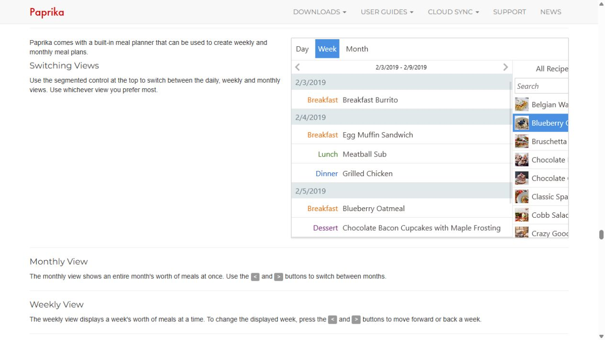
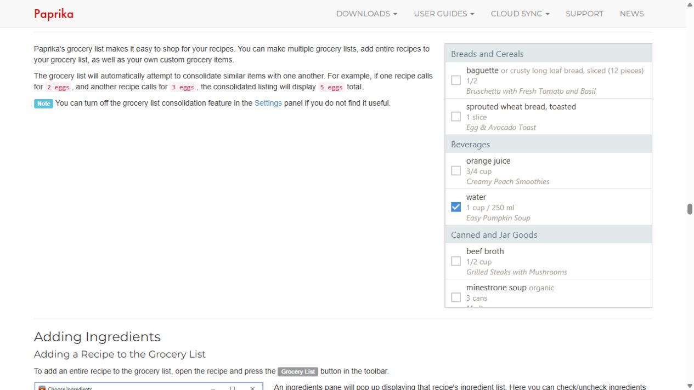
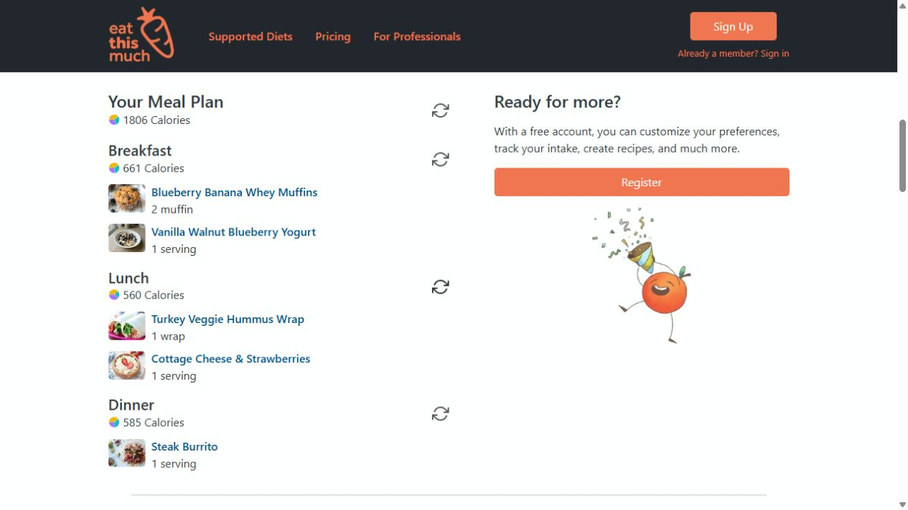

# Meals, Recipes, Groceries and Pantry: evidence and brief

Research date: 2026-10-15. Goal: related food pages with distinct working layouts. This report uses an anonymous public planner and official Paprika help screenshots; Paprika itself was not installed or operated.

## Sources and steps actually attempted

1. Read the [supplied vendor comparison](https://blog.eatthismuch.com/best-meal-planning-apps/#paprika). **Editorial evidence; readable.** Its Paprika section motivated checking the primary guide. Its inconsistent pricing descriptions are not carried forward.
2. Used [Eat This Much's public generator](https://www.eatthismuch.com/): clicked Generate with defaults and observed completed Breakfast, Lunch and Dinner rows with food names, photos, portions and per-meal calories. **Interactive public demo; successful.** Did not sign up, save a plan, or test shopping/pantry.
3. Opened [Paprika's official site](https://www.paprikaapp.com/), expanded User Guides, selected Windows, then used the Meals and Groceries contents links. **Official help evidence; successful reading.** Captured and inspected those page sections. The guide explicitly identifies Paprika 3 and offers a separate Paprika 4 beta guide; the screenshots are historical product illustrations, not live current-version screenshots.
4. Read the same guide's recipe, grocery and pantry explanations. **Documented behavior only.** No grocery item, recipe or pantry inventory was changed.

## Findings grounded in the evidence

The [Paprika meal guide](https://www.paprikaapp.com/help/windows/#meals) shows Day/Week/Month controls, date navigation, colored meal-type text, shallow date bands and a recipe sidebar with small thumbnails. Planning is the central surface; recipes are a supporting source. Its dense rows are more efficient than giving every empty meal a large image. On a small viewport, the narrow recipe rail and tiny labels would need a different arrangement.

The [recipe guide](https://www.paprikaapp.com/help/windows/#recipes) documents category and field search, list/photo-grid views, recipe metadata, scaling, and separate ingredients/directions. That separation suggests a browsable library with detail disclosure, rather than a page filled with simultaneously expanded recipe text. The captured meal view is visual evidence; recipe-detail behavior remains help documentation.

The [grocery guide](https://www.paprikaapp.com/help/windows/#groceries) shows aisle headers, checkboxes, ingredient quantities and source-recipe subtitles. It documents reviewable ingredient selection before adding a recipe, and consolidation of similar ingredients. The [pantry guide](https://www.paprikaapp.com/help/windows/#pantry) documents quantity, stock status and dates, with pantry ingredients unchecked during grocery addition. These are useful interaction patterns, but do not establish compatible unit conversion or automatic stock accounting in Tempo.

Eat This Much reinforces meal-group hierarchy and visible portions. Its completed public plan is easy to read but spends a large right column on registration. Tempo can replace that marketing rail with the user's selected-day details. The supplied diary reference supplies the shared pale blue / white rounded-card language; Paprika supplies structure, not its desktop-era gray-table styling.

## Tempo implementation brief

Primary ownership: `src/app/workspace/FoodViews.tsx`, scoped food styles in `food-fitness.module.css`, and only necessary rules in `workspace.module.css`. Preserve `MealPhoto`, `demo-recipes.ts`, existing editors/callbacks, and `src/server/domain/meal-groceries.ts` semantics.

**Meals:** keep a compact week strip, date input and Plan a meal action. Use a broad selected-day planner with meal groups as rows/cards and small dish thumbnails, plus a narrower “From your recipes” area when space permits. Clearly label preparing servings and ingredient basis. Put shopping inclusion and recipe swap behind an intentional details region, retaining access. Empty meals need a short Add meal affordance, not a large repeated decorative illustration. State that plans are separate from eaten food.

**Recipes:** use a white photo-card library inside the blue family surface, searchable by title locally if implemented. Cards lead with photo, title, preparation time and servings. Save and Plan actions stay distinct. Ingredients and directions open in a readable details area. Keep saved recipes above a clearly marked recipe-ideas shelf; sample ideas must not look saved until their existing save succeeds.

**Groceries/Pantry:** use a task-focused shopping list with an adjacent stock panel on desktop, stacked on mobile. Keep unchecked shopping items first; label purchased items “not added to pantry.” Retain quantities, units and source-meal links. Group only by data the app actually knows; do not fabricate aisles, expiration dates or inventory amounts. Unknown pantry amounts remain unknown and cannot reduce shopping calculations.

## Acceptance and validation

- Each page has a distinct primary layout while sharing blue surfaces, rounded white cards and consistent type.
- Plans, recipes, purchases, pantry and consumed food remain distinct records and actions.
- Servings scale through existing behavior; manual groceries remain separate; derived groceries edit their source meal.
- Buttons, disclosure controls, checkboxes and photo alt text remain accessible at desktop/mobile widths.
- Run `FoodViews.test.ts`, nearest meal-groceries tests, lint and typecheck after implementation; browser-check meal selection, recipe save/plan, shopping purchase and pantry edit. Research changed no app code and ran no functional tests.

## Implementation pass, 2026-10-15

`FoodViews.tsx` now gives Recipes a working local title search and saved count, Meals compact paired meal cards without repeated empty illustrations, and Shopping a distinct main list with an adjacent pantry panel. Scoped `food-fitness.module.css` supplies blue-family borders and rounded white surfaces. Existing meal, recipe, portion, stock and purchase callbacks remain intact. The three nearest food/fitness test files passed (19 tests); lint and typecheck passed. Parent agent owns final browser QA and global family styles.
