# Independent novice customer review — Tempo adaptive Home

Review date: 2026-10-21. Reviewer: independent agent taking a novice customer's perspective; this is a usability evaluation, not a claim of lived ADHD experience or a clinical evaluation.

Environment: local Next.js preview at `http://localhost:3103/workspace/preview`, own IAB tab 1. Initial commit `95d7d1d1a880fdbec3a80adfd1fc002085af9351`, branch `codex/tempo-adaptive-home`. The walk repair was re-reviewed from the running working tree during hot reload, before its commit. No production, backend, real SMS, real AI calls, external messages, or secret files were used. The banner explicitly says fictional data, resets on reload, no messages sent. Desktop screenshots are 1265px wide. A separate reviewer briefly changed the shared viewport for its mobile review; this reviewer did not make a mobile assessment.

**Overall: 8/10 after the observed walk repair; initial Home journey 7/10.** The preview feels calm and gives me useful next actions. Tasks, a working timer, a recoverable thought, and grocery follow-through make it more than an attractive dashboard. The repaired walk action removes the main context break. Remaining friction is minor but real: help drafts omit the task title, shopping quantities are overly precise, and thought-to-task conversion lacks a visible link to the created task. This score is for the interactive preview only. Live coaching usefulness, persistence, SMS reliability, and long-term adherence remain unproven.

## Numbered journeys

1. **Arrive and understand Home — healthy, 8/10.** I opened the preview afresh and read the fictional-account notice. Home offered one next task, a short starting timer, the to-do list, and calendar. At the observed live evening time, the morning project task was still the suggested next step; the rationale is only implied by its unfinished status. The layout and reassuring copy reduce pressure, though a brief overdue indicator or rationale would make that suggestion easier to trust. [01-home.png](customer-screenshots/01-home.png)

2. **Add, start, pause, and complete one task — healthy, 8.5/10.** I added “Put sketchbook in my backpack,” estimated three minutes, expanded “Show 5 more,” and found it. Starting it opened the correct title and `3:00`; Pause changed to Resume and stopped at `2:57`. Returning Home kept a paused current-focus banner and mini timer. “Continue focus” reopened the paused session. “I’m done” removed it from the unfinished Home list and showed an encouraging completion message with Undo. A new unscheduled task initially sits under “Show more,” so the generic save toast is less useful than a direct “View task” action would be. [02-timer.png](customer-screenshots/02-timer.png)

3. **Customize the Home rhythm and follow automatic routines — healthy, 8/10.** “Customize home” explained that only the banner changes, with time zone, routine-derived defaults, dinner time, workout lead time, and pinned mode. I saved “Meal plan · pinned,” which showed dinner. Selecting sample `8:10 AM` kept meal mode pinned and showed breakfast; unpinning immediately restored Auto · Morning. “Continue routine” started the named breakfast step at `15:00`; “I’m done” advanced the banner from 2/4 to 3/4 and changed the next step to “Choose one thing for today.” Preferences felt reversible and understandable. [03-home-preferences.png](customer-screenshots/03-home-preferences.png), [04-auto-morning.png](customer-screenshots/04-auto-morning.png)

4. **Follow the upcoming walk — initially broken, repaired and re-reviewed, 8/10.** Sample `3:05 PM · walk` correctly selected “Walk home from design lab,” scheduled 3:10 PM. Initially “Open workout” sent me to generic Fitness, where the selected template was Full-body foundations and the named walk was absent. I reported this immediately. After the live repair, the same banner offered “Start 20 min.” Clicking it opened “Walk home from design lab” at `20:00`. I then stopped it and received an explicit message that the task remained unfinished. The primary action now follows through on the banner's promise. [07-walk-banner.png](customer-screenshots/07-walk-banner.png) → initial wrong landing [05-walk-lands-generic-fitness.png](customer-screenshots/05-walk-lands-generic-fitness.png) → repaired result [11-repaired-walk-timer.png](customer-screenshots/11-repaired-walk-timer.png)

5. **Override a task's starting timer and icon — healthy, 8.5/10.** I opened the walk icon's customization control, changed Movement to Personal and the starting timer from 20 to 7 minutes, and saved. The row said “Your choice: Personal, 7 minutes,” and “Start 7 min” launched the correct title at `7:00`. Stopping left it unfinished. The dialog's explanation that a starting session is not a deadline is helpful. Changing the icon also caused the automatic banner to stop treating that task as movement and fall back to Focus; that coupling is worth explaining if the icon is intended to represent a category rather than decoration. [12-manual-seven-minute-timer.png](customer-screenshots/12-manual-seven-minute-timer.png)

6. **Meal planning, grocery follow-through, and completed movement — functional, 8/10.** In Food & fitness I logged a fictional 12-minute “Walk home from design lab”; the total increased from 20 to 32 minutes and two sessions. In Meal plan I swapped dinner from Lemon chicken grain bowl to Tomato & lentil soup. Ingredients in shopping switched on. Groceries included soup ingredients with source links, while manual groceries remained separate. This made the connections legible. Remaining polish: `266.667 g` tomatoes, `0.667 onion`, `1.333 carrots`, and `2 slice` bread are awkward at the shop. Show readable fractions/rounded practical amounts while preserving calculation accuracy. [06-groceries-after-swap.png](customer-screenshots/06-groceries-after-swap.png); quantities were verified in the current accessibility state, below the screenshot's viewport.

7. **Capture a thought, retrieve it, and make a task — healthy, 8.5/10.** From Groceries I used “Capture a thought,” saved “Ask studio about Saturday opening hours” with a fictional detail, returned Home, and searched “studio.” The Thought result reopened both exact fields. Spaces → Thoughts showed the saved note. “Add to To-do” opened a prefilled task editor; saving preserved the original thought. Home search subsequently showed separate To-do and Thought results with clear type labels. The capture save toast only says “Updated in preview”; naming its destination or linking to the thought would reassure a novice. After conversion, the original card still offers the same “Add to To-do” without a backlink or created-task state; I did not test repeated conversion/duplicates. [13-search-task-thought.png](customer-screenshots/13-search-task-thought.png), [14-captured-thought.png](customer-screenshots/14-captured-thought.png)

8. **Use Spaces, search, and Journey — healthy, 8.5/10.** Spaces grouped Planner, Daily rhythm, Food & fitness, and Brain dump, and Thoughts opened the expected page. Search found the newly created content and offered “Ask Tempo” as a draft requiring review. Journey showed activity counts and a non-punitive explanation. Next milestone switched to Exploring Level 2, explained one more active day, and offered Return to my level 1. “How your journey grows” clarified active days versus checkoffs, local day, undo behavior, and sample limitations. “Keep numbers out of it” immediately hid the streak, levels, and milestones while retaining the world and encouragement. The ability to remove numbers is a meaningful strength. [09-journey-full.png](customer-screenshots/09-journey-full.png)

9. **Settings and optional personalization — healthy, 8.5/10.** Account menu → Settings was discoverable. Quiet hours & delivery expanded to `22:00–08:00`, America/New_York, confirmation before removal, and limits on check-ins. I turned fictional proactive check-ins off. Personalize Tempo walked through optional name, tone, and progress display; I chose direct tone and saved. The checkbox remained off afterward, matching the repeated promise that setup does not turn on check-ins. Profile/connection links lead outside the preview workflow and were not followed. [10-settings.png](customer-screenshots/10-settings.png)

10. **Ask for a smaller step — clear demo limitation with a minor context gap, unscored for AI quality.** From both the sketchbook and walk timer I chose “Feeling stuck? Let’s make it smaller.” Ask Tempo was clearly marked “Scripted example · no AI calls,” with no assertion that the transcript was live. The draft was “I’m stuck on my current task. Help me make the next step smaller.” The task title is absent, though a mini timer is visible. Including the exact title would help a novice trust that the right context was carried forward. I did not send it or rate the sample conversation as observed AI behavior.

## Remaining observations and limits

- The principal blocking Home issue was repaired and behaviorally verified in journey 4. The initial screenshots remain historical evidence and are not presented as the current behavior.
- All accepted screenshots were captured during this run, saved, reread, and visually inspected. `08-journey.png` is a lower-page detail; `09-journey-full.png` is the accepted whole-page Journey evidence. The initial cropped search capture was replaced with a full-page capture at the same path.
- Visible labels and focus destinations were generally clear, and editors focused a close button or heading. Some custom controls were exposed as checkboxes in the native accessibility tree while equivalent DOM role selectors did not match; direct accessibility-node interaction succeeded. That is a reason for a dedicated screen-reader/keyboard check, not proof of an accessibility failure.
- I did not measure contrast, conduct a complete keyboard-only flow, use a screen reader, change zoom, validate mobile, wait for timer expiry, test notification delivery, exercise reload persistence, authenticate a real account, or assess database/provider behavior. Preview changes were retained through in-app navigation and explicitly advertised as resetting on reload; durable persistence is not established.
- The report contains no code modifications. No tests, lint, typecheck, or build are claimed by this reviewer.

## Screenshot evidence

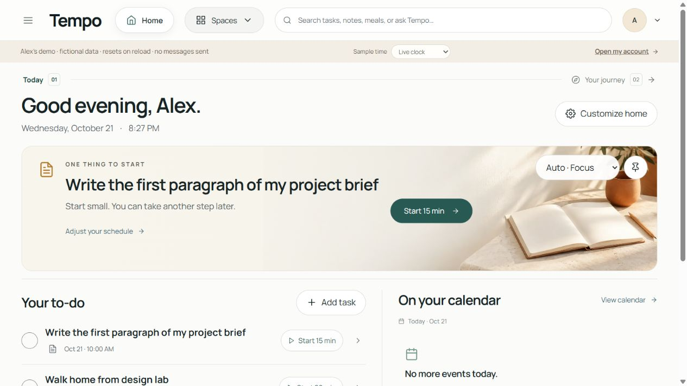

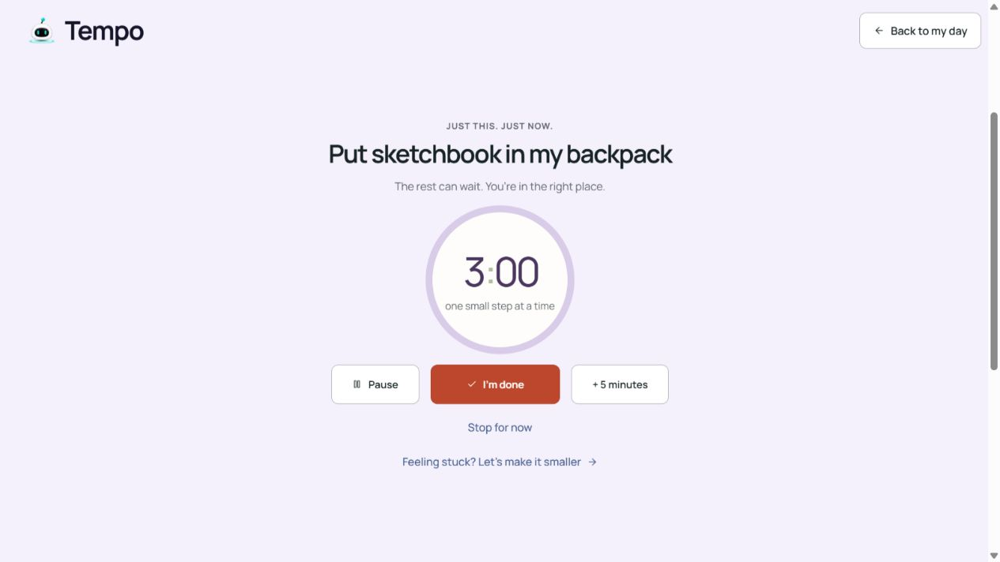

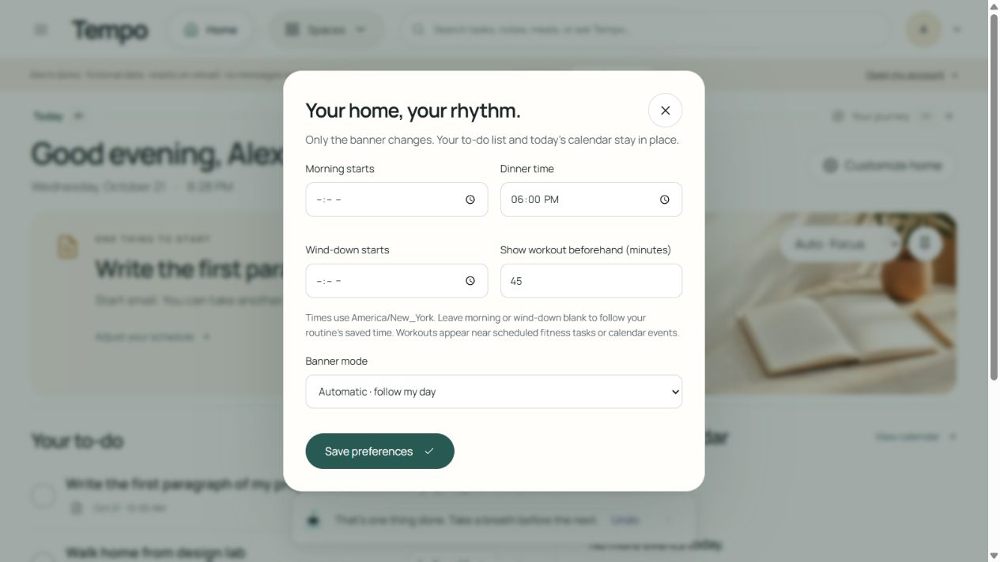

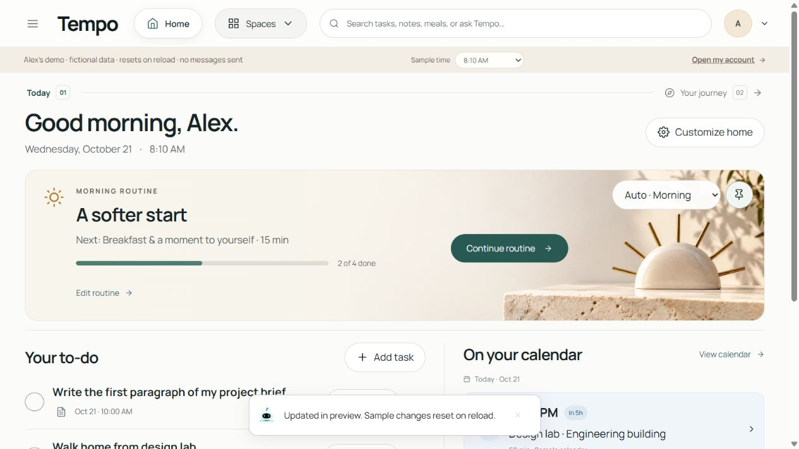

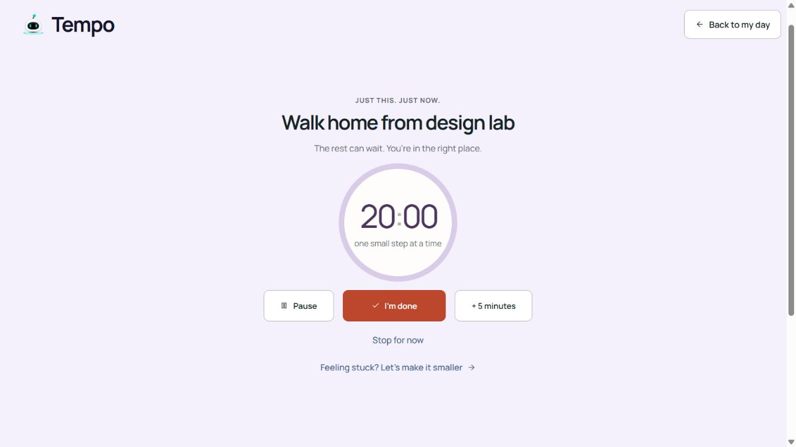

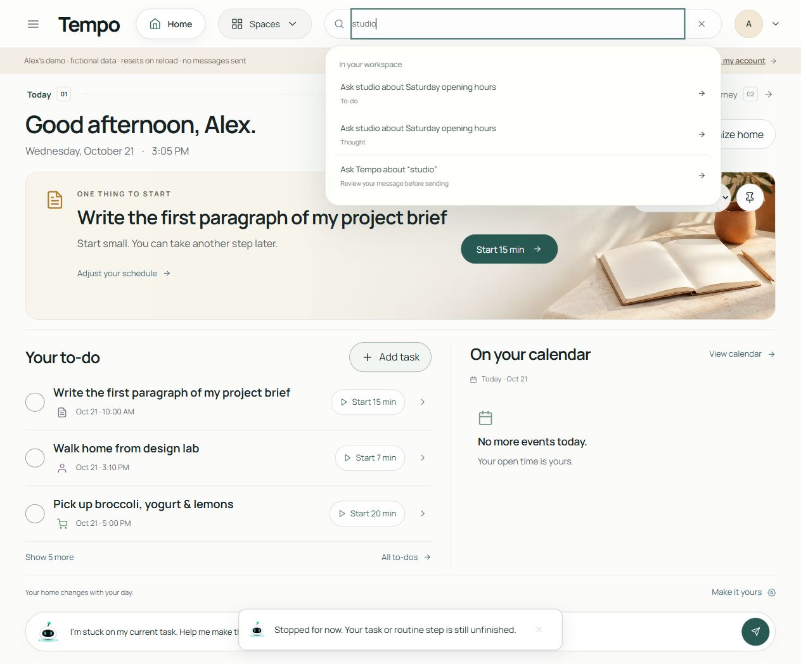

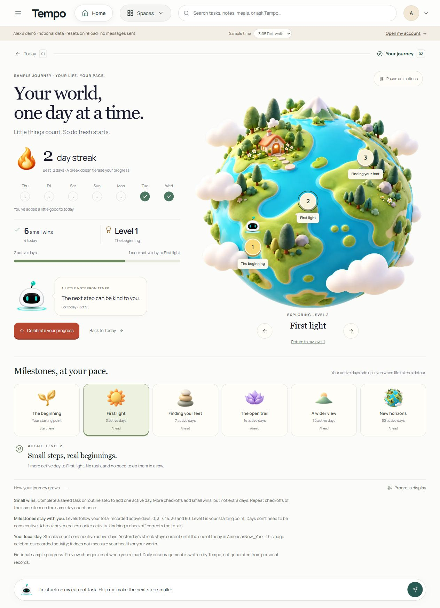

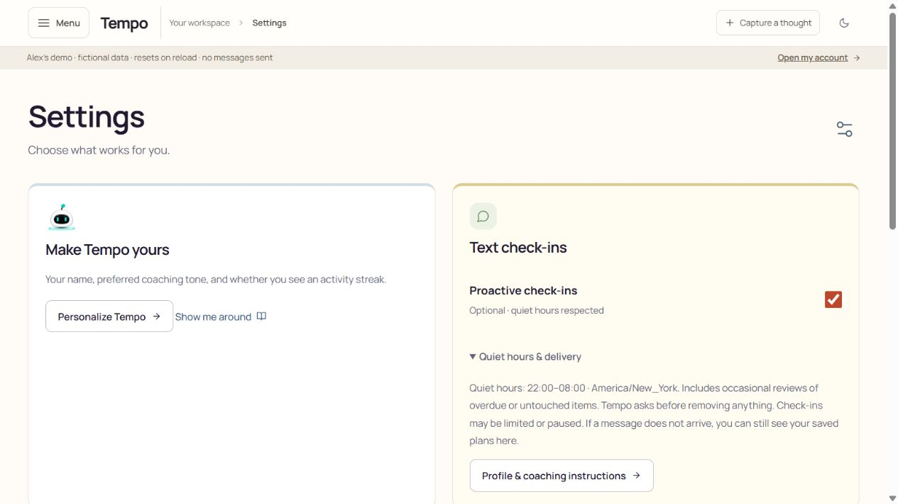

## Attributed visual re-review — 2026-10-21

The main reviewer supplied `account-smaller-step.png` and `final-home.png` after additional repairs. I independently opened and visually inspected both saved images. These are main-reviewer captures, not screenshots from my own interactions. My resumed browser session exposed no available browser, so I could not perform a fresh interactive pass on these final changes.

11. **Smaller-step task context — visually repaired.** The supplied signed-in fictional QA screenshot shows the draft: `I’m working on "Write a short project outline" and feeling stuck. Help me make the next step smaller.` The mini focus control names `Write a short project outline` and shows `5:30`. The matching title visibly resolves the omission observed in journey 10. This image establishes the displayed draft and context match; it does not establish how the draft was generated, whether sending succeeds, a live AI response, or reload persistence. The main reviewer reports separate interaction and persistence checks, documented separately. [account-smaller-step.png](account-smaller-step.png)

12. **Final Home — visually healthy.** The supplied full-page screenshot shows the fictional Alex preview at sample `8:10 AM`, Auto · Morning, a 2/4 routine progress bar, Continue routine, visible to-dos with timer actions, and the upcoming Design lab calendar card. Nothing appears clipped or overlapping in this desktop image. It supports the calm hierarchy and connected next actions noted in the original review; it is not a new behavioral or mobile check. [final-home.png](final-home.png)

**Rating remains 8/10 for the interactive preview.** The named help draft is a useful improvement and its visual defect is closed. I have not independently rechecked the new grocery formatter or serving changes in a browser; local-test results reported by the implementation team do not replace that usability check. Consequently journey 6 retains its observed 8/10, with the original quantity evidence treated as historical and final readability marked awaiting independent interaction. This addendum does not extend the rating to signed-in persistence, live coaching, or SMS delivery.

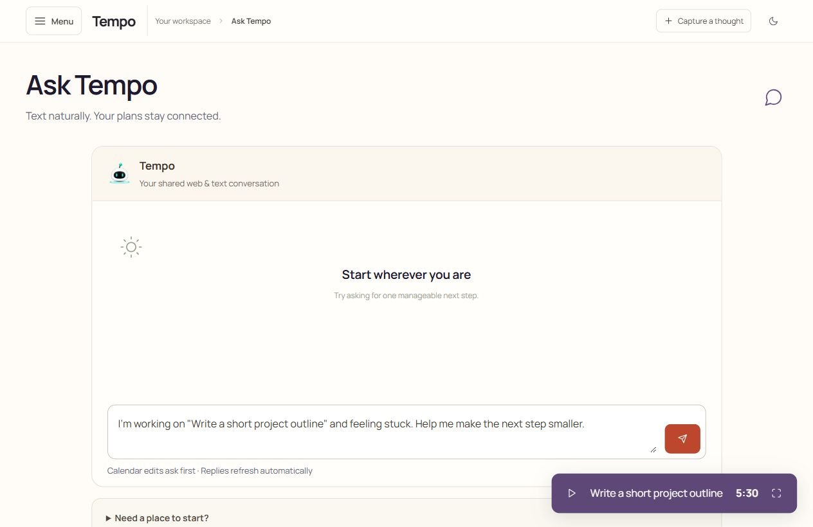

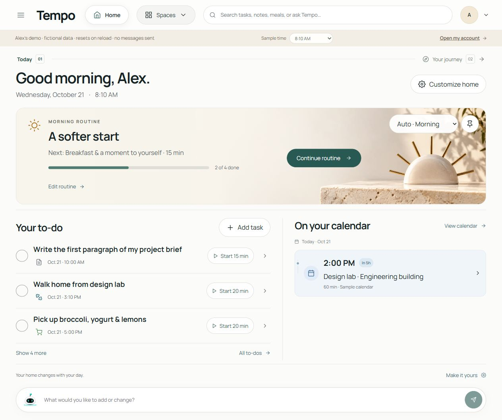

## Attributed grocery visual re-review — 2026-10-21

13. **Grocery quantity precision — visually repaired, 8/10 retained.** I independently opened the main reviewer's supplied `final-groceries.png` at original resolution. The soup rows legibly show `about 266.7 g canned chopped tomatoes`, `about ⅔ onion, diced`, and `about 1⅓ carrots, diced`. These are easier to read than the original three-decimal labels, so the quantity-precision finding in journey 6 is closed on visual evidence. The screenshot also visibly retains the manually added groceries, identifies the soup rows as “From your meal plans,” and shows a Tomato & lentil soup source label beneath each. Its counts are internally consistent: eight manual items plus eight meal rows give 16 to buy, followed by two checked purchases. No duplicate soup ingredient row is visible in this captured list. `2 slice wholegrain bread` remains a minor grammar issue.

The main reviewer reports performing the dinner swap from a two-serving chicken meal to soup and observing automatic shopping inclusion. I did not repeat that interaction. A final screenshot cannot prove serving-change arithmetic across states, non-duplication under repeated edits, unchanged underlying quantities, source-link behavior, or persistence. Those remain implementation/main-reviewer validation claims rather than this reviewer's observations. This closes the visual-readability uncertainty in the preceding addendum without claiming a new interactive grocery pass. Overall remains **8/10**.

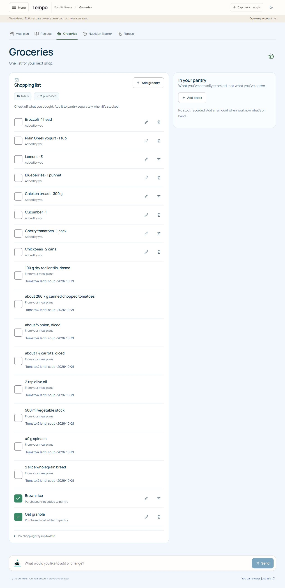
