# Independent product/UI design review

Reviewed 2026-10-21 against commit `95d7d1d`, using a new in-app browser tab at `/workspace/preview`. Fictional demo data only; no production writes, model calls, or external messages. The approved Home image supplied by the user was the visual reference. This is an independent review; I made no product-code changes.

**Initial score: 7.8/10.** The Home visual design itself is approximately 8.5: clear hierarchy, warm photography, restrained surfaces, consistent line icons, and an obvious current activity. The score is held below 8 by a confirmed keyboard-focus defect in the new Home settings dialogs. Compacting the Meal Plan cards is a secondary improvement, not a reason to redesign the approved Home.

## Scope and user goal

Find the next useful activity, begin a short session, adjust the suggested icon/timer, personalize the Home banner, and navigate into related spaces without losing orientation. Combined visual/UX review plus sampled keyboard and responsive checks; this is not a full accessibility-conformance audit.

Desktop captures used the existing approximately 1264 × 712 viewport. Mobile checks used 390 × 844, coordinated with the other reviewer; the viewport was reset afterward. All evidence below was captured during this audit, saved, and visually inspected.

## Findings

1. **P2 — Tab escapes the new Home settings dialog.** Open Customize home; focus starts on Close settings. Shift+Tab changes `document.activeElement` to BODY. Tab from Save preferences likewise changes focus to BODY rather than Close settings. The same dialog hosts task icon/timer preferences. Escape closes correctly and restores the opener. `TodayView.tsx`'s `<dialog>` lacks the existing `loopDialogTab` handler, which is already used by the other workspace editors. Reuse that handler and verify both directions. Evidence: steps 4 and 9, with read-only active-element observations. This is a keyboard navigation defect rather than a screenshot-only inference.
2. **P3 — Meal Plan is unnecessarily tall for scanning a day.** At the default desktop width, two populated cards occupy roughly 780px each and Dinner requires substantial scrolling. Photos are attractive, but the Ingredients, shopping checkbox, swap selector, edit/remove, and Add a meal controls form widely separated rows. Reduce the photo height moderately, compact these secondary rows, and preserve 44px touch controls. Relevant selectors are `food-fitness.module.css` `.mealPlanGrid figure img`, `.mealPlanGrid>article>div`, and the inherited shopping `.taskRow` in `FoodViews.tsx`. Evidence: step 7.
3. **P3 — Task-icon customization is discoverable mainly through a small metadata icon.** Its accessible label and tooltip are good, but a sighted user may perceive the icon as a category indicator only. A subtle hover/focus affordance or a brief one-time hint would improve discovery without adding permanent Home clutter. Evidence: steps 1 and 4.
4. **P3 — Supporting text is very small in several dense areas.** Home task dates compute to 12px; small action/helper text is 12–13px. The sampled colors (`rgb(96,103,108)` for dates; `rgb(53,94,113)` for the banner secondary link) do not establish a contrast failure. Consider a small metadata-size increase if readability testing with target users shows difficulty. Do not darken the entire composition based solely on screenshot impression.

## Numbered flow and evidence

1. **Morning Home — healthy.** Sample 8:10 AM selects the Morning banner. Photo, warm surface, progress, primary action, task list, and calendar form a coherent continuation of the approved composition. The task list remains easy to scan. The demo controls explain fictional/reset behavior.

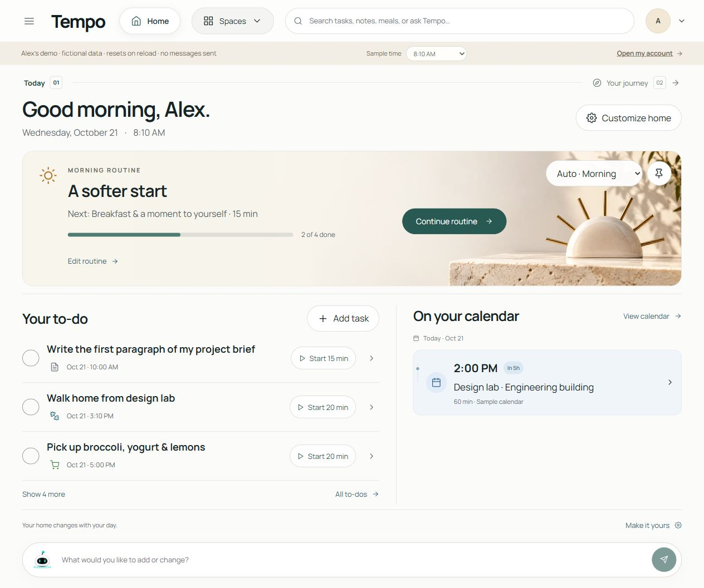

2. **Spaces menu — healthy.** Four labeled groups make the broad product comprehensible. Icons and arrows are consistent; Escape dismisses the menu and returns focus to Spaces.

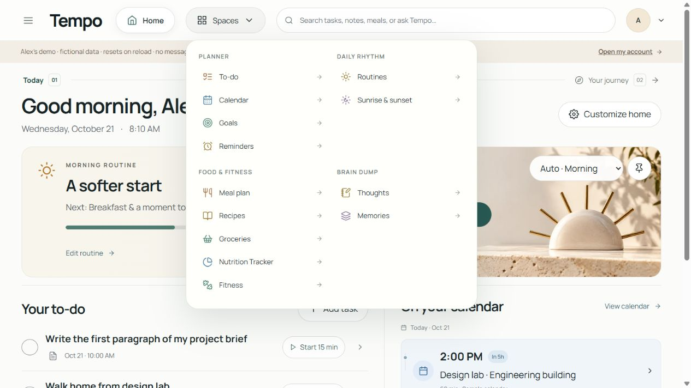

3. **Add task — healthy.** Clear field labels, readable modal width, clear Cancel/Save pair. Empty Save focuses the required title field, and Escape restores Add task focus. The initial focus is the close button, consistent with the existing editor pattern.

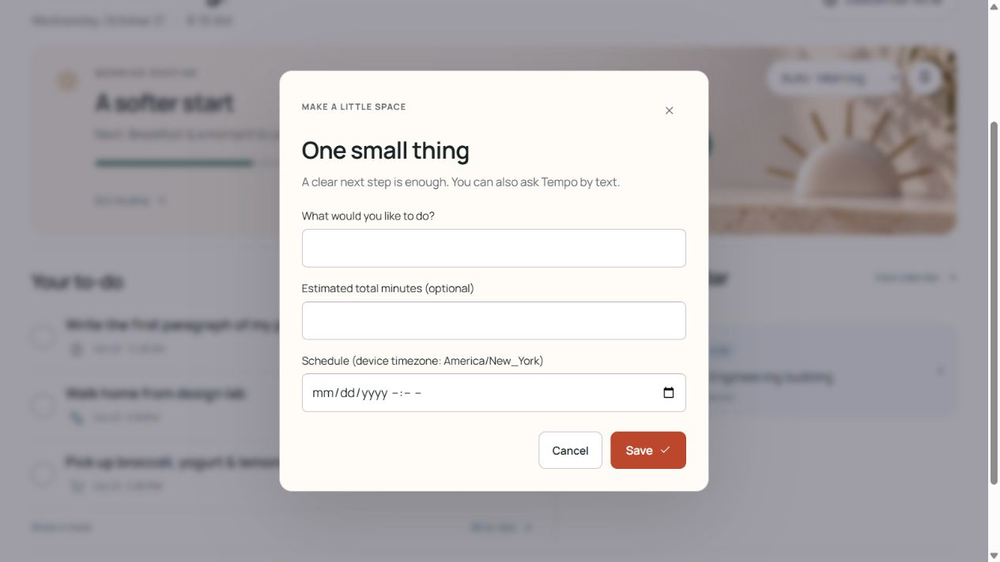

4. **Task icon/starting timer — good visual design; keyboard issue.** The form is short, explains that a starting timer is not a deadline, and gives the user priority over suggestions. It shares the focus-loop defect in finding 1.

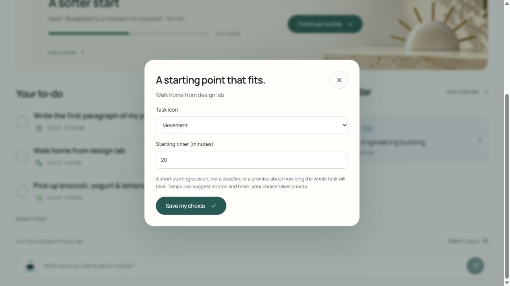

5. **Start focus session — healthy.** Starting the first task opens a distinct lavender focus surface with a large timer, simple actions, and a clear Back to my day control. Stop for now returns to Home with explicit unfinished-task feedback. This was an interactive local demo, not observed live AI output.

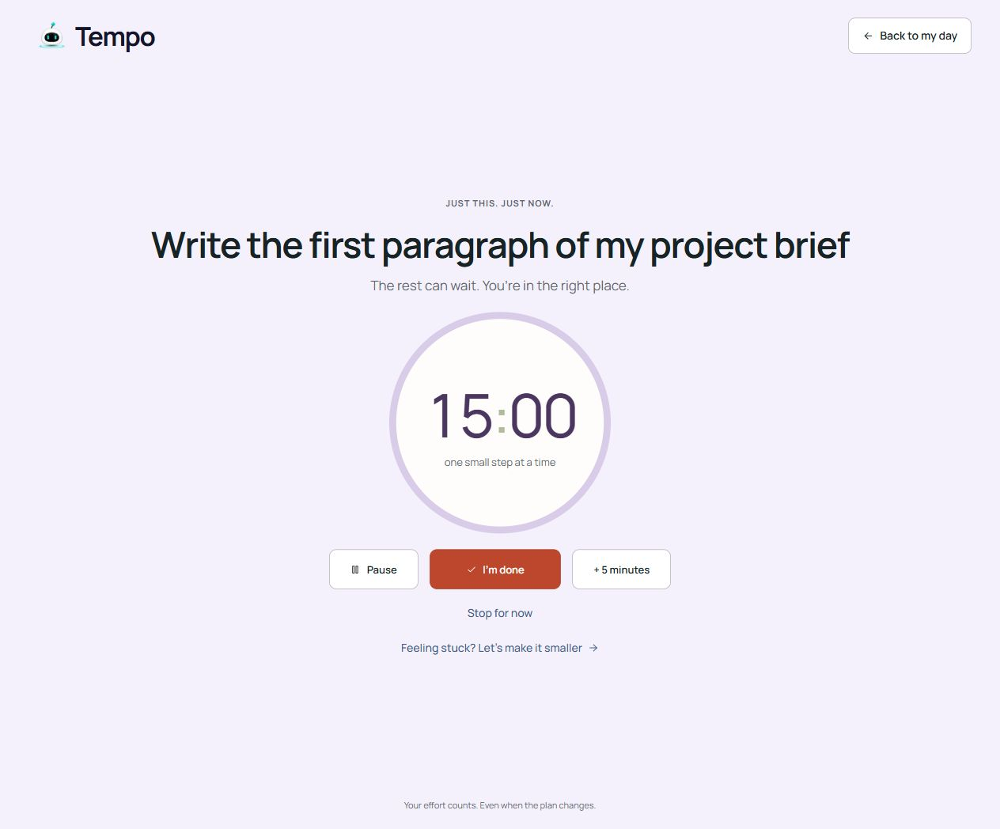

6. **Journey — healthy.** The expressive world illustration, serif editorial heading, milestones, and mascot make this a distinct reflective space while retaining Tempo's soft palette and controls. Progress wording avoids presenting a break as lost progress. Animation pause is available. No clipped illustration or milestone labels were observed in the desktop capture.

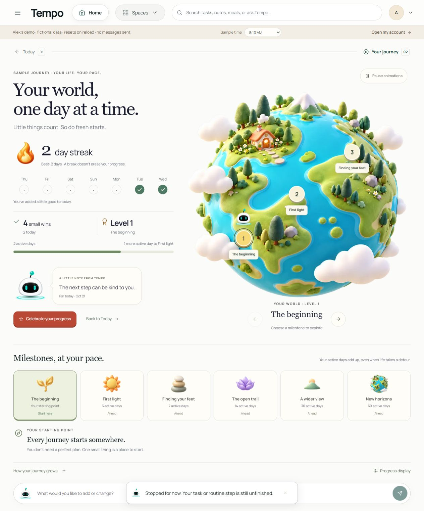

7. **Meal Plan — usable, density polish recommended.** Good food photography, clear meal groups, day selection, and shopping controls. The very tall cards reduce day-at-a-glance usefulness; see finding 2.

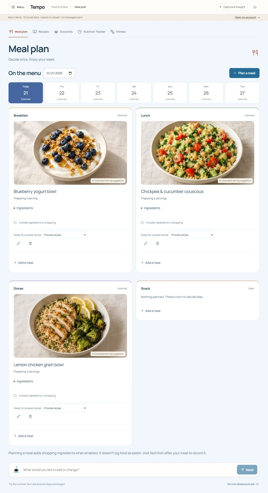

8. **Fitness — healthy with substantial content.** Blue background and movement illustrations give this space its own identity. Logged movement, saved plans, template selection, and session details are clearly separated. The template area is long but its length is justified by actual content rather than blank card spacing.

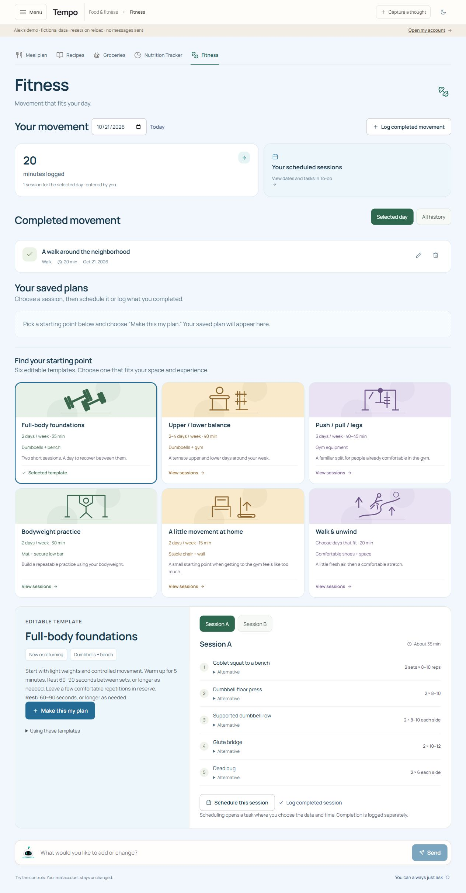

9. **Customize Home — good visual design; keyboard issue.** The four timing controls, automatic/pinned mode, and explanatory text are clear. Escape restores Customize home focus. Boundary Tab/Shift+Tab escape the control loop as described in finding 1.

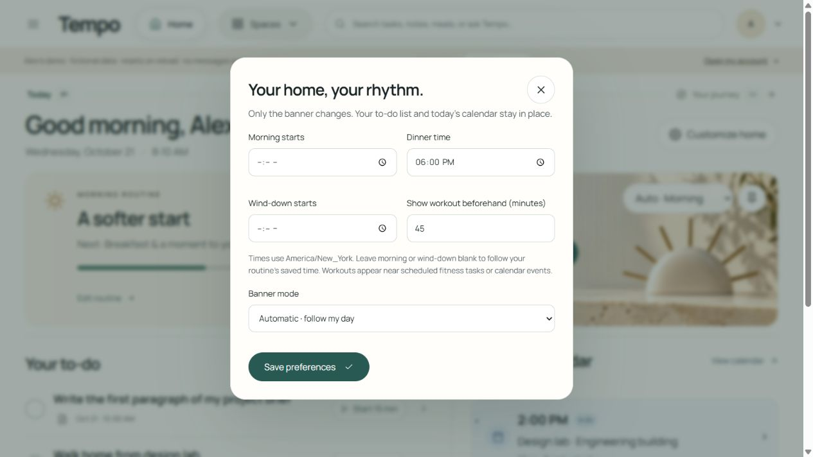

10. **Adaptive movement state — healthy.** Sample 3:05 PM selects the scheduled walk, with appropriate movement imagery and accessible task actions. The calendar presents a clear no-more-events state. The task list and calendar retain their position.

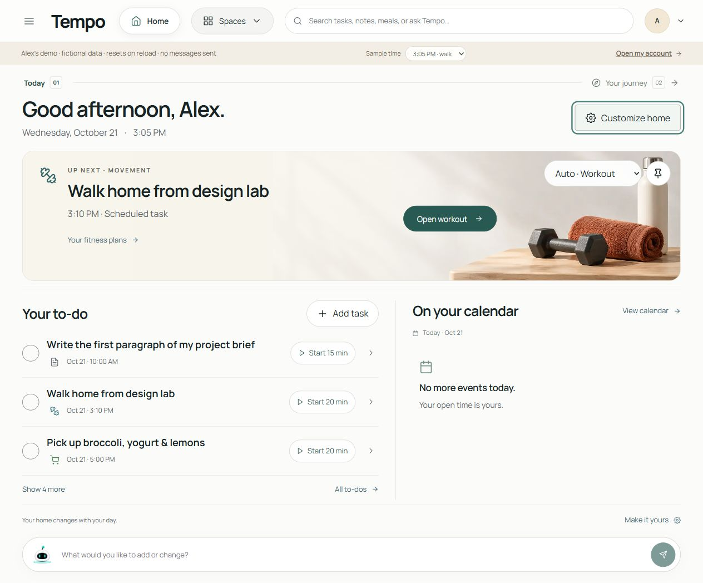

11. **Mobile Home — healthy.** At 390px the hero stacks controls and CTA, task titles wrap, and calendar follows the list without horizontal clipping. The Morning banner was manually previewed while the sample clock remained 3:05 PM; the footer accurately says this is a preview.

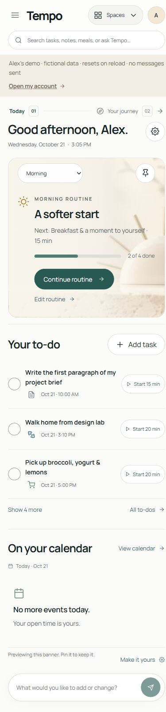

12. **Mobile Spaces — healthy.** The two-column grouped menu fits, including wrapped Sunrise & sunset and Nutrition Tracker labels. Touch rows remain distinct and no menu content is clipped at this viewport.

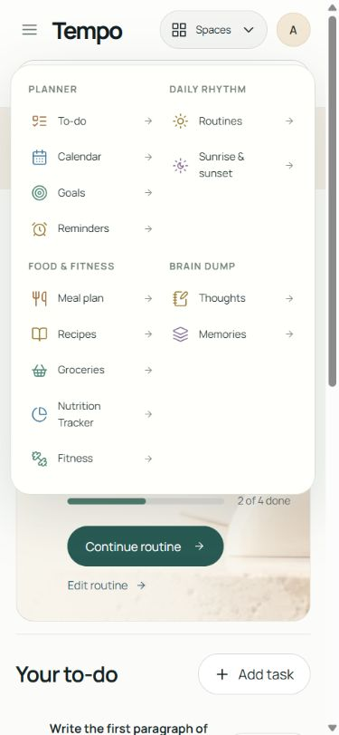

13. **Mobile settings — usable.** The form becomes one column and scrolls internally; Save is below the initial viewport. No horizontal clipping was observed. The same keyboard issue remains until fixed.

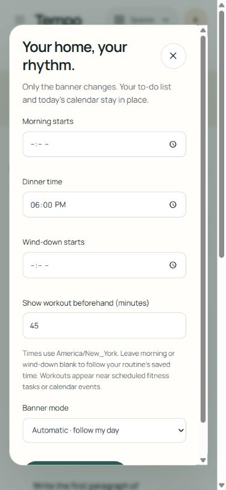

## Evidence limits

No screen reader, forced-colors mode, 200% zoom, reduced-motion OS preference, touch hardware, real account persistence, or provider integrations were tested in this review. Only sampled computed styles were read; no exhaustive contrast calculation was performed. Screenshots alone cannot establish full accessibility compliance. The preview resets on reload, so successful demo actions do not establish database persistence.

## Re-review

### Revision 1 — focus correction observed

**Revised score: 8.3/10.** After reloading the actual preview with the correction, both forms pass the observed acceptance checks:

- Customize Home: Close settings + Shift+Tab → Save preferences; Tab → Close settings; Escape → Customize home.
- Task icon/timer: Close settings + Shift+Tab → Save my choice; Tab → Close settings; Escape → the Walk home task icon button.

Finding 1 is resolved. This score reflects the observed UI after the fix; the initial 7.8 assessment is preserved above. The remaining P3 items are modest product polish, with no observed blocker to the reviewed core flow. Meal-density follow-up remains to be inspected if changed.

14. **Home settings keyboard re-review — healthy.** Fresh screenshot shows the visible focus ring after the corrected boundary loop.

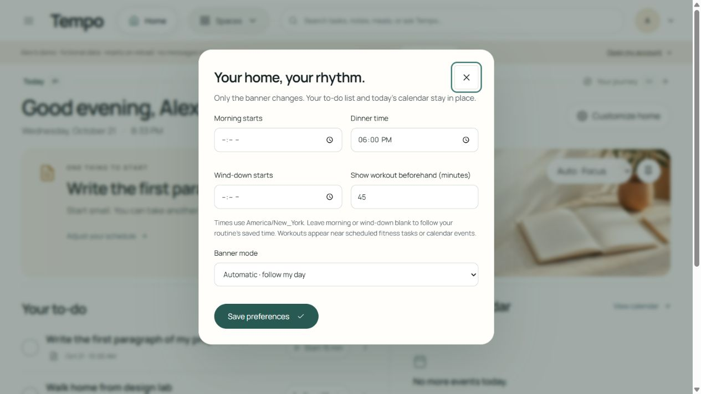

15. **Task presentation keyboard re-review — healthy.** Both boundary directions and opener restoration pass.

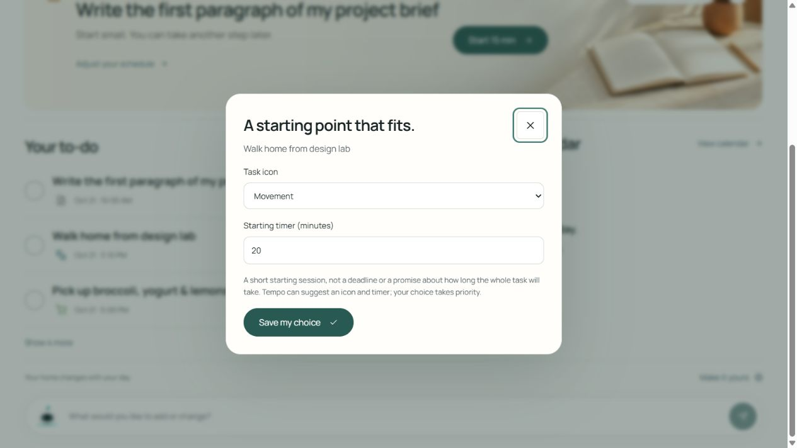

16. **Adaptive walk action re-review — healthy.** After selecting sample 3:05 PM, the updated hero reads Start 20 min. Clicking it opens Current focus session titled Walk home from design lab, with a 20:00 timer. The displayed activity and launched activity match.

### Revision 2 — meal compacting follow-up, source check

The follow-up diff in `FoodViews.tsx` and `food-fitness.module.css` is scoped appropriately: named meal-item/shopping-toggle classes, 190px desktop photos / 170px phone photos, reduced secondary-row spacing, and 44px minimum ingredient-summary, swap-selector, and footer controls. No source-level concern was found.

Interactive re-review is temporarily blocked in this resumed reviewer session: browser inventory is empty and both the documented selected browser ID `2` and alias `iab` report unavailable, including an attempted attachment to the root session's offered tab. No other browser technology was used. This source check does **not** resolve the visual finding or establish absence of clipping. The previously observed score remains **8.3/10**, pending fresh rendered evidence for the spacing change.

### Revision 3 — compact meal cards visually reviewed

**Final revised score: 8.4/10.** I independently inspected the fresh `final-meals-desktop.png` and `final-meals-phone.png` captures supplied by the main agent during this audit, including the phone image at original resolution. These screenshots were captured by the main agent, not through my interactions. The desktop image is 1264px wide; the phone image is 375px of page content within the main agent's reported 390px viewport. The main agent separately reported a 390px DOM scroll width and restored the viewport; I did not independently reproduce that measurement.

17. **Compact desktop Meal Plan — healthy.** The shorter food images and tighter Ingredients/shopping/swap rows make the cards materially easier to scan while retaining attractive photography. Breakfast, Lunch, Dinner, and Snack retain distinct headings and colored top borders. Lunch ingredients are expanded: the serving explanation and full ingredient list remain legible, and the shopping checkbox, full-width recipe selector, edit/remove controls, and Add a meal action remain separate and unclipped. The previously recommended modest density adjustment is visually resolved. A long page remains appropriate when an ingredient list is expanded.

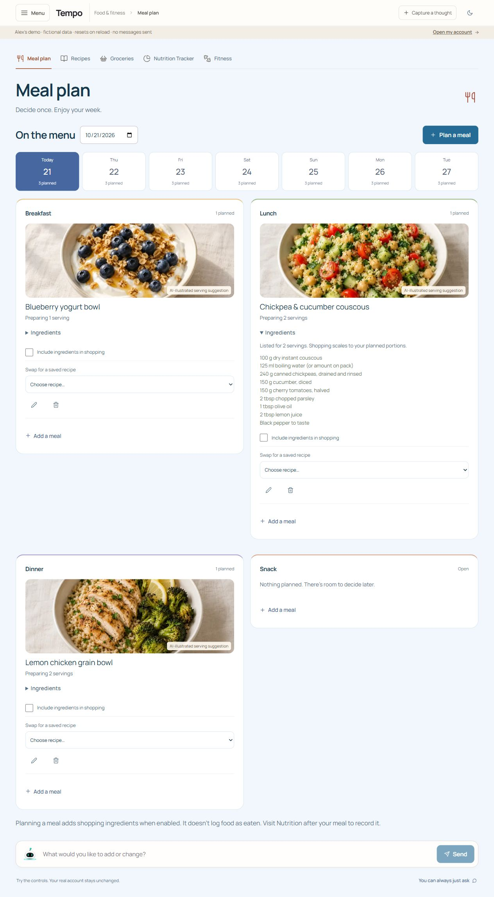

18. **Compact phone Meal Plan — healthy.** Cards stack within the page width; photos retain useful food composition, meal titles fit, and expanded Lunch ingredients wrap naturally. Serving explanations, ingredient quantities, shopping labels, and full-width swap selectors remain readable and within their cards. Ingredient disclosure and form controls retain comfortable vertical spacing. The navigation row shows continuation beyond the visible width, consistent with the existing horizontal section navigation; this is separate from meal-card overflow. I see no required visual fix in these captures.

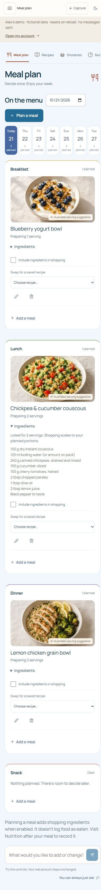

The final score is based on the earlier directly observed Home/focus/Journey/mobile review and these attributed meal screenshots. This pass did not include a new Home screenshot, real-account persistence, or a fresh interaction test of ingredient/swap controls; those checks remain with the main agent. Remaining icon-discovery and small-metadata recommendations are optional P3 polish.
