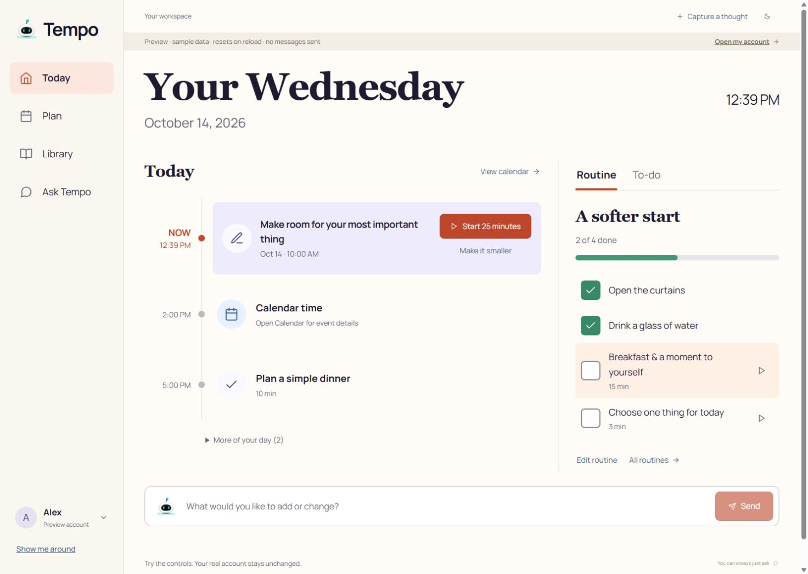
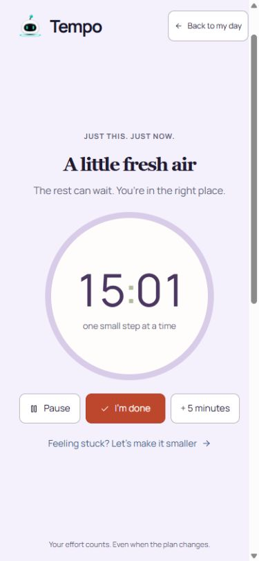
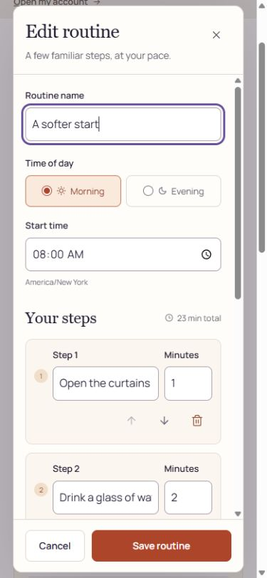

# Tempo independent customer review

Date: October 14, 2026. Reviewer: independent simulated novice customer seeking executive-function support. Environment: local `/workspace/preview`, fictional sample records; requested browser viewport overrides: desktop 1264×712 and 1487×1058, mobile 390×844. Screenshot pixel dimensions differ from viewport dimensions; see Evidence below. This is a UI and isolated preview-interaction review, not an assessment of production AI, SMS, persistence, account isolation, or Google Calendar reliability.

## Verdict

The revised visual direction is coherent, calm, and substantially easier to navigate than a dense all-features dashboard. Four main destinations, a visible current action, small routine steps, and consistent forms reduce decision load. Section colors help recognition without turning every element into an alert. Initial review uncovered navigation, chronology, modal, and discoverability issues; fixes were applied during review and independently rechecked.

**The revised interface passes this review: 8.2/10 overall for local preview usability and appearance.** Do not interpret an interface score as proof that every live subsystem works. Preview explicitly disables AI and external delivery. Reminder/memory changes and Calendar edits route through the assistant and cannot be completed in this environment.

## Initial findings and rechecks

1. Calendar showed Google events first, then tasks, then reminders rather than time order. Fixed and observed as 9 AM → 10 AM → noon → 2 PM → 5 PM.
2. Focus timer pushed Pause/Done below the fold at 1264×712. Responsive timer sizing fixed this on mobile and desktop. Final desktop check placed all three primary actions between y=485 and y=535 in a 712-pixel-high viewport.
3. Routine editing required pipe-delimited text. Replaced with named step and minute fields, add/remove/reorder controls, and sticky save footer. Added “Pack lunch,” moved it upward, saved, and observed 2/5 completion with existing checked steps preserved.
4. Reminders lacked an obvious creation/edit action and copy claimed a completion control that did not exist. New reminder and Change with Tempo entry points now appear; changing a reminder carries its name and scheduled time into the assistant composer. Preview cannot execute that AI request.
5. Memories claimed editing but exposed only delete. Revised copy and Add/Change with Tempo buttons make the behavior clear. The correction draft carries the exact saved fact; removal confirmation preserves the distinction between saved memory and conversation history.
6. Every recipe could only be planned for dinner. Revised Plan a meal opens date, meal, and servings. A new berry-oatmeal recipe was successfully planned into Breakfast and appeared in the meal plan.
7. Switching sections preserved scroll position, hiding the next heading and primary controls. Fixed: switching from assistant composer to Settings returned document scrollY to 0 and displayed the Settings heading.
8. Mobile section navigation took three rows and pushed useful content far down. Revised two-row grid and tighter headings reduced that overhead without horizontal overflow.
9. Keyboard focus left both RoutineEditor and the shared editor when tabbing beyond the last control (BODY became active). Fixed and rechecked: Save→Tab focused Close; Close→Shift+Tab focused Save in both editors. Escape dismissed each modal.
10. A native time-input automation fill did not update the React value, so an apparent time-save failure was investigated. Native keyboard interaction changed 08:00 to 09:00; Save updated the card and reopening retained 09:00. This was not recorded as a product defect. Created an evening routine and verified step/time editing with native input.
11. Preview Calendar/Settings originally used connected-account wording despite the sample-data banner. Final fresh-page recheck shows “Sample calendar,” explains that Google is not connected to the preview, and labels Settings “sample connection.”
12. An image aspect-ratio warning appeared in the first console capture. After the logo fix, the final fresh tab returned zero warning/error entries.

## Steps and observed health

| Step | Section | Observed result | Interface score |
|---|---|---|---:|
| 1 | Today | Clear current action, upcoming items, routine/to-do switch. Task completion and routine checkmarks update immediately. | 8.3 |
| 2 | Tasks | Added an undated task with duration; clear today/undated groups, edit and focus actions. | 8.3 |
| 3 | Focus | Start, countdown, pause, completion and return-to-day worked; mobile actions visible after fix. | 8.4 |
| 4 | Goals | Created a goal and retained explanation; linked-task completion updated goal progress. Clear distinction from daily tasks. | 8.2 |
| 5 | Calendar | Day navigation and chronological combined agenda work in sample mode. Live Google edits not tested. | 8.1 UI only |
| 6 | Morning/evening routines | Step completion, create/edit, adding and reordering work; original completion retained. Native time edit persists. Forward/reverse keyboard wrapping and Escape pass. | 8.4 |
| 7 | Reminders | Search/list, clear create/change assistant entry points, confirmation and deletion 1→0 work. AI create/reschedule not tested. | 8.1 UI only |
| 8 | Sunrise/sunset | Sunrise 20-second session progressed to completion; clear opt-in entry and honest unscheduled-session warning. Sunset selector works. Physical brightness/audio and scheduled alarms unverified. | 8.2 session UI |
| 9 | Meal plan | Added breakfast and planned a saved recipe into chosen meal slot; dates/meal sections clear. | 8.2 |
| 10 | Recipes | Saved ingredients/preparation; selected Breakfast and servings in new planning form. | 8.2 |
| 11 | Groceries | Added item; concise list and edit/toggle/remove affordances. | 8.1 |
| 12 | Nutrition | Recent-food repeat doubled known totals 360→720 kcal; manual snack save worked. Search clearly reports login requirement; barcode manual-entry fallback visible. | 8.3 UI/manual paths |
| 13 | Fitness | Logged a 5-minute mobility session; simple form and daily log. This is a movement log, not a comprehensive training planner. | 8.1 |
| 14 | Thoughts | Captured a titled thought and detail; note-to-task action reported saved task while preserving original note. | 8.3 |
| 15 | Memories | Search/list, assistant correction prefill, and confirmed removal 1→0 work. AI memory save/edit not tested. | 8.1 UI only |
| 16 | Ask Tempo | Helpful starter actions prefill editable message; preview honestly refuses AI calls instead of fabricating success. | 8.2 interface only |
| 17 | Settings/privacy | Preview check-in toggle, privacy cover/uncover, clear connection and optional-audio controls. Navigation reset fixed. | 8.2 interface only |
| 18 | Optional tour | Four concise, skippable steps, working next/back/finish and destination entry points. | 8.2 |
| 19 | Sign-in entry | Warm theme and clear single Continue with phone action; explains shared SMS/workspace account. No sign-in or credential entry performed. | 8.2 interface only |

Scores reflect observed usability and appearance, not an averaged product-readiness score. Users with ADHD have varied needs; this simulated persona does not replace recruiting actual customers.

## Evidence

Screenshots are in this directory. Initial pass: `01`–`16` desktop, `18`–`34` mobile; `17-mobile-today.jpg` actually captures the scroll-retention Settings defect and is not a Today screenshot. Reference comparison: `35-today-reference-size.jpg`. Fixed flows: `36-settings-top-fixed.jpg`, `37-recipe-meal-fixed.jpg` (recipe view after save; Breakfast was separately verified in the DOM), `38-mobile-routines-fixed.jpg`, `39-mobile-routine-editor.jpg`, `40-mobile-reminders-fixed.jpg`. Added `41-desktop-login.jpg`, `42-desktop-focus-fixed.jpg`, and `43-final-today.jpg`. Browser sizing was reset and review tabs closed at completion.

Viewport metadata measured in the final pass: desktop `window.innerWidth/innerHeight = 1487×1058`, document client dimensions `1472×1058`, device pixel ratio 1; mobile inner dimensions `390×844`, client dimensions `375×844`, device pixel ratio 1. The screenshot helper returned images proportionally resized to the client width (for example screenshot 35 is 1472×1047; screenshot 38 is 375×812), so image pixels should not be treated as exact viewport or reference dimensions.

Representative screenshots:

## Limits and remaining polish

- No real AI, SMS, Google Calendar OAuth/read/write, authenticated account isolation, database persistence, physical camera barcode scan, audio audibility, hardware brightness, or wake-from-sleep was tested. Preview state resets on reload/HMR, as visibly disclosed.
- Food search is intentionally unavailable in preview. Successful manual and recent-food logging does not prove Open Food Facts availability or barcode coverage.
- No screen-reader session, automated WCAG audit, measured contrast sweep, or real touchscreen test was performed. Semantic labels and visible responsive states were inspected; both tested modal keyboard loops now pass.
- The routine editor is much clearer but a long routine still requires scrolling. Sticky Save and explicit numbered steps mitigate that.
- Some supporting copy uses small muted text; actual users should test readability at arm’s length on the intended wall display.
- Final browser console (`browser-console-final.json`) is an empty warning/error list from a fresh tab after the logo fix. This is scoped to the inspected preview pages and does not establish production console health.
- The final ongoing-session/current-meeting logic changes were not separately exercised with controlled clock fixtures by this reviewer; the implementation owner should retain their unit-test evidence for those states.
