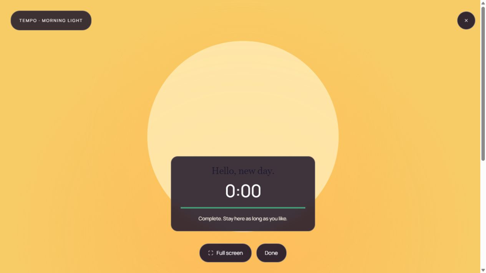
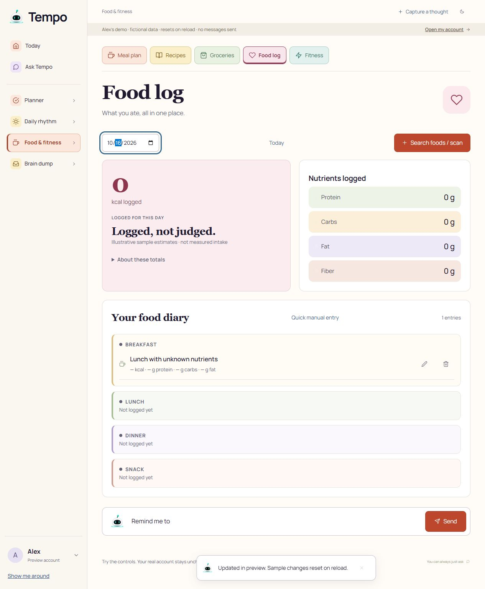

# Independent customer review — initial candidate

Reviewed 2026-10-15 around 14:50–15:05 America/New_York at `http://localhost:3100/workspace/preview`, desktop 1265 × 712 browser viewport. This is the initial served candidate, before any review-driven fixes. No production or TextFree tabs were operated; no paid AI calls or real-account writes were made.

## Verdict

The desktop workspace is legible, calm, and broadly navigable. The tested preview controls work, but this is **not evidence of authenticated persistence, AI quality, SMS delivery, or Google Calendar writes**. The preview is explicitly fictional and resets on reload. No section is release-accepted solely from this review.

Scores below are provisional customer-flow scores for what was observed, supplemented by narrow source review. They are not inflated to meet the requested 8/10 target. A rating of 8 means the exercised UI path is coherent with no material defect found, not that the whole subsystem is release-ready.

## Acceptance matrix

| Step / section | Observed path and health | Provisional /10 | Evidence / missing acceptance |
|---|---|---:|---|
| 1. Today | Start first task, complete focus, see next task and linked goal progress. Clear primary action. NOW suggests a future task while a calendar event is still happening. | 7 | `01-today.jpg`, `02-focus.jpg`. Authenticated calendar blocks use generic titles; see F2. |
| 2. To-do | Add a disposable task; title, default duration and undated placement are correct. Completed focus task is removed from open list. | 8 | `03-todo.jpg`. Authenticated CRUD, reload, conflict and recovery not observed. Source cap issue F5. |
| 3. Goals | First goal changes from one to two of three steps after task completion. Next-step and add-step controls are available. | 8 | `04-goals.jpg`. Goal create/edit/achieve and persistence not exercised. |
| 4. Calendar | Day agenda separates sample events, tasks and completed state; date navigation, connection and edit explanations are present. | 7.5 | `05-calendar.jpg`. Event fetch/reconnect, timezones, confirmations and writes not observed. |
| 5. Reminders | New reminder routes to Ask Tempo with “Remind me to” prefilled; search, change and removal controls are visible. | 7 | `06-reminders.jpg`. Creation requires the untested AI/worker path; delivery/cancel race not observed. Historical cap issue F5. |
| 6. Routines | Check a step, observe 2→3 complete, Undo restores 2. Daily reset explanation and per-step focus controls are clear. | 8 | `07-routines.jpg`. Creation/reorder/conflict and persistence remain untested. |
| 7. Wake | Start 20-second sunrise, observe screen-awake status, completion at 0:00, then Done. Honest immediate-session limitations. Completion heading nearly invisible. | 7 | `08-wake-settings.jpg`, `09b-wake-viewport.jpg`. F3. Audio, actual device sleep, sunset and mobile untested. |
| 8. Meals / recipes | Seven-day menu, ingredients and portions are discoverable. Recipe-to-meal source path exists. No direct meal-to-grocery action in served UI; changed portions ask user to scale ingredients themselves. | 7 | `10-meals.jpg`. Recipe creation/plan save not exercised. Metadata loss F1. |
| 9. Groceries | Check broccoli; checkbox and success notice update. Clear single list with edit/remove. No grouping or connection to planned ingredients in served UI. | 7 | `11-groceries.jpg`. Persistence, pantry deductions, aggregation, scaling and source-link maintenance not observed. |
| 10. Nutrition | Create food with all nutrients blank; diary preserves unknown as —. Summary incorrectly displays 0 for every nutrient. | 6.5 | `12-nutrition-unknown.jpg`. F4. Database search/barcode, camera, portions and persistence untested. |
| 11. Fitness | Template/session details are clear; Plan this session opens task editor with name and duration. Completed movement is separately and honestly logged. | 7 | `13-fitness.jpg`. No observed saved editable program. Planned-session count relies on exact title match, so renaming removes recognition. |
| 12. Brain dump | Add to To-do shows confirmation and keeps original note. Notes are legible and expandable. Task only receives title, with no link to detailed original note. | 7.5 | `14-brain-dump.jpg`. Persistence and memory AI edits untested. |
| 13. Workspace tour | All four steps, Next and Got it work. Plain overview with optional destinations. | 8 | `15-tour.jpg`. This is workspace orientation only, not signup/phone consent onboarding. |
| 14. Settings | Optional check-ins, connections, audio and privacy are findable. Hide workspace removes main content. | 7.5 | `16-settings.jpg`. Profile/quiet-hours editing, check-in persistence, reconnect and speech output untested. |

## Highest-impact findings

**F1 — Preserve data the editor does not expose.** Source review: `WorkspaceClient.itemEditor` constructs `{ ...v, kind }` and replaces the complete saved item. Editing existing food therefore drops barcode, portion amount/unit, source and favorite; grocery drops quantity, unit and mealSources; meal drops ingredientServings and groceriesEnabled; workout drops programId, sessionName and notes. These optional fields exist in `lifeItemSchema`. A title edit can silently destroy relationships established elsewhere. Preserve existing fields or use a typed patch. This was source-confirmed, not reproduced against a real account.

**F2 — Today is less informative with real calendar data.** `today-model.ts` obtains names only through `data.demoCalendarEvents`; authenticated `readBoard` returns start/end busy windows. The demo shows “Design lab · Engineering building,” while a real account receives “Calendar time.” The Calendar section separately fetches actual events. A daily executive-function view should have an honest loading/unavailable state and useful real event identity. The observed NOW card also invites starting the 15:10 walk at 14:51 while the 14:00–15:00 event is happening; evaluate whether the recommendation should respect current busy time. This is a UX concern, not an asserted deterministic gate bypass.

**F3 — Wake-session heading fails visible contrast.** Screenshot `09b-wake-viewport.jpg`: “Hello, new day.” is dark on a dark translucent panel. Read-only computed style: heading `rgb(32, 26, 48)`, parent `rgba(32, 23, 43, 0.86)`. `wake.module.css` gives `.sessionContent h2` typography but no explicit contrasting color. The timer and explanatory text remain readable.

**F4 — Unknown nutrition appears as zero in totals.** Reproduction: Food log → Quick manual entry → name “Lunch with unknown nutrients” → Oct 16 → leave every nutrient blank → Save → select Oct 16. Diary shows — for calories/macros; top summary shows 0 kcal and all 0 g. `WorkspaceClient` sums null using `?? 0` without known-value counts. Display unknown when there are no known values, and mark mixed totals as partial. The summary's explanatory disclosure does not resolve the contradictory headline numbers.

**F5 — Historical records can hide active obligations.** Source review: `readWorkspace` selects scheduled/sending/sent/failed reminders ordered ascending by `remindAt`, limits 201, then returns the oldest 200. After enough delivered history, upcoming reminders disappear from Reminders, Calendar and Today. The “ask older items” truncation message is reversed relative to the query. Tasks similarly mix active and completed, order ascending due date and limit 200 without a truncation flag; old completed tasks can crowd out current items. Prioritize active/upcoming work and explicitly paginate history. Not reproduced with a seeded database.

## Evidence limits and required release checks

- This run exercises client-local preview state only. No successful preview mutation is a persistence claim.
- A real account still needs observed create → reload → edit → reload → completion/removal for tasks, goals, routines, food, recipes, meals, groceries, workouts and notes.
- AI: observed intent, clarification, confirmation, refusal and error behavior remain untested. Scripted preview messages are not live AI output.
- Calendar: connect/reconnect, event reads, stale/error state, timezone boundaries and confirmed writes remain untested.
- Messaging: reminder scheduling, worker processing, carrier delivery, consent, opt-out, quiet hours and cancellation remain untested.
- Signup/phone verification/consent and profile changes were not exercised. Workspace tour completion is not onboarding completion.
- Desktop screenshots and semantic DOM were inspected. No claim of full accessibility compliance: mobile, screen readers, zoom, comprehensive keyboard traversal and contrast across all colors remain untested.
- No lint, typecheck or automated test command was run by this reviewer because no code was changed. Root agent owns build/test validation and integration evidence.

## Screenshots

The accepted captures are in this directory, numbered by review step. `09-wake-complete.jpg` is an additional full-page capture; `09b-wake-viewport.jpg` is the more useful contrast evidence. `12-nutrition-unknown.jpg` was recaptured after committing the date control and shows the verified unknown-only entry.

