# Independent mobile screenshot review — October 18, 2026

Scope: all 27 current-run screenshots below, opened as actual local files with
`view_image`. Mobile captures are 375 px wide; signup captures 22–23 are desktop
at 1265 px. Root reports mobile browser configuration of 390 px. Treat the saved
mobile captures as 375 px visual evidence, not independent proof of both
widths. No browser interaction, DOM accessibility inspection, persistence or
provider test was performed by this reviewer. Product Design's screenshot audit
workflow was used; no saved Product Design context existed.

The goal is a novice finding today's next action, logging breakfast, asking the
assistant to use that entry, locating the saved note, and understanding memory.
The captured surfaces are readable, coherent and calm. No P0/P1 issue or clipped
primary action is visible. Recaptures 19–21 visibly resolve the initial Today,
Goals and Reminders clarity findings. Capture 24 shows the Fitness reorder
authored by this reviewer; root independently browser-reviewed and approved that
state at 8.0. Capture 25 confirms the meal dinner photo fully loads. Small
secondary controls and muted copy need accessibility
measurement rather than a claim of compliance from screenshots.

## Latest section scores and evidence

Scores assess only the depicted state and its clarity, out of 10. They
are not customer-journey, reliability, persistence or release-readiness scores.

| Capture | Section and depicted state | Visual health | Score |
| --- | --- | --- | --- |
| 19 | Today | Explicit overdue labels | 8.0 |
| 2–3 | Nutrition, empty and saved breakfast | Clear totals, missing values and date | 8.0 |
| 4 | Ask Tempo | Request and recap response readable | 8.0 |
| 5 | Thoughts | Clear saved destination; repetitive expanded preview | 8.0 |
| 6 | Memories | Fact/removal consequences explained | 8.0 |
| 7 | To-do | Past-due and undated groups clear | 8.0 |
| 8 | Calendar, disconnected local agenda | Honest connection state | 8.0 |
| 20 | Goals | Relevant Mark achieved action visible | 8.0 |
| 21 | Reminders management | Overdue context preserves true scheduled status | 8.0 |
| 11 | Routines | Clear next step and daily reset explanation | 8.5 |
| 12 | Paused focus | Named pause/stop/complete alternatives | 8.0 |
| 13–14 | Foreground wake | Controls 8.5; running state 8.0; device behavior unverified | 8.0–8.5 |
| 15, 25 | Meal plan | Clear shopping/eating distinction; photo now verified loaded | 8.0 |
| 16 | Recipes | Readable filter/detail/preparation state | 8.0 |
| 17 | Groceries/pantry | Purchase versus actual stock explicit | 8.5 |
| 24 | Fitness after authored reorder | Root's independent browser approval | 8.0 |
| 26 | Settings | Quiet hours, connection and audio limits clear | 8.0 |
| 27 | Tour, first step only | Short actionable guidance and visible exit | 8.0 |
| 22–23 | Pending signup/recovery, desktop only | Clear alternate-number and return actions | 8.0 |

Original captures 1 (Today), 9 (Goals), 10 (Reminders) and 18 (Fitness) each
scored 7.5 before their targeted repairs. Their observations remain below so
the newer scores do not erase initial findings.

### 1. Today

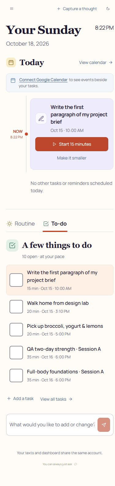

The large day/date, Start 15 minutes button and uncluttered single-column list
make the next action easy to find. Calendar is honestly described as disconnected;
the connection prompt does not imply a successful sync. The Routine/To-do tabs
use an underline as well as color.

**P2 clarity:** the October 18 screen puts an October 15 task beside `NOW` under
Today, with no `Overdue` or `Still waiting` label. Its old date is visible, so this
is not hidden data, but a novice can misread it as today's scheduled obligation.
The line `No other tasks or reminders scheduled today` adds ambiguity about
whether the featured card belongs to today's schedule. Label the carried-over
task explicitly and distinguish it from today's timed agenda. This is a
recommendation from the displayed state, not a claim that scheduling is wrong.
Resolved visually by recapture 19 below; retain this original evidence.

### 2–3. Nutrition

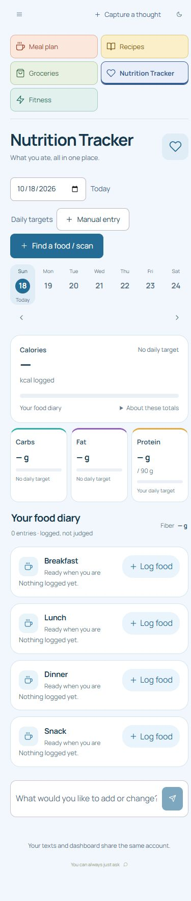

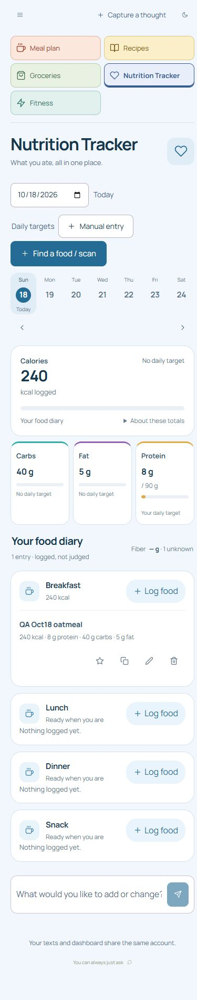

Date selection and Today are visible before the totals. Find a food / scan and
Manual entry provide clear alternatives. Empty meals say `Nothing logged yet`,
and missing totals use dashes rather than invented zeroes. The saved state shows
240 kcal, 8 g protein, 40 g carbs and 5 g fat, with the breakfast item directly
below. The protein goal is distinguished from the logged amount, while calories,
carbs and fat honestly say `No daily target`. Fiber is marked `1 unknown`.

**P3 visual risk:** small gray labels, the fiber unknown count, and the light
meal-entry buttons deserve contrast measurement. Favorite/copy/edit/delete icons
are visually small and have no persistent text labels. Their actual accessible
names and hit areas cannot be determined from the image; verify them before
calling this an accessibility pass. No visible horizontal clipping is present.

### 4. Ask Tempo

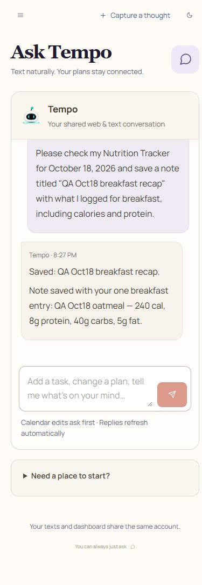

The user asks for a named note, and the reply names the saved destination and
includes the depicted meal's calories and protein. The visually separate message
bubbles, shared web/text explanation and Calendar confirmation reminder give
useful context. The composer and send action remain visible and unclipped.

The reply says `Saved` and then `Note saved`, which is mildly repetitive but
does not obstruct the result. This screenshot alone cannot establish whether
the assistant actually read or wrote storage, used a live model, or respected
authorization. Those are separate root-observed results described below.

### 5. Thoughts

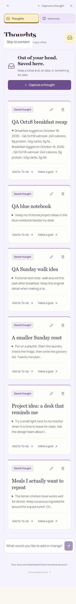

The new note title is prominent, and the expanded body contains the meal values
shown in Nutrition. Capture a thought, Add to To-do and Make a goal are named
actions; the page communicates where a loose thought belongs.

**P3 polish:** the open disclosure retains a truncated preview and then repeats
the full body directly beneath it. Showing the preview only while collapsed
would reduce repetition and make the expansion easier to understand. The edit
and delete glyphs also need the hit-area/name check described above.

`Skip to content` is visible over the heading in this capture. A focused skip
link should become visible, so this is not classified as a defect without
knowing the capture's keyboard/focus state. Root should confirm that it hides
when unfocused and sends focus to main content when activated.

### 6. Memories

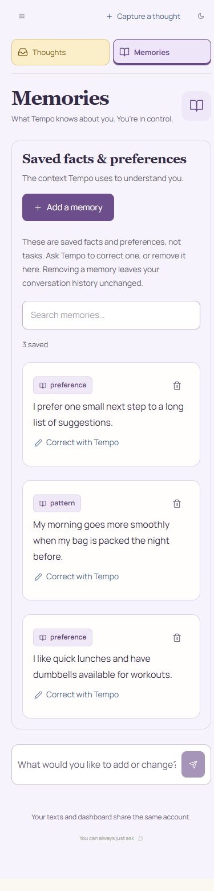

This is the clearest explanatory state: it distinguishes facts/preferences from
tasks, gives Add a memory and search, and explicitly says removal leaves
conversation history unchanged. `Correct with Tempo` is more informative than
an unexplained pencil alone. The card text wraps cleanly at the saved width.
No serious misleading state or clipping is visible. Small delete glyphs and
muted secondary copy retain the same accessibility verification needs.

### 7. To-do

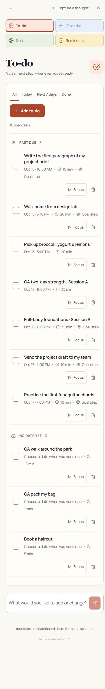

The All/Today/Next 7 days/Done filters fit without clipping. `PAST DUE 7` and
`NO DATE YET 3` explain the two groups, and dates, durations and Goal step labels
add useful context. Add to-do and individual Focus buttons are plainly named.
The ten-item list is long but structured; this screenshot does not show a
readability or horizontal-overflow problem. The explicit past-due treatment is
a useful pattern for the Today and Reminders findings. Small delete glyphs still
need hit-area and accessible-name inspection.

### 8. Calendar

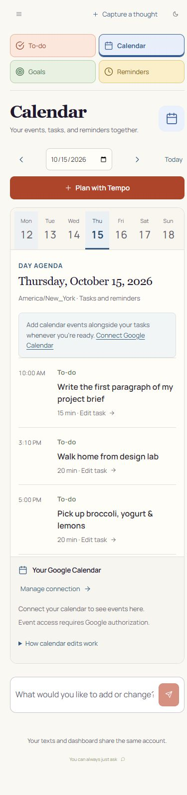

The date field, highlighted Thursday 15 and full `Thursday, October 15, 2026`
heading agree. The agenda distinguishes its local To-do items from Google
events. Connect Google Calendar and `Event access requires Google authorization`
are clear, and the timezone is visible. It does not imply an empty connected
Google Calendar. Navigation arrows, Today and Plan with Tempo fit at this width.
This screenshot supports only the disconnected local agenda, not connected
Google event rendering or permission/error behavior.

### 9. Goals

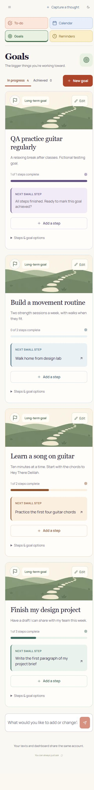

The next-small-step cards and numeric progress make each goal understandable.
Titles wrap instead of being clipped, and Edit/New goal/Add a step are visible.
The decorative illustration does not interfere with action text.

**P2 discoverability:** the first card says `All steps finished. Ready to mark
this goal achieved?` and shows a full progress bar, but offers only Add a step
and the collapsed `Steps & goal options`. The achievement action is not visible
beside this invitation. A novice can mistake the full bar for completion or
struggle to finish the goal. Show an explicit Mark achieved action in this
state, or point the instruction directly to the named disclosure. No claim is
made here about whether the hidden action works.
Resolved visually by recapture 20 below.

### 10. Reminders

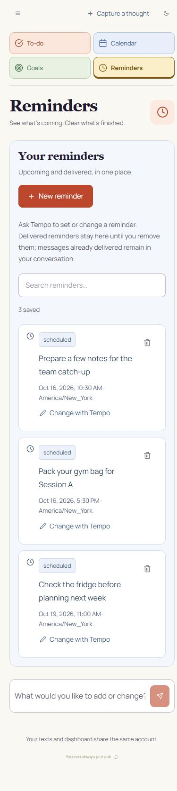

New reminder, search and Change with Tempo communicate the basic workflow.
Each card includes a full date/time, timezone and status. The explanatory copy
correctly distinguishes removing a displayed reminder from erasing messages
already delivered in the conversation.

**P2 temporal clarity:** in this October 18 capture set, two October 16 reminders
are labeled only `scheduled`, while the panel introduction says `Upcoming and
delivered`. Those past-due records are not identified as overdue or awaiting
delivery. Their dates remain visible, so this is a presentation ambiguity, not
proof of lost or failed SMS. Add explicit past-due context/grouping while
preserving the true delivery status. The third reminder's October 19 date is
visibly future. No carrier delivery is certified from this screenshot.
Resolved visually by recapture 21 below.

### 11. Routines

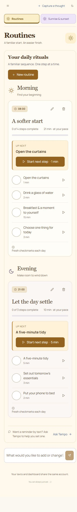

Morning/evening headings, routine times, total duration, completion counts and
the highlighted Up next step create a useful sequence. Start next step is large
and named; individual step controls and check circles are visually distinct.
`Fresh checkmarks each day` explains resetting progress. The footer asks the
user to request an SMS reminder separately, so simply defining an 08:00 routine
does not visibly promise a scheduled text. No major misleading state is visible.

### 12. Paused focus

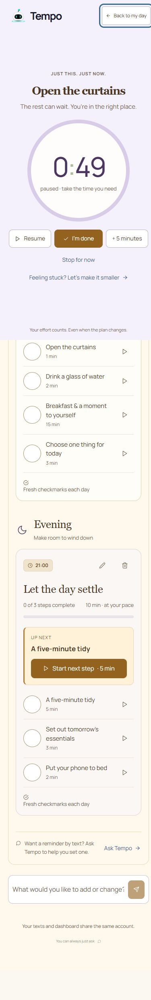

The large timer explicitly says paused; Resume, I'm done, +5 minutes and Stop
for now provide understandable alternatives. Task title and reassuring copy are
readable. This is a screenshot of the paused state, not a replay of starting,
pausing, completing or stopping a stored routine step.

**P3 capture/layout concern:** the Back to my day focus ring touches/clips the
right image edge, and a thin strip of the underlying routine is visible below
the focus surface. Root should compare a viewport-only capture with the actual
browser height before treating the strip as an overlay defect; a full-page
capture can include document space outside a fixed surface. Ensure the focused
back control has visible padding on a real phone. This has not been promoted
to a confirmed functional or accessibility failure.

### 13. Sunrise & sunset

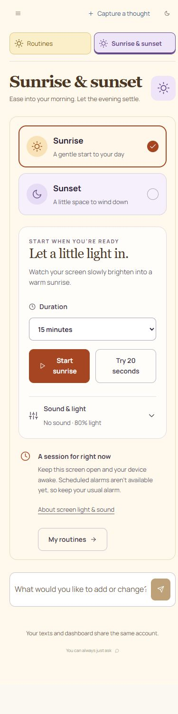

Sunrise/sunset selection has both a check/radio treatment and color. Duration,
Start sunrise, Try 20 seconds and expandable Sound & light fit cleanly. The
page explicitly says `A session for right now`, requires keeping the screen
open/device awake, and says scheduled alarms are not available. These limits
are visible before a novice relies on it as an alarm. The screen can support
foreground-session usability only; it does not prove actual light, audio,
physical brightness, background wake or device behavior.

### 14. Running sunrise

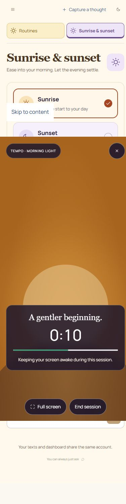

The running surface shows a large 0:10 countdown, progress bar, named End session
and Full screen controls, plus a separate close action. Text remains readable
against the illustrated light. This is evidence of the depicted foreground
state only. The image's `Keeping your screen awake` text does not establish
that the device actually acquired a wake lock, changed physical brightness or
played audio. Like the focus capture, it includes surrounding document content;
inspect a viewport-only frame before judging full-screen/overlay positioning.

### 15. Meal plan

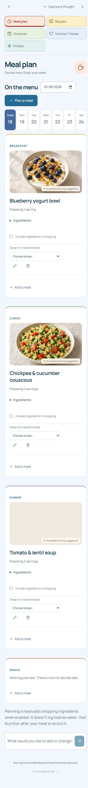

The date/week selection, Plan a meal, meal slots, serving counts, ingredient
disclosures and recipe swap dropdowns form a clear workflow. `Include ingredients
in shopping` is an explicit opt-in. The footer distinguishes planning from
eating and directs the user to Nutrition afterward, which avoids misleading
automatic food logging. Photos that are visible carry an AI-illustrated serving
suggestion label.

The dinner card has an empty photo-sized region with that badge in this capture.
The same lentil soup has a loaded photograph in capture 16, so this does not
establish a broken image. Root should scroll this card into view and recapture
to distinguish below-fold lazy loading from a persistent blank asset. The meal
plan's pictured photo completeness is unverified. The text and actions fit.

### 16. Recipe detail

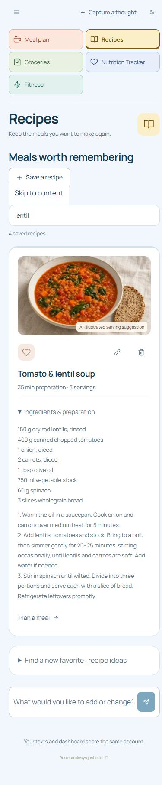

The `lentil` query leaves the matching soup card and its expanded ingredients/
preparation visible. Ingredient quantities, three servings, preparation time
and the Plan a meal action are readable. Instructions wrap inside the card;
there is no clipped preparation line. Save a recipe and favorite/edit/delete
remain available. `4 saved recipes` appears to describe the whole library even
while one result is shown; `1 shown of 4 saved` would be a small optional clarity
improvement, not a blocker. This is a pictured filter/detail state, not an
independent test of search or recipe persistence.

### 17. Groceries and pantry

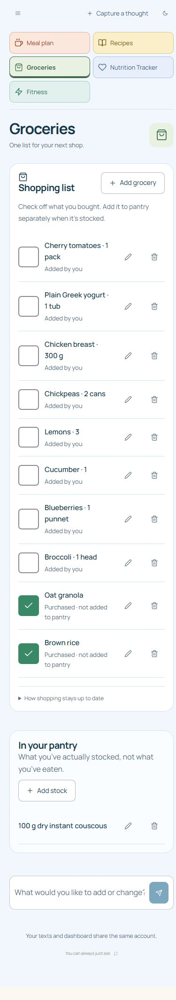

The page explicitly says checking off a purchase does not add it to pantry.
Checked rows say `Purchased · not added to pantry`; the separate pantry section
says actual stock is distinct from eaten food and offers Add stock. This is
especially clear novice guidance. Units and quantities wrap cleanly without
colliding with edit/delete icons. The 100 g couscous pantry entry is visually
separate from shopping. No reconciliation, quantity arithmetic or reload claim
is inferred from these labels.

### 18. Fitness

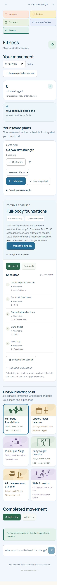

The selected date, minutes total and Log completed movement are easy to find.
Scheduled work, saved plans and completed movement are named separately; the
template text explicitly says scheduling creates a task and completion is
logged separately. Session buttons, exercise doses and alternatives wrap
without apparent clipping, and the six templates show equipment/experience
context.

**P2 navigation depth:** the long selected Full-body foundations exercise detail
comes before `Find your starting point`, so a new user must pass the default
program's exercises to discover the other five choices. Completed movement
history is still farther below all six choices. The screenshot is over four
thousand pixels tall, and neither location is apparent from the day total.
This increases scrolling for choosing a program or checking a just-saved log.
The direct top logging button mitigates entry friction but not readback.

The bounded fix is to reorder existing sections: put the existing template
chooser before its selected-program detail and place the existing Completed
movement section near the day log/saved-plan area, above the long template
detail. Alternatively, reuse an existing disclosure for the selected program's
exercise list while leaving its summary/actions visible. No new feature,
template or navigation system is needed. Recapture that order before increasing
this visual score. The 0-minute/empty-day state shown here does not contradict
root's separate temporary-log test, which included deleting its record.

**Authored follow-up, not independent visual acceptance:** at the parent's
request this reviewer subsequently reordered only `FitnessView.tsx`: Completed
movement/history follows the day summary, saved plans follows history, and the
six-template chooser precedes selected-template detail. Every original source
line was preserved in the move; handlers, state and styles were not edited.
Relevant local Next client/server guidance was read before the change.
`workout-plans.test.ts` and `demo-content.test.ts` passed (13 tests total),
`npm run lint` and `npm run typecheck` passed, and the file's whitespace check
passed. The original 7.5 score remains attached to capture 18. Root's subsequent
independent browser approval of capture 24 is recorded below.

### 19–21. Fix verification from new captures

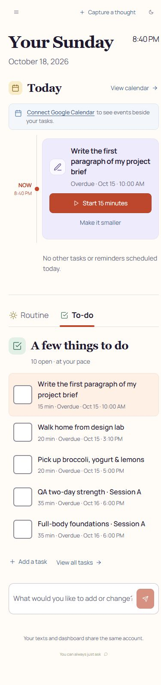

Capture 19 adds `Overdue` to the featured next-action date and every carried-over
list row. The current time can now be read as when to work, while the task's
actual due context stays explicit. The initial P2 Today clarity finding is
visually resolved; revised score 8.0 for this depicted state.

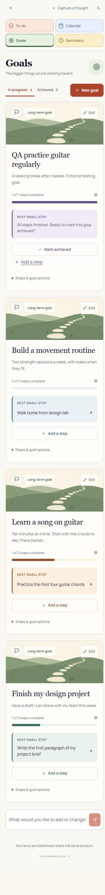

Capture 20 places a full-width Mark achieved control directly below the finished
steps message, with Add a step as a secondary action. The proposed next action
is discoverable without opening goal options. The initial P2 Goals finding is
visually resolved; revised score 8.0. This does not test the click or mutation.

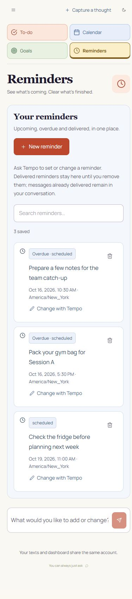

Capture 21 changes the explanation to `Upcoming, overdue and delivered` and labels
the October 16 items `Overdue · scheduled`, while the October 19 item remains
`scheduled`. It adds temporal context without falsely claiming delivery or a
failure. The initial P2 Reminders finding is visually resolved; revised score
8.0. Actual scheduled SMS arrival remains outside screenshot evidence.

### 22–27. Final captures and attributed interaction evidence

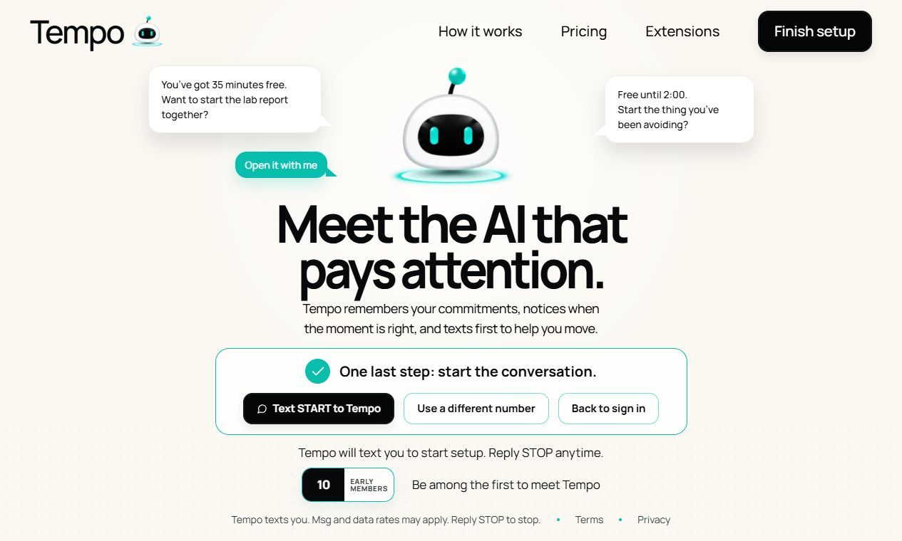

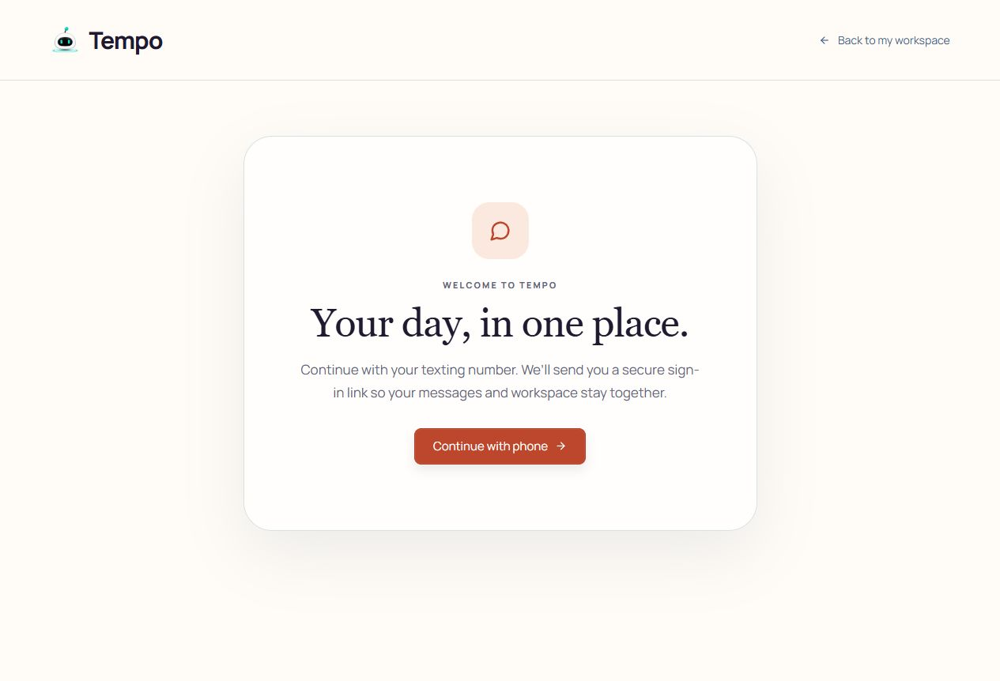

The waiting state visibly offers Text START, Use a different number and Back to
sign in. The returned login screen has a clear Continue with phone action.
These two desktop captures support recovery-action clarity, not mobile signup
reflow or proof that an old verification link was revoked. Root reports testing
the actual pending form, clearing/refocusing fields with the different-number
action, reloading, submitting reserved test number ending 0182, and returning to
login. The other agent reports passing actual HTTP reset/late-old-link checks.
Those are attributed functional checks, not this reviewer's browser execution.

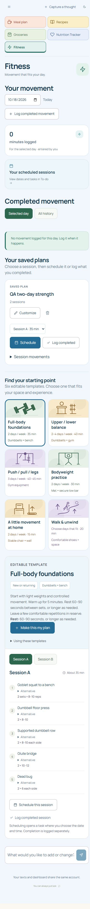

Completed movement now follows the date/summary area and precedes saved plans;
the six-template chooser precedes selected-template detail. Capture 24 confirms
the authored change's intended visual order. Root independently exercised and
approved this state at 8.0. This reviewer authored the fix, so the post-fix score
is attributed to root, not presented as an independent self-review.

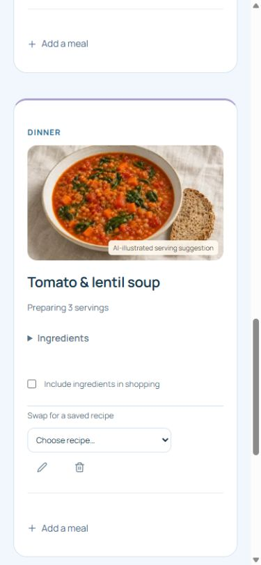

The viewport capture confirms the soup photograph is fully loaded with the
serving-suggestion label. The earlier blank region in capture 15 does not remain
an image defect; it was incomplete below-fold capture evidence.

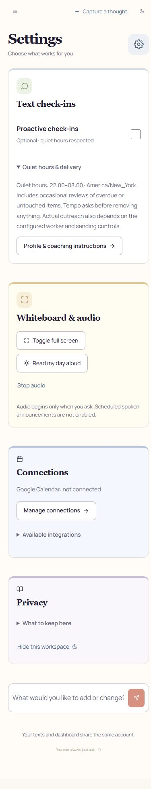

Settings exposes optional check-ins, actual 22:00–08:00 America/New_York quiet
hours, disconnected Google status, user-triggered audio and the lack of scheduled
spoken announcements. These labels are clear and fit. Root separately reports
checking account identity and working sign-out; neither operation nor enforcement
of quiet hours is proved by this screenshot.

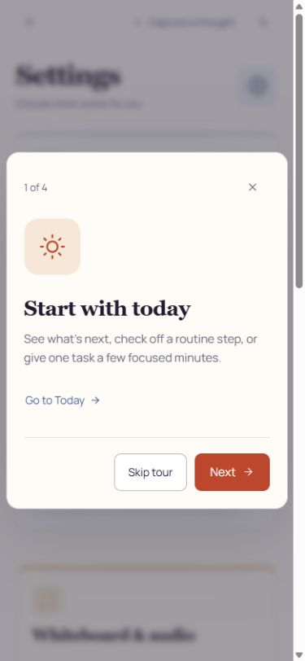

The first tour step has a short task-focused explanation, 1 of 4 progress,
Go to Today, Skip tour, Next and close. No clipping is visible. Root reports
finishing all four steps/Got it and successfully replaying the tour. Only step
one is independently pictured here; keyboard focus, reading order and the
remaining tour steps were not independently inspected.

## Evidence boundaries and next checks

Root separately reports an actual manual food save/reload with 240 kcal and
8 g protein, and a live Claude `life_list` → `life_save` call that created the
matching note. This reviewer checked their visible output, not the calls,
database or reload. Do not count this as an independent persistence replay.
Root reports the live run cost $0.189555, bringing conservatively committed
spend to $5.730615 of the original $10; this review made no paid calls.
Root also reports starting/stopping a 20-second foreground sunrise session with
no audio; searching `lentil` and expanding its recipe; and logging a 12-minute
`QA Oct18 evening walk`, reloading to verify it, then deleting that test entry.
Those are attributed interaction/persistence observations, not this reviewer's
independent execution. The Fitness screenshot shows the cleaned-up empty day.

No screenshots were provided here for the mobile navigation drawer, food editor,
loading/errors, keyboard open, validation, mobile login recovery or confirmation dialog.
No claims are made about those states. Full-page captures also do not establish
what is visible above the fold on a physical phone, sticky behavior, keyboard
avoidance, animation, tap accuracy, focus order or screen-reader announcements.

The scoped P2 clarity findings are visually resolved in the supplied recaptures.
Remaining follow-up is narrow: measure secondary text contrast and icon hit
areas, inspect accessible names and keyboard focus,
then capture the editor/error and navigation states at the actual reported
viewport. These are scoped usability findings; they do not certify actual SMS,
Google, assistant reliability or the complete released mobile journey.
