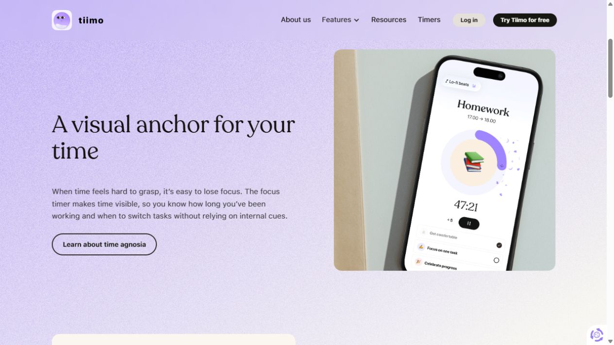
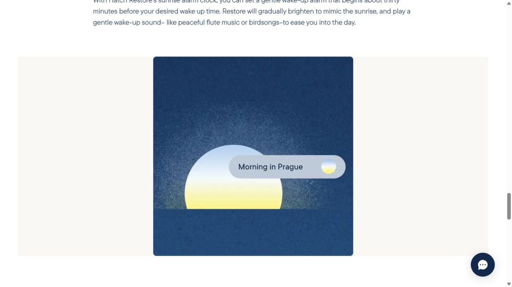

# Routines, wake and wind-down — visual research, 2026-10-15

## Evidence and attempted flow

This study used **official published product visuals and help**, not a hands-on routine or alarm audit. Sources were opened on 2026-10-15. The accepted JPEGs were saved and reopened for visual inspection. No account creation, subscription, hardware pairing, sound playback or alarm scheduling was performed.

1. Opened [Tiimo’s visual-planning page](https://www.tiimoapp.com/product/visual-planning), declined nonessential cookies and inspected the morning routine inside its published day sequence. **Public visual available.**
2. Opened [Tiimo’s focus page](https://www.tiimoapp.com/product/focus), scrolled to the phone example and captured its current-task timer. **Marketing visual available; not an interactive timer.**
3. Opened [Tiimo sign-in](https://webapp.tiimoapp.com/sign-in). **App workflow blocked by account requirement; no routine completed.** Direct navigation to an image-CDN source was separately blocked by browser security. The accepted captures use the permitted official page context; no bypass was attempted.
4. Opened [Hatch’s sleep-routine article](https://www.hatch.co/blog/create-a-sleep-routine-that-works-for-you), followed its Wake Up Gently section anchor and scrolled until its sunrise artwork loaded. **Supplementary historical marketing visual, article dated August 25, 2023.** It shows a named sunrise colorway, not a complete settings interface. Read [Hatch’s alarm help](https://help.hatch.co/hc/en-us/articles/360046899314-How-do-I-create-an-alarm) for documentary context; hardware/app behavior remains untested.

## Observable design and adaptation

Tiimo’s pictured focus screen gives the task name, time range, large circular countdown, numeric remaining time, a small pause control and a checklist. The ring is lavender around a warm illustrated center; the screen itself is predominantly white. A completed step is visibly struck through while the next steps remain readable. Its marketing wrapper has a lavender textured field, large serif headlines and wide two-column spacing. Borrow the task/remaining-time/steps hierarchy, not the photographed phone or marketing whitespace inside Tempo’s working interface. A ring alone would not convey time accessibly; retain numeric time and state text.

Hatch’s accepted visual uses deep textured blue, a large pale sunrise disc with yellow at the horizon, a rounded scene boundary and a pale capsule containing the colorway name. This supports a restrained dawn/night direction, not any claim about current Hatch app controls. The article describes wind-down, sleep and wake as stages; no sleep or clinical outcome is inferred from the visual. Hardware light and alarm capabilities do not transfer to a browser session.

## Tempo direction

Daily rhythm should feel like **a guided ritual**, visibly different from Planner’s agenda sheet. Give the family a horizontal Morning / Evening period choice and a spacious sequence with one highlighted next step. Use the existing cream background, amber/orange for morning and ink/plum for evening. Keep orange on commits and selected controls. Use warm serif routine titles, plain sans-serif step labels, a narrow connecting line and duration labels. Rounded panels can be softer here—about 18–24px—without turning every step into a separate decorative card. Use 24px section gaps and 12–16px between step content; these are proposed Tempo tokens.

The routine summary should show start time, total estimated duration and completed-step count, then a prominent Start next step action. Completed steps remain available behind an unobtrusive expansion, and check/uncheck remains independent from starting a timer. Do not infer completion from elapsed time. Keep editing in the existing routine editor, including conflict/reload behavior.

Wake & wind-down should be a small experience studio: Sunrise / Sunset choice, a wide real light-session preview, duration, one primary Start button and Try 20 seconds. Put sound and maximum glow under a clear disclosure. The preview must reflect the selected mode and values. During a session, show remaining time, progress and End session in stable positions; do not hide the exit behind an icon that becomes unreadable over changing light. Preserve the product’s truthful boundary: this is a session for now, not a scheduled device alarm. Audio starts only with an explicit start action; screen colors do not control physical brightness or wake sleeping hardware.

## Implementation brief and acceptance

- `WorkspaceClient.tsx` currently owns `routineCard`, routine completion and start-step callbacks. Prefer a cohesive `RoutinesView.tsx` plus scoped styles if layout complexity warrants extraction; keep mutations in the existing owner.
- `RoutineEditor.tsx` / `routine-editor.module.css`: retain step order, duration, period, time and stale-version handling. Add no unsupported recurrence promises.
- `WakeExperience.tsx`, `wake.module.css` and `wake-session.ts`: refine the existing two-mode selection and preview; preserve audio cleanup, wake-lock fallback, dialog focus loop, Escape/end behavior and user-controlled fullscreen.
- Mobile: one column, 44px minimum controls, no hover-only actions, long step titles wrapping beside durations, and generous separation between complete and play. Respect reduced motion; provide time/state text and a nonmoving preview. Test contrast through the light range and focus against both modes.
- Acceptance scenarios: empty and long routines; completed-day reset; active/paused focus; switching family mid-session; preview and normal duration; sound failure; unavailable wake lock; fullscreen failure; Escape; tab focus containment; reduced motion; 390px width and 200% zoom. Confirm stopping leaves unfinished work unfinished.
- Run nearest `RoutineEditor`, `today-model` and `wake-session` tests plus lint/typecheck after implementation. This research changed only documentation and evidence files; no runtime validation is claimed.

## Implemented first pass

`WorkspaceClient.tsx` now groups routines into Morning and Evening columns on a warm ritual surface. Each routine shows time, duration, daily progress, a current/next-step action, and its full interactive checklist. Existing edit, check, focus and undo callbacks remain. `rhythm-brain.module.css` supplies the scoped treatment. Wake uses the same family wrapper; its session implementation, capability warnings, audio, wake lock, fullscreen and exit controls are unchanged. Validation: 33 nearest tests passed across RoutineEditor, today-model, wake-session, SavedContextViews and ChatMessage; lint and typecheck passed. Browser review pending.
