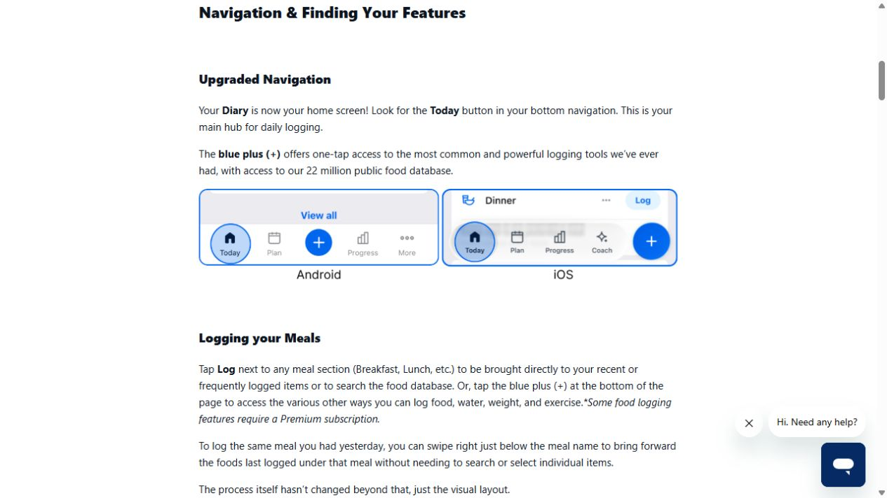
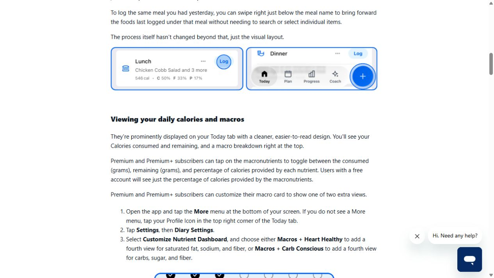
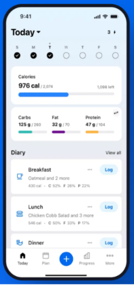

# Nutrition Tracker: evidence and implementation brief

Research date: 2026-10-15. Scope: Tempo's current Food log, renamed **Nutrition Tracker**. This is visual research with one anonymous public planner interaction, not a completed authenticated diary audit.

## Sources and steps actually attempted

1. Opened the user-supplied [Eat This Much comparison, Paprika section](https://blog.eatthismuch.com/best-meal-planning-apps/#paprika). **Editorial/vendor comparison; readable.** Used it to identify organization patterns, not to validate competitors' prices, accuracy, or popularity. Its Paprika table and body describe different pricing models, so those claims are excluded.
2. Opened [MyFitnessPal](https://www.myfitnesspal.com/), followed “Log in,” dismissed the privacy notice, and reached [Member Login](https://www.myfitnesspal.com/account/login). **Actual web entry flow; blocked at authentication.** No credentials entered, account created, CAPTCHA action, or diary reached. Browser 2 / tab 2 was retained for optional user sign-in.
3. Opened [Eat This Much](https://www.eatthismuch.com/), retained its public default settings, clicked Generate, and observed a completed 1,806-calorie sample plan. **Interactive anonymous public demo; successful.** This number is the site's sample output, not a Tempo target or recommendation. No account persistence was tested.
4. Inspected the user's provided mobile diary screenshot. **User-supplied visual reference**, not evidence of a product interaction in this run.
5. After the user could not sign in, inspected [MyFitnessPal's official Today guide](https://support.myfitnesspal.com/hc/en-us/articles/39985611667341-Your-Today-tab), including its meal and macro illustrations. **Official help screens, not authenticated hands-on testing.** They confirm a diary-first layout, date selection, calorie/macro summaries and per-meal Log actions. No claim of a live diary interaction is made.

## Observations

The supplied reference is the strongest direction: a pale blue field, compact white rounded cards, a seven-day strip, a wide calorie bar, three macro bars, and separate Breakfast/Lunch/Dinner cards. A strong number leads each summary; the meal name and Log action share a row. Its close spacing keeps the diary usable without a promotional hero. Small secondary type and faint outlines are visible accessibility risks; Tempo should increase these rather than reproduce their weakness.

The MyFitnessPal login uses a strong blue brand panel and a narrow white form with rounded light-gray fields. It confirms an account boundary only; it supplies no evidence about the current web diary. The official homepage advertises photo, voice, and barcode capture, but those were not exercised and should not appear as working Tempo capabilities.

Eat This Much's generated plan has a clear hierarchy: day total, meal heading, meal calories, photo, food title, portion. Regeneration sits beside the day and each meal. The dense, left-aligned rows make portions easy to scan. Its white background, dark text, blue links and orange registration rail differ from the user's desired calm blue cards. The registration rail takes substantial width; Tempo can use that space for the diary itself.

## Tempo brief

Own `src/app/workspace/NutritionView.tsx` and scoped additions to `food-fitness.module.css`. Coordinate naming with the owner of `WorkspaceNavigation.tsx` and `WorkspaceClient.tsx`; keep the internal `nutrition` section identifier stable. Reuse `FoodSearch`, `FoodEntryEditor`, `NutritionTargetEditor`, and `nutrition-model.ts` contracts.

Build a pale blue nutrition panel with a compact date toolbar and seven-day selection strip. Lead with a white calorie card: logged value, optional user target, and remaining/over-target text only when both values are known. Use a horizontal bar instead of the large decorative circle. Unknown values remain “—”; incomplete totals remain explicitly partial. Without a target, show the logged value and “No daily target,” never fabricate a denominator.

Follow with three equal macro cards using teal, purple, and gold; show fiber as a smaller supporting metric. Keep labels and gram values visible so color is supplementary. Use approximately 18–24px card corners, restrained borders, 16px body type, and 12–16px inner gaps as proposed Tempo choices, not measured competitor specifications.

The diary is the primary work area: four meal groups, counts and known calorie subtotals, clear Add food action, compact portion/nutrient rows. Preserve favorite, copy, edit, delete, search/scan, manual entry and targets. Give empty meals a calm one-line invitation. Keep source attribution and selected-day loading/truncation warnings visible.

## Acceptance and validation

- Desktop shows date, summary, macros and the first diary groups without a large empty hero; mobile stacks cleanly at 390px without clipping actions.
- Date changes select the same diary data as the existing date input. No plan becomes consumed food automatically.
- Optional targets, zero values, missing values, partial totals, portions/units and Open Food Facts attribution survive the redesign.
- Keyboard focus is visible; date buttons expose selection; icon actions retain labels; bars include text equivalents.
- Run `nutrition-model.test.ts`, repository lint and typecheck, then browser-check desktop/mobile, empty/partial/target states and editor opening. Read the relevant local Next.js guide before edits. These are required follow-up checks; no application tests were run for this documentation-only research.

## Implementation pass, 2026-10-15

Implemented in `NutritionView.tsx` and new scoped `nutrition.module.css`: seven-day selection with week navigation, compact calorie bar, teal/purple/gold macro cards, and four rounded meal cards. All existing editors, search/scan, favorite/copy/edit/delete and source attribution remain connected. Targets stay optional; zero targets never become invalid progress denominators, and partial intake cannot produce a misleading remaining value. Added meaningful rendering assertions for complete, partial, absent and zero targets. Nearest three food/fitness test files passed (19 tests); `npm run lint` and `npm run typecheck` passed. Parent agent owns final browser QA, global naming, and final full validation.
