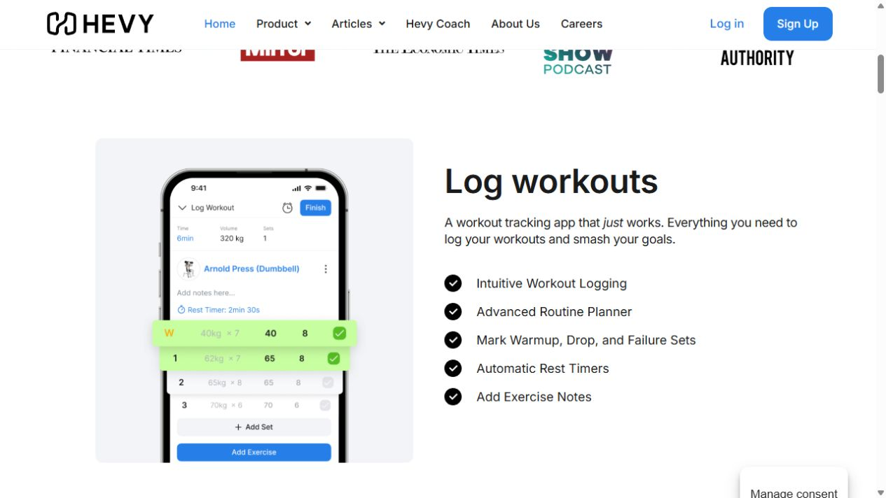
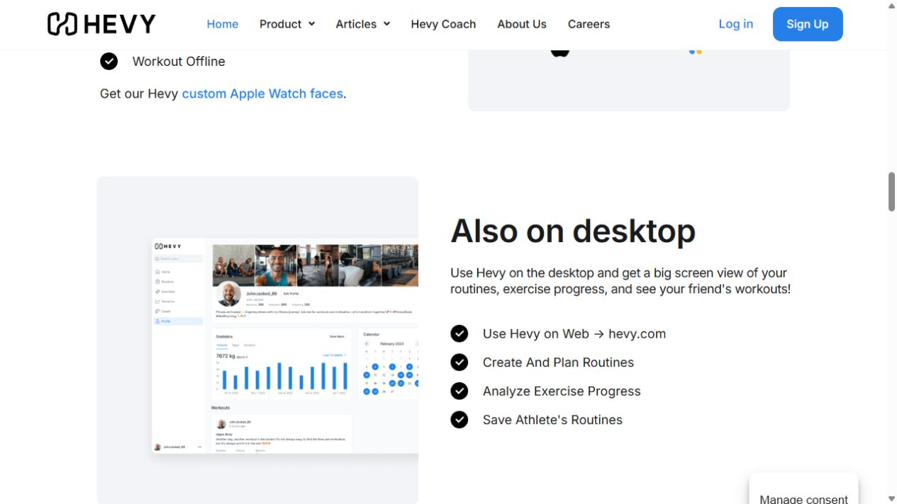

# Fitness: evidence and implementation brief

Research date: 2026-10-15. Primary competitor: Hevy. The food/fitness research set is limited to four primary products total: MyFitnessPal, Eat This Much, Paprika and Hevy. This fitness review is **official marketing visual research**, not an audit of a signed-in workout session.

## Sources and steps actually attempted

1. Opened [Hevy's official homepage](https://www.hevyapp.com/). **Public marketing page; readable.** The page presented logging, progress, social, watch and desktop sections.
2. Scrolled to Log workouts, rejected optional cookies, aligned the visible logging section, captured a JPEG and inspected the saved image. **Official product illustration; accepted.** A phone illustration shows exercise rows, numeric sets, completion checks, summary values and an Add Exercise action.
3. Scrolled to Also on desktop, captured and inspected its dashboard illustration. **Official product illustration; accepted.** It shows a desktop sidebar, compact statistics chart, calendar and workout content.
4. Read the visible feature lists beside these illustrations. **Marketing claims only.** Did not sign in, create a routine, start a timer, record a workout, use social features, or test synchronization. The diagrams and numbers shown are vendor examples, not user activity or Tempo functionality.

## Visible strengths and friction

The [logging section](https://www.hevyapp.com/) puts the workout task inside a single white panel. A small top summary yields to one named exercise, a note line and aligned numeric rows. The repeated columns make sets comparable; completion checks sit at the row end, near the data they confirm. Blue marks actions, gray separates supporting controls, and a lime overlay highlights completed rows in the promotional visual. Typography is a conventional sans serif with strong headings and smaller secondary labels. Corners are modest on controls and much larger on the surrounding illustration panel.

The screenshot does not prove a usable completion flow. Its green overlay is a marketing emphasis, not evidence of runtime color or accessibility. The small phone text would be too small if copied literally to Tempo desktop. Hevy's adjacent copy advertises rest timers and set types, but those require behavior and data Tempo does not currently have.

The desktop illustration offers a useful hierarchy: stable navigation on the left, compact history/statistics in the main area, calendar beside it, and lower workout content. It is an image at reduced scale, so exact spacing, chart values, focus states and hover behavior cannot be assessed. Social/profile content competes with task content in the example; Tempo's executive-function coach should prioritize the user's next session and logged history.

Hevy's public page uses large black promotional headings, blue links, pale gray image panels and generous vertical whitespace. That is useful for identifying visual grouping, but a working Tempo screen should be denser. The food-family user's pale blue panel and white rounded-card direction should carry into Fitness, with a distinct session-oriented composition and a restrained teal action accent.

## Tempo implementation brief

Primary files: `src/app/workspace/FitnessView.tsx`, scoped styles in `food-fitness.module.css`, and relevant existing rules in `demo-content.module.css`. Keep `WorkoutPlanEditor`, `WorkoutLogEditor`, `workout-programs.ts`, `workoutTaskDraft` and persistence callbacks intact. Coordinate shared CSS changes with the food owner.

Lead with a compact date toolbar and a white summary strip: minutes actually logged for the selected day and a clear Log completed movement action. Keep the connection to scheduled tasks explicit. If no completed movement exists, show an honest empty state; do not show invented progress, streaks, calories burned or wearable synchronization.

Give saved plans a prominent session workspace. A plan selector or compact list sits alongside a selected session card containing duration, movement names, dose, alternatives and the distinct Schedule and Log completed actions. Preserve Customize and delete. Scheduling opens the existing task editor; logging opens the existing completion editor. Neither action should imply the other occurred.

Move the six starting templates into a visually secondary library, using compact cards with clear equipment, experience and duration. Maintain the existing selection/session controls and template save behavior. Keep available guidance/rest information in readable disclosure areas. Make completed history a clear lower section with day/all-history controls, compact records, date and actual duration. Teal can identify movement; purple and gold can distinguish supporting summaries without implying performance grades.

## Acceptance and validation

- The selected session and primary logging action are easy to find before the template library; narrow screens stack with intact controls.
- Saved plans, scheduled tasks and completed movement remain distinct; completion requires recorded duration/date, and future completion remains rejected.
- Existing six templates, substitutions, rest guidance, custom plan editing, session selection and history survive.
- No invented set tracking, timers, charts, wearable sync or AI exercise prescription appears as a working capability.
- Maintain semantic buttons, labels, focus visibility, legible numeric data and text equivalents for color.
- After implementation run `workout-plans.test.ts`, lint and typecheck; browser-check saved/empty plans, session switching, schedule opening, log opening, history and mobile. Read the relevant local Next.js guide before code changes. No application validation was run during this documentation-only research.

## Implementation pass, 2026-10-15

`FitnessView.tsx` now presents the selected session workspace before the six-template library. Scoped styles provide compact white movement summaries, an ice-blue session introduction, and a secondary template shelf. Schedule, completion logging, saved-plan customization, history and all existing data contracts remain intact. The nearest three food/fitness test files passed (19 tests); lint and typecheck passed. Parent agent owns final browser QA. No signed-in competitor activity was attempted.
