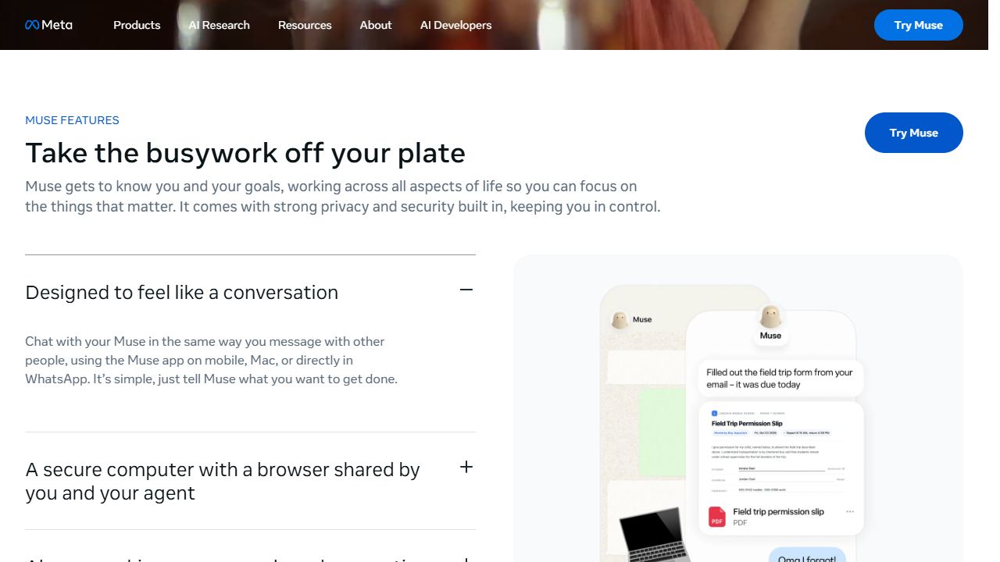
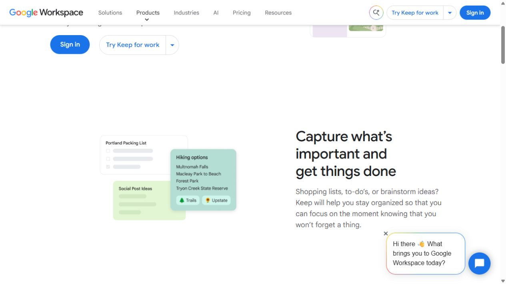

# Brain dump and Ask Tempo research

Observed 2026-10-15 using CUA in the in-app browser. Research only; no application changes or personal account actions. The goal is quick capture, understandable saved context, and a useful assistant that updates the same tasks, routines, food records, and plans shown elsewhere in Tempo.

## Sources and evidence boundaries

- [Meta’s official Muse page](https://ai.meta.com/muse/) verifies the exact product identity and links to Muse’s web destination. This is **marketing with a product illustration**, not an authenticated chat session. Meta AI Assistant appears separately on the same page; it has not been substituted for Muse.
- [Muse public web entry](https://muse.ai/) is an **actual interactive pre-account surface**. Its download chooser was exercised; conversation, memory, and authenticated settings were inaccessible without signing in.
- [Google Keep official product page](https://workspace.google.com/products/keep/) is **marketing with note-card examples**, not a live note editor. No Google account was opened.

These are useful references for particular patterns, not evidence that one product is objectively best.

## Steps actually attempted

1. Opened Meta’s Muse page and inspected its navigation and product identity. Healthy: official branding and a direct product destination establish provenance.
2. Clicked the conversation feature accordion. Healthy: copy expands alongside a chat illustration; screenshot 1 captures the result. The illustration cannot establish live sending, streaming, or persistence behavior.
3. Opened Muse’s public web entry. Healthy entry hierarchy; account access is the boundary. See the separate onboarding report for the controls exercised.
4. Opened Keep’s official page and moved to its capture section by clicking its heading. Healthy marketing presentation: three small note examples remain visually distinct. Actual editing and save behavior were not attempted.

Screenshot 1: white background, black headings, gray supporting copy, thin accordion dividers, blue actions, and a pale rounded illustration panel. The illustrated conversation places a document result below a short assistant update. This suggests a useful relationship between an assistant response and its output; it does not prove the live interaction.

Screenshot 4: white, green, and teal note surfaces; titles lead each card; one example uses checkboxes and another uses small topic chips. Content stays more prominent than decoration. The site’s unrelated sales-chat bubble overlaps the lower page; Tempo should avoid this competing floating prompt.

## Tempo implementation brief

Give Brain dump a creative paper-and-lavender identity: a pale lavender section surface, warm neutral note cards, dark ink text, restrained corner accents, and the existing inbox/book icons. Thoughts and Memories should share this family treatment while retaining their exact purpose. Use a compact family header and related subtabs, consistent with Planner, Daily rhythm, and Food & fitness. Today and Ask Tempo remain direct destinations.

In `src/app/workspace/WorkspaceClient.tsx`, make the Thoughts capture action dominant, retain a readable title/body preview, and place conversion actions in a secondary row. Existing note-to-task and note-to-goal actions should remain explicit user choices. A saved thought must not silently become a memory or a scheduled task. Use an honest “Saved thought” type chip; do not invent dates, tags, or categories absent from the data.

In `SavedContextViews.tsx`, present Memories as saved assistant facts/preferences, with category chips, correction, and deletion easy to find. Use distinct copy for removing a memory versus deleting a thought. Search and counts should remain visible above results. Explain the limited scope of removal rather than implying it erases the conversation.

For Ask Tempo in `WorkspaceClient.tsx` and `ChatMessage.tsx`, retain the shared SMS/web conversation, timestamps, saved/processing states, safe formatting, and retry identity. Give conversation more width than suggested prompts. Show five short prompt starters as optional draft-fill actions. Preserve the existing clear scripted-preview label. A response about an update should point toward the relevant family; only display structured update receipts when real response data supports them.

## Acceptance checks and limits

- Capture → save → reopen preserves text; conversion opens an editor without deleting the source thought.
- Memory correction and deletion address the selected record; empty and search-no-results states differ.
- SMS and web continue to show the same thread; delayed processing says the message is saved and discourages duplicate sends.
- At narrow width, cards stack, chips wrap, and the composer remains usable with long text.
- Keyboard focus, screen-reader names, contrast, 200% zoom, and reduced motion require implementation testing. Pale chips must include text; color alone cannot carry meaning. No clinical benefit or accessibility compliance is claimed from screenshots.

## Implemented first pass

Thoughts now uses lavender paper cards; Memories explains saved-context deletion; reminders retain a separate blue status list. Ask Tempo prioritizes readable conversation with optional starters. Existing mutations, processing states, and preview disclosures remain. Scoped styles live in `rhythm-brain.module.css`. Validation: 33 nearest tests passed; lint and typecheck passed. Browser review pending.
