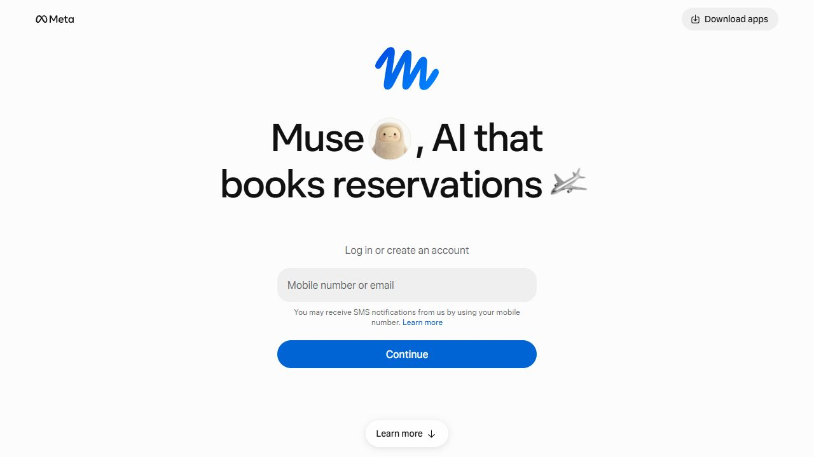
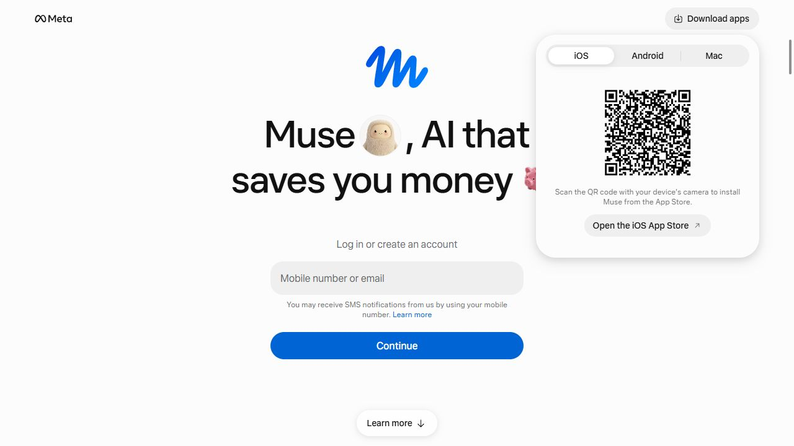

# Onboarding and settings research

Observed 2026-10-15 using CUA in the in-app browser. This is a bounded review of a real public entry and download-choice flow, followed by a Tempo implementation brief. No account was created, credentials entered, message sent, app installed, or personal account changed.

## Official sources and scope

[Meta’s official product page](https://ai.meta.com/muse/) verifies Muse’s identity and links to the web product. [Muse’s public entry](https://muse.ai/) supplied the interactive evidence below. The lower page includes explanations of agent permissions and privacy; these are **marketing claims**, not observed settings behavior. Authenticated onboarding, consent screens, profile settings, memory controls, and account deletion remain untested. This report does not infer those screens from the landing page.

## Numbered flow actually attempted

1. Opened Muse’s public web entry. Healthy first-step focus: a central mobile/email field and a single blue continuation action, with a short SMS disclosure directly below the field. The Meta wordmark and blue Muse mark establish identity. No form data was entered or submitted.
2. Opened the top-right download control. Healthy optional branch: a rounded popover appears at the top right while the entry remains visible. Screenshot 3 shows an iOS default, a QR code, brief device instructions, and a store link.
3. Selected Android in that popover. Healthy state feedback: the DOM reports Android selected, changes the instructions to Google Play, and exposes its corresponding official store link. No download link was followed. This state was observed through DOM; the saved screenshot records the initial iOS choice.
4. Stopped before account identification and verification. Deliberate evidence boundary: downstream onboarding and settings cannot be assessed from the accessible state.

Screenshot 2: spacious near-white canvas, small black Meta wordmark, large blue hand-drawn Muse mark, bold centered rotating headline, soft-gray rounded field, and a blue pill action. The field and disclosure are close together; the oversized headline occupies more room than the practical form. For Tempo, the useful pattern is one clear next action and nearby explanation. A rotating promotional headline is unnecessary during phone verification.

Screenshot 3: platform choices form a compact segmented control above the QR code. A selected platform has a raised white treatment. One popover groups the complete optional task. The small gray instructions and field copy need contrast and zoom testing; screenshots cannot establish compliance. Focus trapping, escape dismissal, responsive placement, and reduced motion were not tested.

## Tempo implementation brief

Keep phone setup focused on its current actual state in `src/app/components/PhoneSignup.tsx`: phone entry, verification/request acknowledgment, or account ready. Use one dominant next action, a persistent short state title, and secondary recovery actions. Match the action to the existing provider-specific response: opening SMS, checking a queued sign-in link, or entering the workspace. Do not collapse these into one invented success state. Show the user’s masked number and existing expiry/recovery instructions where available. Consent must stay separate and explicit; visual simplification cannot opt users into check-ins.

Use `src/app/workspace/WorkspaceTour.tsx` for a short, skippable orientation to Today, the four families, and Ask Tempo. Each step should show one destination and one practical action. Preserve progress, Back, Skip/Close, keyboard containment, and replay from the account area. The user should reach useful content without completing a tour.

In the existing settings section of `WorkspaceClient.tsx`, group controls into communication, profile/coaching, connections, and workspace/audio. Put check-in state and quiet-hours summary together so optional outreach is comprehensible. Keep timezone visible beside times. Use a neutral settings surface and the same clear headings, spacing, and control treatments as other families; decorative family art should not compete with switches.

Retain working links to `/profile` and `/extensions`, implemented by `src/app/profile/ProfileClient.tsx` and `src/app/extensions/ExtensionsClient.tsx`. Connection rows need an honest status plus a management action; preview/sample connections must be labeled. Show memory management as an explicit route to Brain dump → Memories. Destructive account actions, if supported elsewhere, must have separate review and precise scope. Do not add a pretend account-delete control.

## Acceptance checks

- Provider-specific setup states and existing recovery paths still work; copy never promises an unconfirmed send.
- Skip/replay/back/close work without losing the current workspace destination; dialogs return focus.
- Check-ins retain the real persisted opt-in; quiet hours and timezone remain legible beside it.
- Toggling/checking controls reports pending, saved, and failure states truthfully; no visual-only integration status.
- Verify narrow screens, keyboard-only use, readable focus, 200% zoom, adequate targets, and contrast. This research does not establish live Muse settings quality or a comparative ranking.
