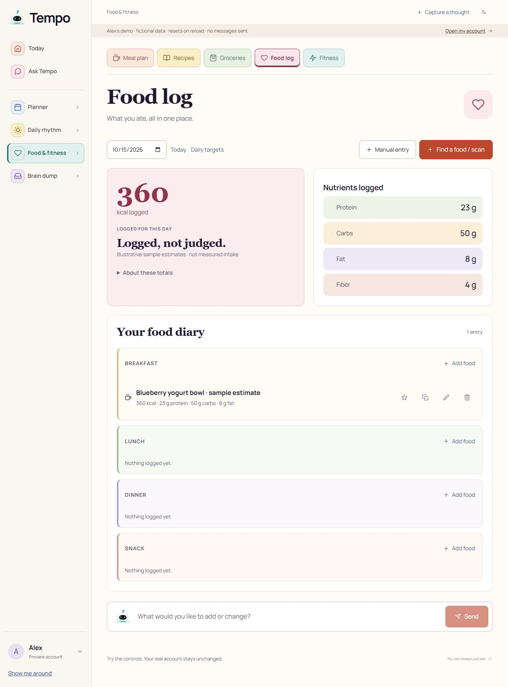
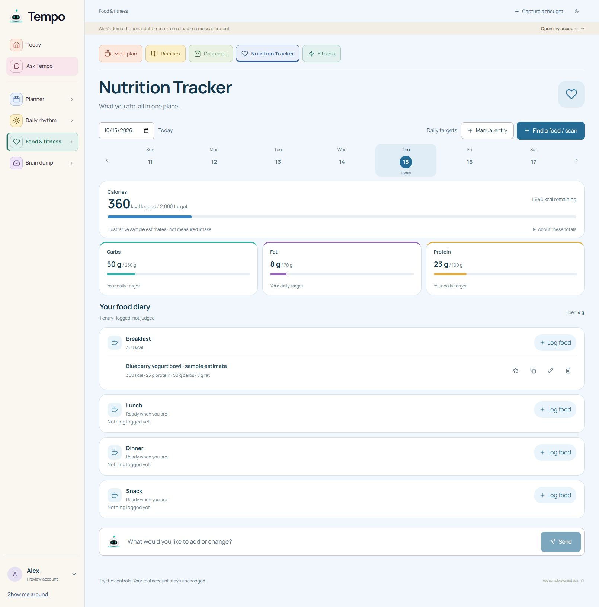
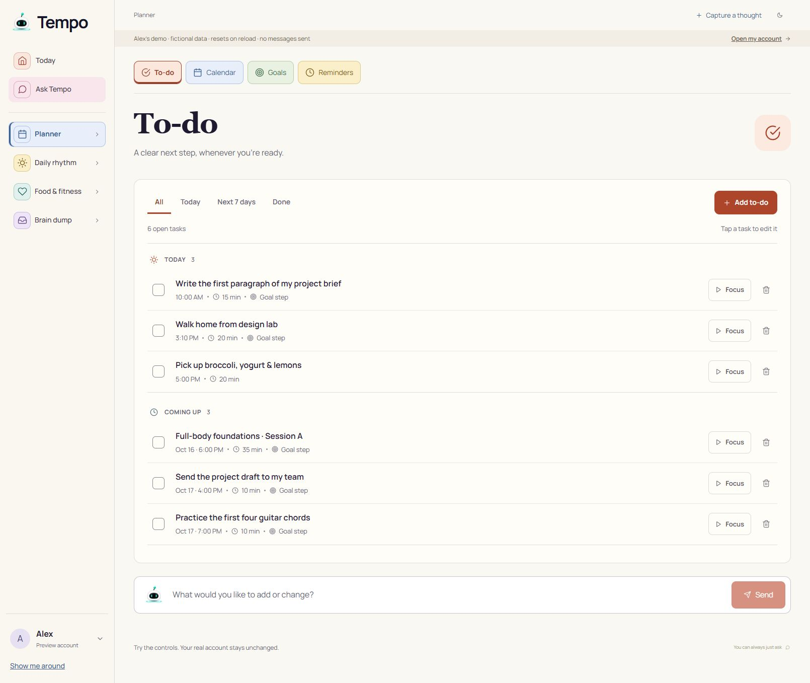
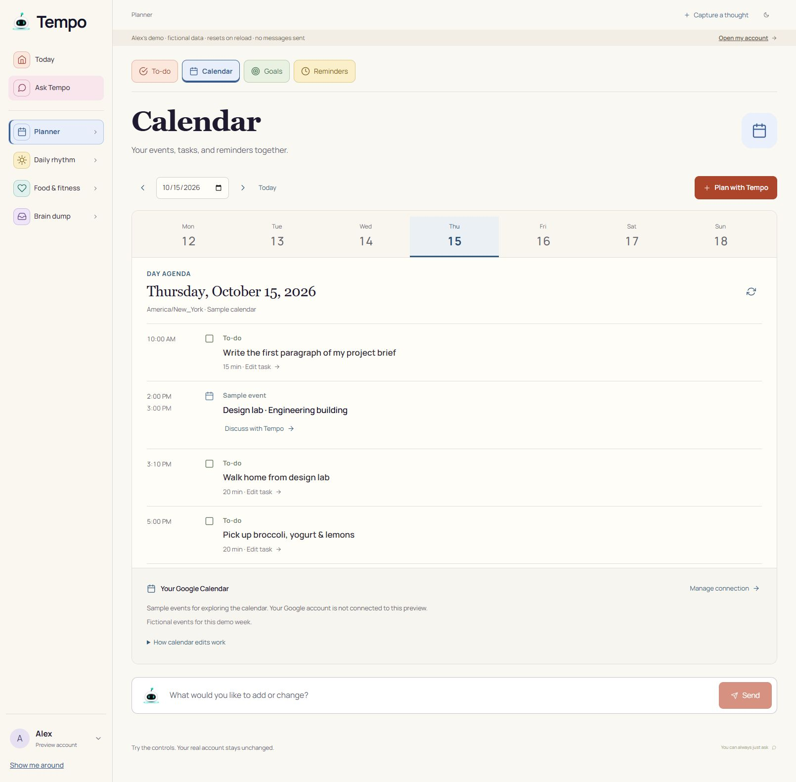
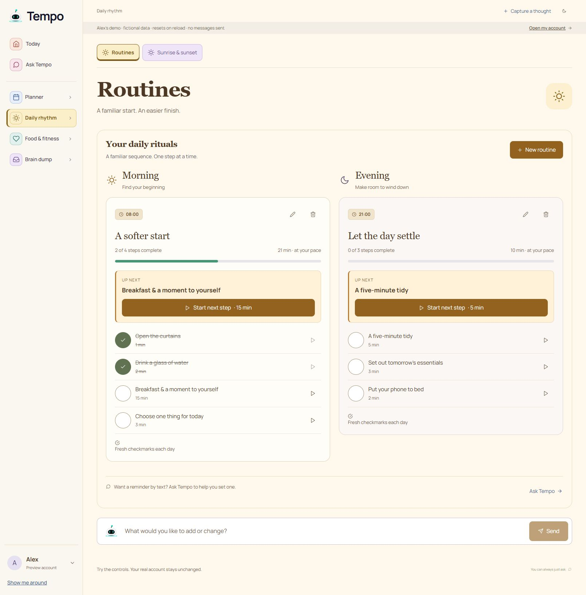
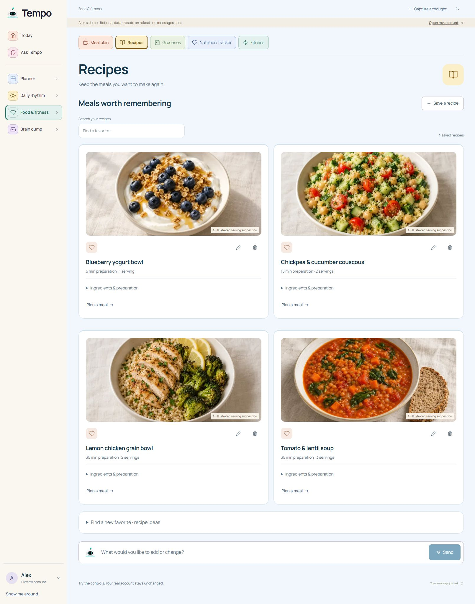
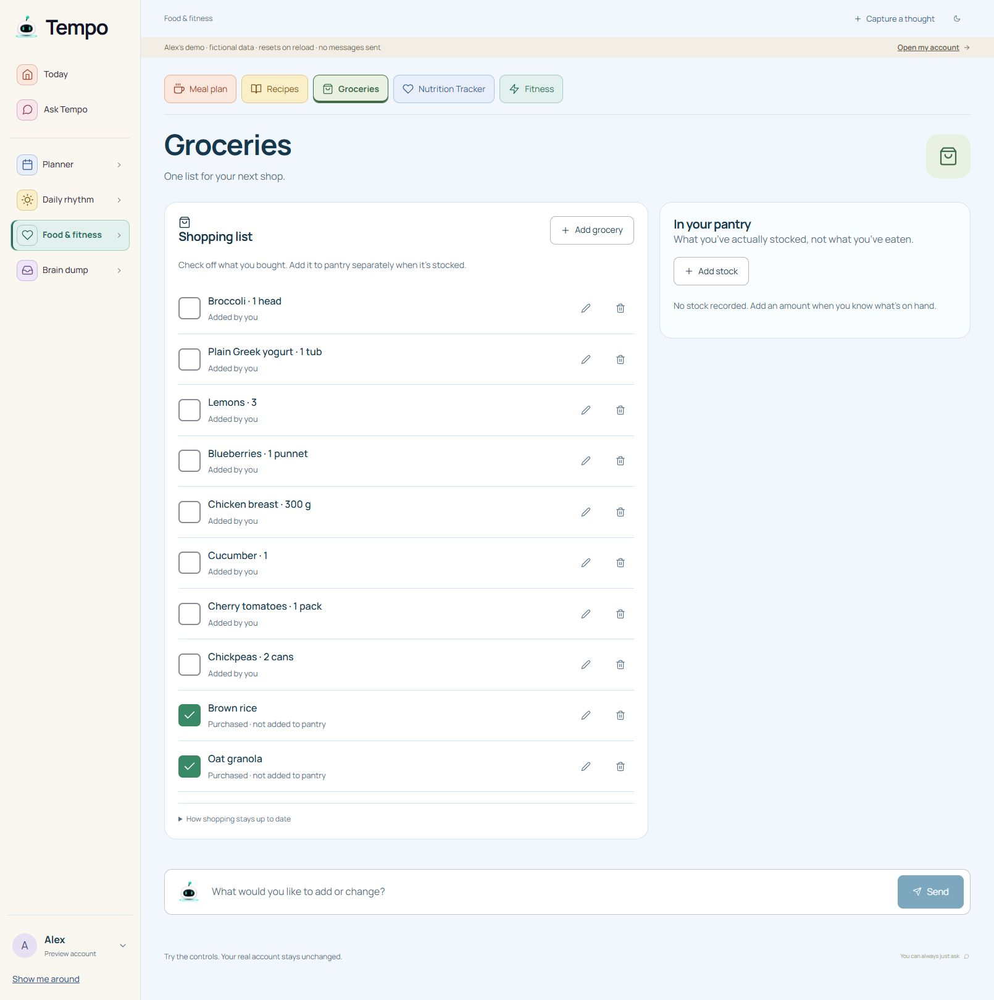
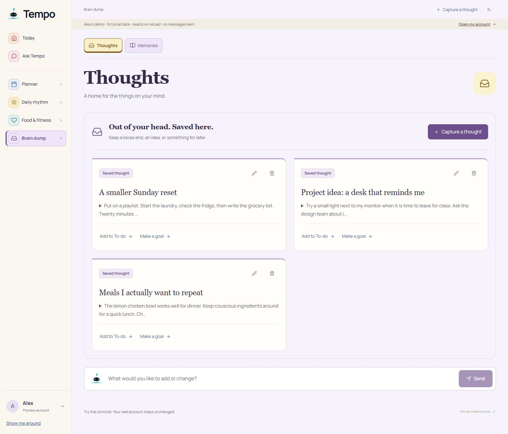
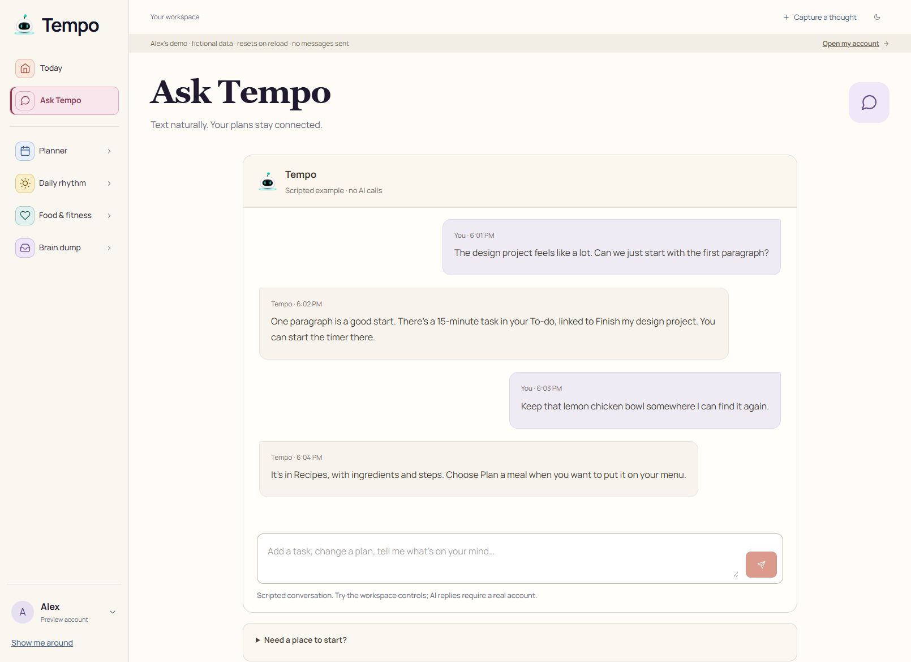

# Implementation and review checkpoint

15 October 2026 · candidate branch `codex/tempo-calm-ui` · local Next development server at port 3101. Base commit `98e61bf`; this report accompanies the research implementation commit. These are fictional Alex preview records, not a customer's account.

## Nutrition: reference to implementation

The supplied reference and official MyFitnessPal guide inform the information hierarchy, not a pixel-identical copy. Tempo retains its sidebar, account identity, family subtabs, four meal groups and account-owned data contracts. Desktop expands the layout; colors, type, controls and assets are Tempo's own.

The example targets were entered only to test the preview. They are not defaults or recommended intake. The saved sample food totals 360 kcal; a fictional 2,000-kcal target correctly displayed 1,640 remaining. Macro values also populated the corresponding bars. Without targets, the cards show no denominator or invented progress. Partial and zero-target behavior has automated coverage.

## The four work areas

## Observed controls and repairs

- Recipe search for “lentil” returned only Tomato & lentil soup; clearing it restored all four recipes.
- Completing Book a haircut removed it from open To-do and changed the count from seven to six.
- Calendar Next day changed October 15 to 16, including the day's different sample events, tasks and reminders. The edit disclosure opened and described confirmation requirements.
- Checking the next morning routine step changed progress from 2/4 to 3/4, exposed Undo, and changed the next-step title and duration correctly.
- Nutrition Daily targets opened, accepted the fictional values, and updated arithmetic and progress. These tests did not exercise PostgreSQL persistence or a live model.
- Corrected inherited green nutrition bars so calorie and macro colors stay specific; retained colored card edges when targets are absent. Corrected an empty meal card stretching alongside a full card.
- Independent review caught checked-box icons on open Calendar tasks. Open tasks now use a hollow square, completed tasks a checked square. Increased Planner metadata to 13px and tightened Calendar row spacing.

## Independent desktop visual review

Reviewers were GPT-6.1 Sol agents, reviewing areas they did not implement. They opened the actual saved captures. No score below is a backend, mobile or release score.

| Surface | First review | After fixes | Evidence boundary |
| --- | --- | --- | --- |
| To-do | 7.5 | 8 | Screenshot layout and readability |
| Calendar | 7 | 8 | Screenshot layout, icon meaning, spacing |
| Food suite: Nutrition, Meals, Recipes, Shopping, Fitness | 8 | 8 | Desktop screenshot review as a group |
| Routines | 8.5 | 8.5 | Desktop screenshot hierarchy |
| Thoughts | 8 | 8 | Desktop screenshot hierarchy |
| Memories | 8.5 | 8.5 | Desktop screenshot hierarchy |
| Ask Tempo | 8.5 | 8.5 | Scripted preview layout, not model behavior |

Retained the distinct subtab colors because the user explicitly values them. Shared family canvas, typography, borders and corners provide consistency. Remaining minor findings: repeated introductory headings use space; thought expansion could be clearer; small secondary copy and icon-only actions need measured contrast and touch/keyboard review. A contextual grocery-to-pantry handoff is a future interaction improvement, not permission to silently mark food stocked.

## Validation and limits

The integrated `npm run check` passed: lint, TypeScript, 805 tests passed with 3 skipped, production Next build and operations TypeScript build. The final full rerun after the Calendar readability/icon changes also passed with exit 0 and the same 805 passed / 3 skipped result. Local raw logs remain in `qa/design-research-2026-10-15/check-final.log` (not published). The focused follow-up also passed 17 tests, lint and typecheck. No paid API calls were made in this research pass.

Desktop captures use the normal 1625px browser viewport (1610px content with scrollbar). The browser's requested 390px viewport override was ignored: the DOM still reported desktop width. A separate embedded responsive harness was blocked by the app's frame protection and was removed. No protection was disabled. **There is no mobile pass for this checkpoint.** Real-device/mobile, 200% zoom, assistive technology, measured contrast and live account/channel validation remain outstanding.

Goals, Today and wake-session internals retain their approved behavior and existing components; onboarding/settings has a research brief rather than a newly completed redesign. No merge, production deployment, customer mutation, provider message or hardware verification occurred. Continue from this candidate and existing release records; do not treat this report as beta release approval.
