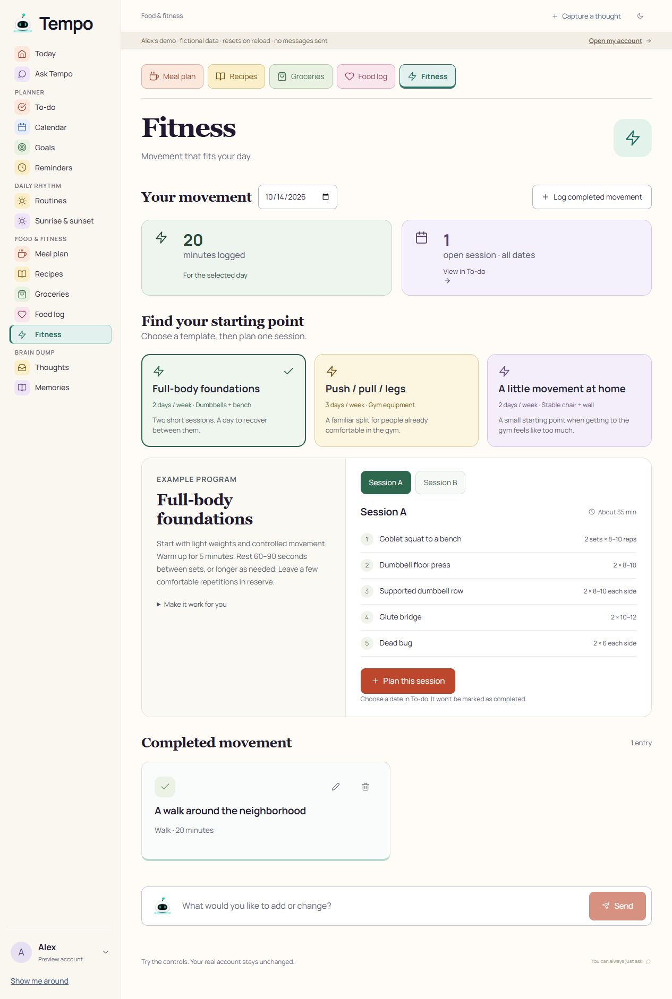
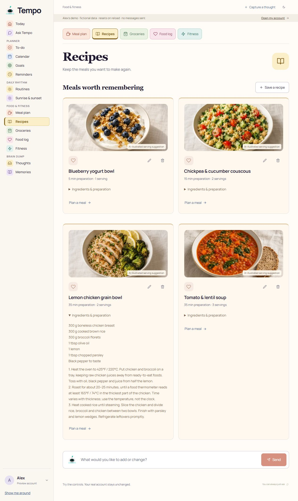
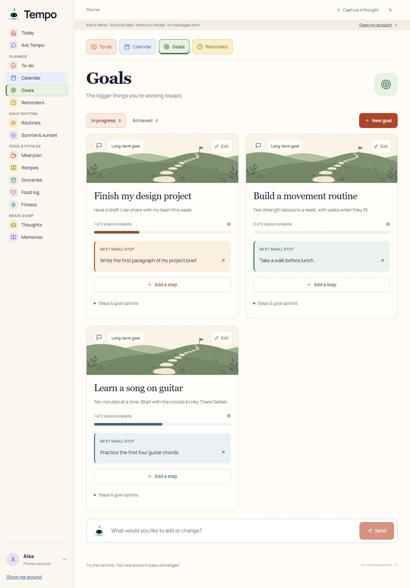
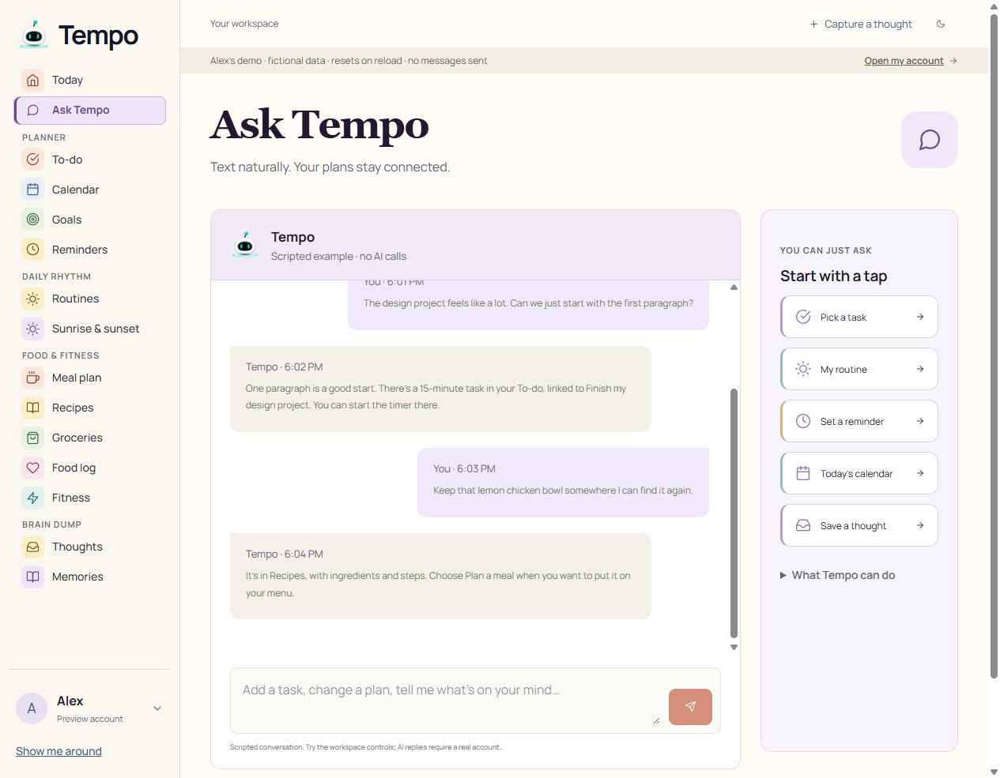

# Filled demo workspace: independent customer review

Date: October 14, 2026. Reviewer: independent `filled_demo_review` agent.

## Verdict

**8.3/10 for a guided investor demo and novice-user presentation.** The populated workspace tells a believable story: a student has a project, a small fitness plan, meals to repeat, groceries to buy, routines, and a place for stray thoughts. Photos and concrete examples make the breadth much easier to understand than empty screens. The primary local controls tested worked.

This is **not a commercial-readiness rating**. I used only `http://localhost:3100/workspace/preview`, a fictional in-memory account. Reload resets edits. I did not contact providers, use a real account, test paid AI responses, send messages, or verify persistent cross-device state.

## Review steps and results

1. **Today — healthy.** The current-day timeline, one prominent task, and nearby checklist provide a clear entry point. The page visibly identifies Alex's data as fictional and says no messages are sent. Sample Calendar events also appear in the timeline.
2. **Fitness — healthy after a wording correction.** Three distinct templates cover full-body strength, push/pull/legs, and a short home circuit. Sets, repetitions, equipment and session duration are concrete. I switched sessions, scheduled Full-body foundations · Session B for October 17 at 10 AM, and verified its 35-minute task appeared in To-do. Completed movement remained 20 minutes. The all-dates planned-session count is now explicitly labeled, so it no longer looks like a selected-day total.
3. **Recipes — strong.** Four matching food images, readable ingredient quantities, preparation steps, and a direct Plan a meal action give this section substance. Each image says “AI-illustrated serving suggestion.” Chicken instructions use a thermometer endpoint rather than claiming a fixed cooking time guarantees safety. This review is not a professional recipe/nutrition validation.
4. **Meal plan — healthy.** The seven-day selector is visible. I planned Tomato & lentil soup for Sunday lunch; the page moved to the chosen date and displayed the added meal in Lunch. Existing meals remained. The portion-count dialog explicitly warns that ingredient quantities are for the recipe's original servings and require adjustment if the count changes. Automatic ingredient scaling remains absent.
5. **Groceries — healthy.** A recognizable shopping list includes quantities and checked pantry staples. Checking broccoli updated its state. This is a sample shopping list, not evidence of automatic recipe-to-grocery reconciliation.
6. **Food log — honest but lighter than the recipe demo.** Today's breakfast has clearly labeled sample estimates. The page states these are not measured intake. Switching from a future meal-plan date carries that date into Food log, which can initially show zero entries; the date is visible and editable. A “Today” shortcut would make recovery faster.
7. **Goals and To-do — healthy.** Three goals have realistic descriptions, linked steps and partial progress. Goal illustrations and distinct accent colors support scanning. The new workout appeared under Coming up without being misrepresented as completed exercise.
8. **Routines — healthy.** Morning and evening lists are concrete and short. I checked breakfast, observed progress change from 2/4 to 3/4, then used Undo to return to 2/4.
9. **Thoughts — healthy.** Three different notes feel like plausible daily captures and connect naturally to meals, planning and the project. Add to To-do is discoverable. I inspected these cards; I did not execute every note action.
10. **Memories — healthy presentation.** Three preferences/routine facts are easy to inspect, with correction and removal controls. No claim was made that the displayed facts came from a real model run.
11. **Calendar and reminders — clearly bounded.** Sample events, tasks and scheduled sample reminders are visible. Calendar explicitly says the Google account is not connected to this preview. The refresh control's accessible label was corrected to “Refresh sample calendar.” Real Google authorization, calendar edits and reminder delivery were not tested.
12. **Ask Tempo — healthy after a real demo defect was fixed.** Initially both fictional user messages showed “Tempo is taking longer than usual” despite an existing reply. This made the product look stalled. The fixture statuses were corrected; I reloaded and verified those notices disappeared. The persistent header now says “Scripted example · no AI calls,” and the footer explains real AI requires a real account.
13. **Sunrise/sunset — honest functional preview.** I started the 20-second sunrise preview and ended it successfully. Visible copy says this requires an awake, open screen, cannot control physical brightness or wake the device, and is not a scheduled alarm. I did not verify actual speaker output or hardware.
14. **Settings — understandable.** Preview account, sample Calendar connection, check-in controls and foreground audio limitations remain visible. I did not follow account/provider links or change live settings.

## Iteration findings

Initial score: **7.8/10**. The false pending-chat warnings were the main must-fix issue. The mixed selected-day/all-dates Fitness count was a smaller clarity problem. Both were corrected and rechecked. Final score: **8.3/10**. No remaining blocker for a guided demonstration of this fictional workspace.

Remaining improvements do not block this demo:

- Add a Today shortcut beside the shared date controls, especially Food log and Fitness.
- Recipe cards stretch tall when one preparation disclosure opens. A drawer or independent-height cards could shorten scanning, but the current content remains readable.
- Fitness templates are a useful starting point, not individualized coaching, exercise instruction videos, adaptive progression or medical advice. Avoid presenting them as those capabilities.
- Keep presentation language explicit: sample data, illustrated food, scripted assistant conversation, no live integrations in this route. Never present this account as customer traction or proof of working live AI.
- A full screen-reader pass is still needed. After exercise markup changed to an unordered list without literal numerals, the browser AX snapshot still represented a row as “1 1 …”; the DOM contains one exercise label. This may be snapshot/CSS-marker aggregation. Actual spoken duplication was not tested.

## Evidence and limits

Four screenshots were captured from the rendered local page in this review and inspected before acceptance:

- [Fitness](review-01-fitness.png)
- [Recipes, including expanded preparation](review-02-recipes.png)
- [Goals](review-03-goals.png)
- [Assistant after correction](review-04-assistant.png)

The fresh review tab reported no warning/error console entries at the final check. This does not prove exhaustive correctness. I did not change viewport dimensions, run a full keyboard/screen-reader audit, verify mobile layouts, test every destructive action, certify nutrition/exercise safety, or assess load, durable state, account isolation and live provider reliability. Those require separate evidence.
