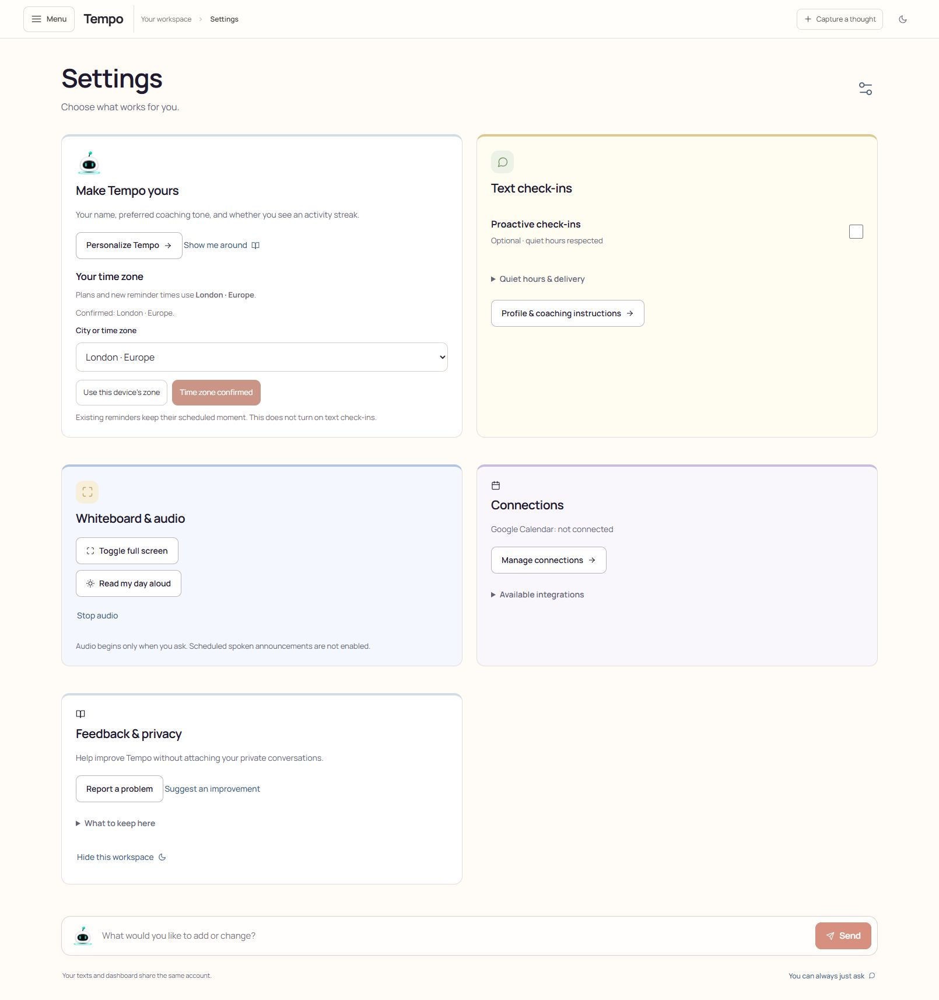
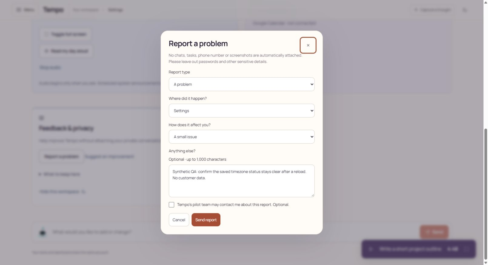
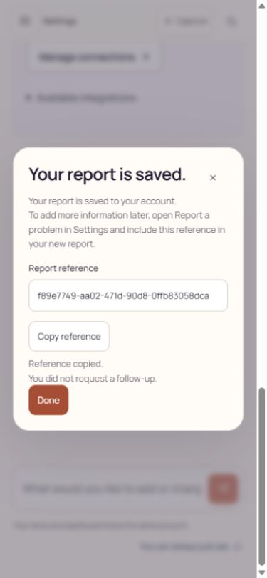
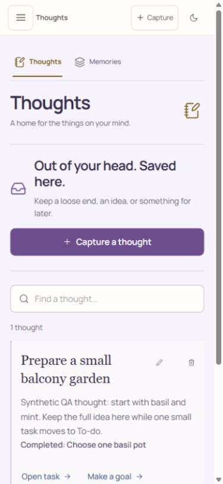

# Authenticated pilot customer-flow observations

October 22, 2026. Author: principal/root agent. Candidate: `codex/tempo-adaptive-home`,
checkpoint `4400de5` plus the A2/R2 changes and final review corrections. See the
directory README for the eventual integrated commit. This is local browser and
PostgreSQL evidence, not SMS, Google Calendar or real-model evidence.

## Environment and boundaries

- Isolated Next on loopback port 3103, PostgreSQL on loopback 55437.
- Fresh fictional QA Riley account created by the authenticated HTTP fixture,
  using normal short-lived sign-in. A second conflicting/empty account was
  exercised by the HTTP isolation checks. No personal account was opened.
- No live provider keys loaded; no worker or outbound provider delivery.
- Desktop and 390 × 844 CSS-pixel browser viewport. This is viewport emulation,
  not a physical phone, software-keyboard or screen-reader test.
- Screenshots below were captured and inspected by root. Independent customer
  and designer reviewers inspected these images and source; they did not perform
  these browser actions or independently observe the database.

## Observed journey

1. **Sign in and recover work.** Opened the normal fixture sign-in and dashboard.
   A saved focus session for “Write a short project outline” returned paused at
   4:48 after reload. Stopping the session kept the underlying task unfinished.
   The companion HTTP run passed ten acceptance groups, including single-use
   activation, empty-account isolation, Home preferences, concurrent/stale edits,
   task retry and durable timer state.

2. **Confirm local time.** Opened Settings, changed New York to Europe/London,
   explicitly confirmed it, then reloaded. The selected city and durable
   “Confirmed: London · Europe.” status remained. The saved-state button was
   disabled, and proactive check-ins stayed off. A direct local record check
   confirmed users.timezone, confirmation timestamp and unchanged proactive flag.
   Existing reminder instants were not changed by this action; repository tests
   separately cover that invariant. Initial UI lacked a persistent confirmation
   label; the implementation was corrected and rechecked.

   

3. **Submit private feedback.** Opened Report a problem; labels and optional
   follow-up consent were explicit. Entered only fictional QA detail, left
   follow-up unchecked and submitted. The UI showed a report receipt. Local
   database inspection found encrypted detail and no follow-up consent. Tab from
   the final form action wrapped to Close; Escape and Done returned focus to the
   opener. An initial receipt-focus issue was fixed: focus now lands on the
   success heading. At phone width there was no horizontal page overflow.

   

4. **Retain the receipt.** After independent review, the receipt gained a labelled
   selectable reference and Copy reference. A new fictional report showed
   “Reference copied.” after that action. Done returned focus to Report a problem.
   The saved screen now explains how to quote the reference in a future report.
   Clipboard-denied fallback exists in code but was not forced in this browser.

   

5. **Turn a thought into a useful step.** Captured “Prepare a small balcony
   garden” with a longer fictional note. Selected Add to To-do, changed the task
   title to “Choose one basil pot”, selected six minutes and saved. The thought
   displayed its linked task. Open task then Start 6 minutes showed the exact
   task timer. Selected I'm done, returned to Thoughts and reloaded. The task was
   completed, the full original thought remained, and Open task was still
   available. A local joined record check confirmed completed task and intact
   source note. Duplicate and cross-channel conversion are separately covered by
   repository regressions, not claimed from this one browser sequence.

6. **Review correction.** Both independent reviewers found the original linked
   task status too small and faint. It now has a dedicated 14px dark-text style.
   Reloaded and captured the corrected phone view.

   

## Review outcome and limits

- Independent customer review: initial 8/10; **9/10** after both findings closed.
- Independent designer review: initial 7/10; **7.5/10** after all observed visual
  findings closed. Remaining requested evidence: physical-phone keyboard entry,
  failed save/retry, denied clipboard/manual copy and a screen-reader journey.
  The score has not been rounded up or treated as a whole-product release pass.
- Full current-product section scoring and fresh week-long novice scenarios
  remain open in `customer-release-matrix.md`. This bounded flow review does not
  certify Nutrition, Calendar, Fitness or live SMS.
- Screenshot 03 and 04 preserve the earlier review state; 05 and 06 show the
  corrections. No anonymous/new-account feedback, personal content or customer
  communications were created.
