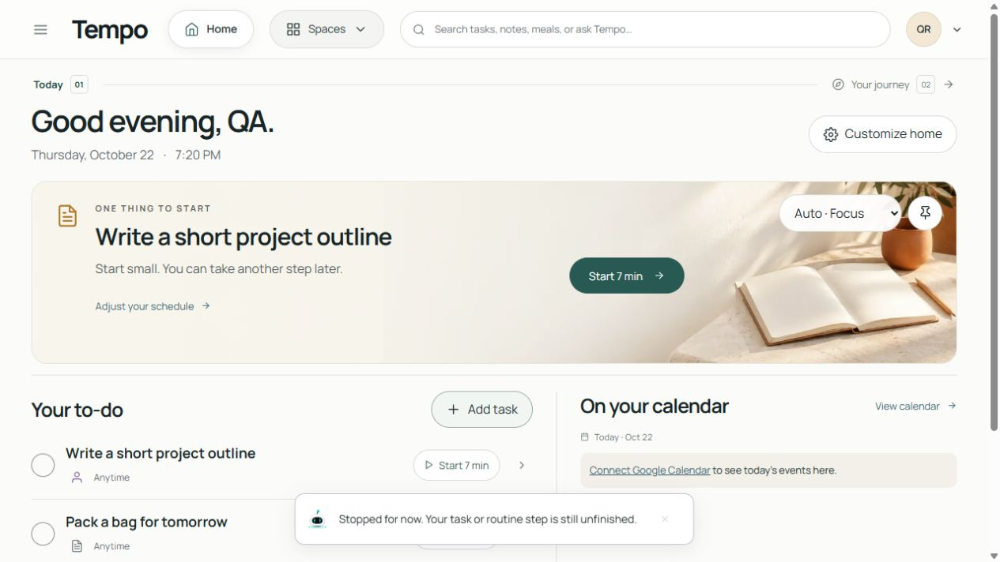
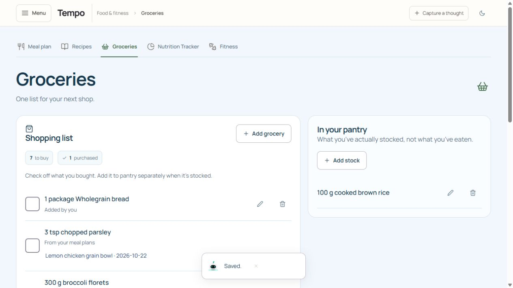
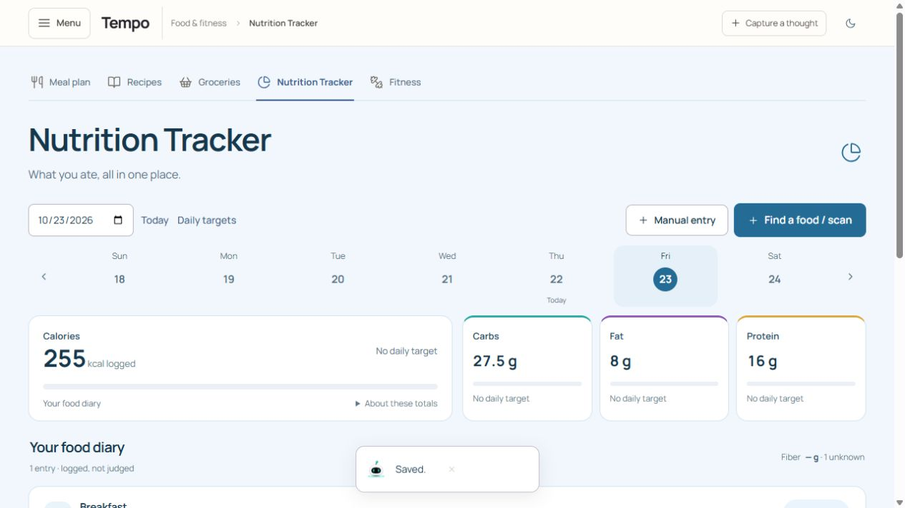
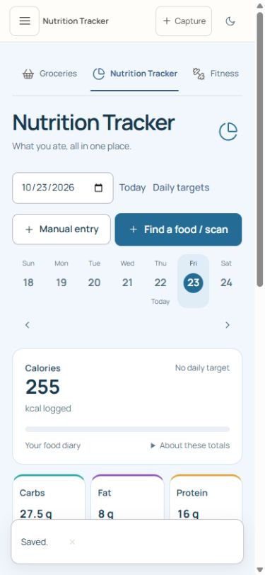
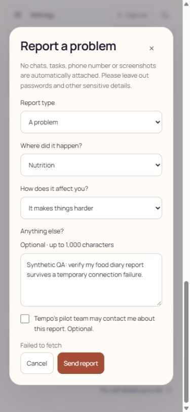
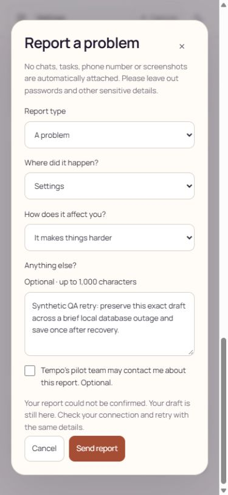
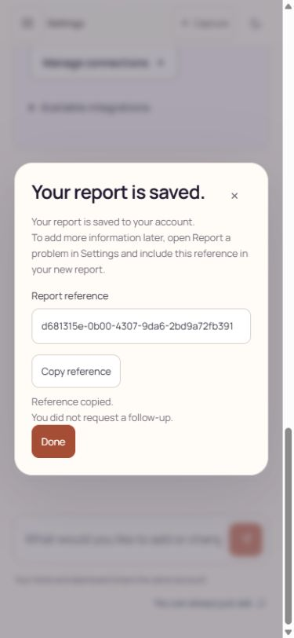
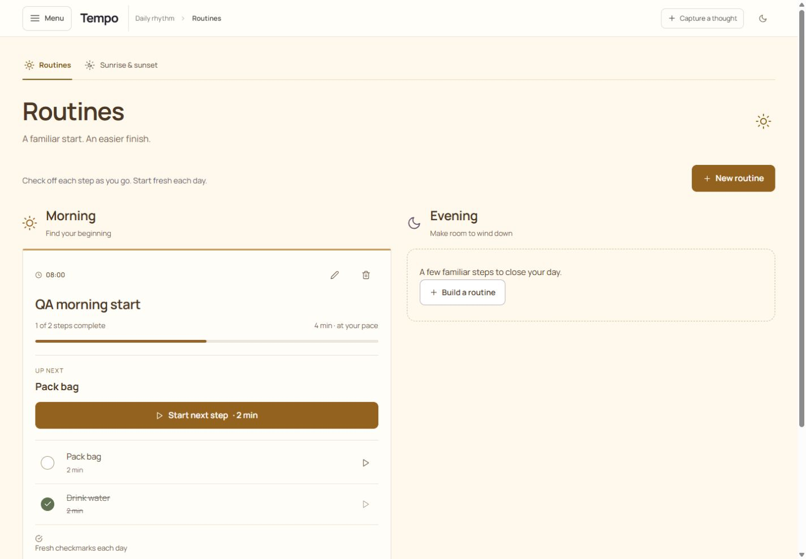
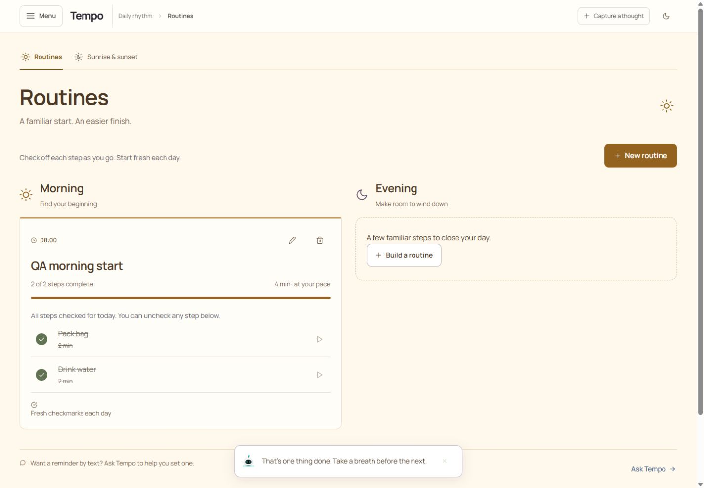

# Independent review of captured food, feedback, and routine workflows

Reviewed October 22, 2026. **Scoped visual-clarity score: 8.3/10** for the final captured food, feedback, and routine states. No required visual fix was found in these final screenshots. This is a professional UI/customer interpretation of a bounded evidence set, not a whole-product score, competitor-parity rating, clinical study, release approval, or proof of accessibility conformance.

## Evidence and attribution

I read this folder's `README.md` and `records.json`, then opened and visually inspected all nine saved PNGs. I inspected the phone, feedback, and routine captures at original resolution. The main agent captured the screenshots and performed the browser interactions in a local synthetic signed-in account. **I did not interact with that account or independently execute the database checks.** The README's observed flows and the seven groups listed in records.json are corroborating reports from the main agent, not my direct observations.

The captures describe the adaptive worktree over `3892b74` plus an uncommitted continuation; final integration/account-guard work was still in progress. This assessment applies to that tested snapshot. It does not establish behavior of later builds. No provider calls or external account changes were performed for my review.

## Findings and recommendations

- **No required visual correction in the final captured states.** Preserve the existing theme and information structure.
- **P3, capture completeness:** the Saved toast overlays the lower macro cards in phone capture 04. It also overlaps lower content in several desktop captures. This confirms a transient obstruction at capture time, not a proven persistent interaction blocker. Add one phone diary capture after the toast dismisses so the macro totals and entry are simultaneously unobscured. Consider a more compact status presentation only if this overlap routinely interferes with use; do not change the layout solely to improve screenshots.
- **Verification gap, not a confirmed defect:** secondary labels and icon-only edit/delete controls use small, muted styling. Check measured contrast, focus indicators, accessible labels, and actual target sizes through DOM/keyboard testing. The PNGs alone do not justify calling them inaccessible.
- **Resolved historical issue:** capture 05 shows raw “Failed to fetch.” Final captures 06–07 replace this with actionable recovery language and a saved receipt. Do not list capture 05 as a current unresolved defect.

## Numbered evidence review

1. **Authenticated Home — healthy within the visible viewport.** The warm banner presents a specific task and a short starting timer. The same task appears in the to-do list; disconnected calendar copy provides a direct connection action. “Stopped for now” explicitly leaves the task unfinished. The lower page is outside this screenshot, so it is not evidence of every Home control or an empty-account first run.

2. **Groceries and Pantry — healthy visible distinction.** Shopping and Pantry are separate, clearly titled areas. “Check off what you bought. Add it to pantry separately when it’s stocked” and the Pantry subtitle make the purchase/stock distinction explicit. The visible bread row says “Added by you”; the parsley row names its source meal and date. The Pantry shows a measured rice stock entry. This screenshot does not display the source-linked rice row or prove its recalculated amount; that result comes from the main agent's interaction and record report.

3. **Next-date nutrition totals — healthy visible state.** October 23 is selected. Calories and macros are displayed with units and “No daily target”; fiber is explicitly unknown rather than shown as zero. The summary matches the reported half-portion values: 255 kcal, 27.5 g carbs, 8 g fat, 16 g protein. The diary entry itself is below the visible capture; this image alone does not establish the portion's provenance or the unchanged earlier date.

4. **Phone nutrition summary — usable, with evidence obstruction.** Heading, date, entry actions, selected day, and calorie summary reflow within the visible phone width. The three macro cards remain side by side. The Saved toast covers their lower portion, so I cannot assess their complete phone layout or the diary entry from this capture. The section navigation is horizontally continued; a partial navigation item alone does not prove page overflow. No physical-device or touch testing was performed by this reviewer.

5. **Original feedback error — historical failure, subsequently resolved.** The old raw transport error is visible beneath an intact draft. It lacks recovery guidance. The README explicitly identifies this as pre-fix provenance, so it is excluded from the current-state score.

6. **Repaired feedback recovery — healthy captured state.** The final error explains that saving could not be confirmed, that the draft remains, and that the user can retry with the same details. The report type, location, effect, text, and unselected follow-up checkbox remain visible. Cancel and Send report stay reachable. The phone form fits without visibly clipped fields; scrollbars indicate a scrollable context. Draft preservation across a mounted retry is reported by the main agent, not inferred solely from this different draft versus capture 05. Recovery after reload is explicitly outside the evidence.

7. **Feedback saved receipt — healthy.** The screen clearly says the report is saved, provides a report reference and Copy reference action, shows “Reference copied,” and explicitly says no follow-up was requested. Done and close provide clear exits. The main agent reports the real outage/retry, one matching encrypted record, and keyboard focus checks; I did not independently reproduce them. The screenshot establishes the displayed successful state and copy acknowledgement, not clipboard-denial handling or delivery to a human support team.

8. **Reordered routine after reload — healthy visible state.** Morning and Evening are distinguishable. The Morning card shows 1 of 2 complete, identifies Pack bag as Up next, and offers a labeled two-minute action. Pack bag is first and unchecked while Drink water is second and checked. This visual result is consistent with the main agent's report that completion followed step identity after reordering/reload. The screenshot alone does not prove the earlier order, reload, or paused timer duration.

9. **Routine completion — healthy.** The Morning card now says 2 of 2 steps complete, the progress bar is full, and both items are checked. Copy explains that the user can uncheck a step, offering a reversible completion model. The toast acknowledges completion without implying that every activity is finished. This capture supports the final visible state; the timer pause/resume history remains main-agent-reported evidence.

## Why the scoped score is justified

The tested end states use consistent hierarchy, plain instructions, units, explicit status, and distinct section identities. They make several potentially confusing boundaries visible: planned versus eaten, purchased versus stocked, unknown versus zero, failed confirmation versus saved report, and partial versus complete routine. The score reflects those captured strengths and the remaining evidence/readability limitations. It does not assign a score to unobserved goals, fitness, memories, model coaching quality, onboarding, or provider behavior.

## Limits

This review does not include independent browser actions, screen-reader use, measured contrast, keyboard traversal, clipboard failure, physical-device/touch behavior, 200% zoom, forced colors, or OS motion preferences. The main agent's keyboard and database checks are clearly attributed above. Screenshots do not prove durable state, ownership isolation, consent enforcement, transactional idempotency, overnight reset, or actual delivery. Those require their separate code/fixture/record evidence. The known raw feedback error is historical; in-progress account-guard work is not scored from these captures.
