# Independent review of captured food, feedback, and routine workflows

Reviewed October 22, 2026. **Scoped visual-clarity score: 8.3/10** for the final captured food, feedback, and routine states. No required visual fix was found in these final screenshots. This is a professional UI/customer interpretation of a bounded evidence set, not a whole-product score, competitor-parity rating, clinical study, release approval, or proof of accessibility conformance.

## Evidence and attribution

I read this folder's `README.md` and `records.json`, then opened and visually inspected all nine saved PNGs. I inspected the phone, feedback, and routine captures at original resolution. The main agent captured the screenshots and performed the browser interactions in a local synthetic signed-in account. **I did not interact with that account or independently execute the database checks.** The README's observed flows and the seven groups listed in records.json are corroborating reports from the main agent, not my direct observations.

The captures describe the adaptive worktree over `3892b74` plus an uncommitted continuation; final integration/account-guard work was still in progress. This assessment applies to that tested snapshot. It does not establish behavior of later builds. No provider calls or external account changes were performed for my review.

## Findings and recommendations

- **No required visual correction in the final captured states.** Preserve the existing theme and information structure.
- **P3, capture completeness:** the Saved toast overlays the lower macro cards in phone capture 04. It also overlaps lower content in several desktop captures. This confirms a transient obstruction at capture time, not a proven persistent interaction blocker. Add one phone diary capture after the toast dismisses so the macro totals and entry are simultaneously unobscured. Consider a more compact status presentation only if this overlap routinely interferes with use; do not change the layout solely to improve screenshots.
- **Verification gap, not a confirmed defect:** secondary labels and icon-only edit/delete controls use small, muted styling. Check measured contrast, focus indicators, accessible labels, and actual target sizes through DOM/keyboard testing. The PNGs alone do not justify calling them inaccessible.
- **Resolved historical issue:** capture 05 shows raw “Failed to fetch.” Final captures 06–07 replace this with actionable recovery language and a saved receipt. Do not list capture 05 as a current unresolved defect.

## Numbered evidence review

1. **Authenticated Home — healthy within the visible viewport.** The warm banner presents a specific task and a short starting timer. The same task appears in the to-do list; disconnected calendar copy provides a direct connection action. “Stopped for now” explicitly leaves the task unfinished. The lower page is outside this screenshot, so it is not evidence of every Home control or an empty-account first run.

2. **Groceries and Pantry — healthy visible distinction.** Shopping and Pantry are separate, clearly titled areas. “Check off what you bought. Add it to pantry separately when it’s stocked” and the Pantry subtitle make the purchase/stock distinction explicit. The visible bread row says “Added by you”; the parsley row names its source meal and date. The Pantry shows a measured rice stock entry. This screenshot does not display the source-linked rice row or prove its recalculated amount; that result comes from the main agent's interaction and record report.

3. **Next-date nutrition totals — healthy visible state.** October 23 is selected. Calories and macros are displayed with units and “No daily target”; fiber is explicitly unknown rather than shown as zero. The summary matches the reported half-portion values: 255 kcal, 27.5 g carbs, 8 g fat, 16 g protein. The diary entry itself is below the visible capture; this image alone does not establish the portion's provenance or the unchanged earlier date.

4. **Phone nutrition summary — usable, with evidence obstruction.** Heading, date, entry actions, selected day, and calorie summary reflow within the visible phone width. The three macro cards remain side by side. The Saved toast covers their lower portion, so I cannot assess their complete phone layout or the diary entry from this capture. The section navigation is horizontally continued; a partial navigation item alone does not prove page overflow. No physical-device or touch testing was performed by this reviewer.

5. **Original feedback error — historical failure, subsequently resolved.** The old raw transport error is visible beneath an intact draft. It lacks recovery guidance. The README explicitly identifies this as pre-fix provenance, so it is excluded from the current-state score.

6. **Repaired feedback recovery — healthy captured state.** The final error explains that saving could not be confirmed, that the draft remains, and that the user can retry with the same details. The report type, location, effect, text, and unselected follow-up checkbox remain visible. Cancel and Send report stay reachable. The phone form fits without visibly clipped fields; scrollbars indicate a scrollable context. Draft preservation across a mounted retry is reported by the main agent, not inferred solely from this different draft versus capture 05. Recovery after reload is explicitly outside the evidence.

7. **Feedback saved receipt — healthy.** The screen clearly says the report is saved, provides a report reference and Copy reference action, shows “Reference copied,” and explicitly says no follow-up was requested. Done and close provide clear exits. The main agent reports the real outage/retry, one matching encrypted record, and keyboard focus checks; I did not independently reproduce them. The screenshot establishes the displayed successful state and copy acknowledgement, not clipboard-denial handling or delivery to a human support team.

8. **Reordered routine after reload — healthy visible state.** Morning and Evening are distinguishable. The Morning card shows 1 of 2 complete, identifies Pack bag as Up next, and offers a labeled two-minute action. Pack bag is first and unchecked while Drink water is second and checked. This visual result is consistent with the main agent's report that completion followed step identity after reordering/reload. The screenshot alone does not prove the earlier order, reload, or paused timer duration.

9. **Routine completion — healthy.** The Morning card now says 2 of 2 steps complete, the progress bar is full, and both items are checked. Copy explains that the user can uncheck a step, offering a reversible completion model. The toast acknowledges completion without implying that every activity is finished. This capture supports the final visible state; the timer pause/resume history remains main-agent-reported evidence.

## Why the scoped score is justified

The tested end states use consistent hierarchy, plain instructions, units, explicit status, and distinct section identities. They make several potentially confusing boundaries visible: planned versus eaten, purchased versus stocked, unknown versus zero, failed confirmation versus saved report, and partial versus complete routine. The score reflects those captured strengths and the remaining evidence/readability limitations. It does not assign a score to unobserved goals, fitness, memories, model coaching quality, onboarding, or provider behavior.

## Limits

This review does not include independent browser actions, screen-reader use, measured contrast, keyboard traversal, clipboard failure, physical-device/touch behavior, 200% zoom, forced colors, or OS motion preferences. The main agent's keyboard and database checks are clearly attributed above. Screenshots do not prove durable state, ownership isolation, consent enforcement, transactional idempotency, overnight reset, or actual delivery. Those require their separate code/fixture/record evidence. The known raw feedback error is historical; in-progress account-guard work is not scored from these captures.

## Separate scoped addendum: captures 10–13

**Visual-clarity score: 8.2/10 for these four captured states.** This is a separate bounded assessment of Goals, empty Memories, saved/logged Fitness, and Profile recovery; it does not revise the earlier food/feedback/routine score or assign a whole-product rating. I opened all four original PNGs with the image-viewing tool. The main agent captured them and performed the account actions; I did not interact with this account. I also read the updated README for explicitly attributed functional context.

### Concrete finding

**P3 — Profile navigation links run together (capture 13).** The left card renders “Manage extensions →Open room board →” with almost no visual gap between the first arrow and the next label. The labels remain legible, but the cluster weakens separation between two destinations. Put each link on its own row, or use a wrapping flex layout with a 12–16px gap between complete link elements. Verify the result at a narrow viewport. This is a visible spacing issue; the screenshot does not establish overlapping hit areas, inaccessible names, or an actual touch failure.

The disabled Profile save state is **not** counted as a defect: the visible recovery message says the last-known profile may be stale and instructs the user to refresh before saving. The retained draft, Try again action, and strong textarea focus ring provide a coherent recovery state. No other required visual fix is established by these four captures.

10. **Achieved goal — healthy.** The selected Achieved tab and count, Achieved badge, “1 of 1 steps complete,” full progress bar, and “YOU MADE IT” panel give consistent completion feedback. The purpose text remains visible, and Edit/Steps & goal options are discoverable. The main agent reports that it completed the linked step through To-do, explicitly marked the goal achieved, and reloaded. Those interactions and durable-state agreement are not independently verified here. The reported trip to To-do is a usability-friction observation from the main agent; the collapsed options in this screenshot do not reveal the full step-completion interface.

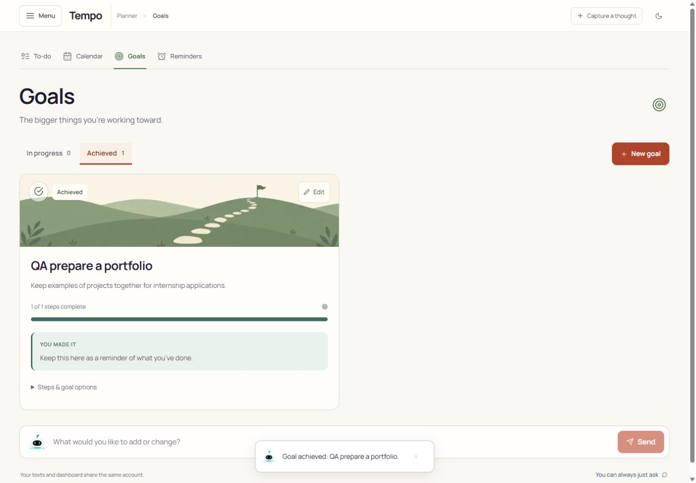

11. **Memory after removal — healthy visible empty state.** “0 saved” and “Nothing saved here yet” agree. The page explains the purpose of saved facts/preferences and provides Add a memory. The disclosure and search field remain available. The main agent reports removing a synthetic preference and reloading, with prior conversation history unchanged. The image alone establishes an empty view, not the deletion operation, search-filter state history, or live AI memory extraction/correction.

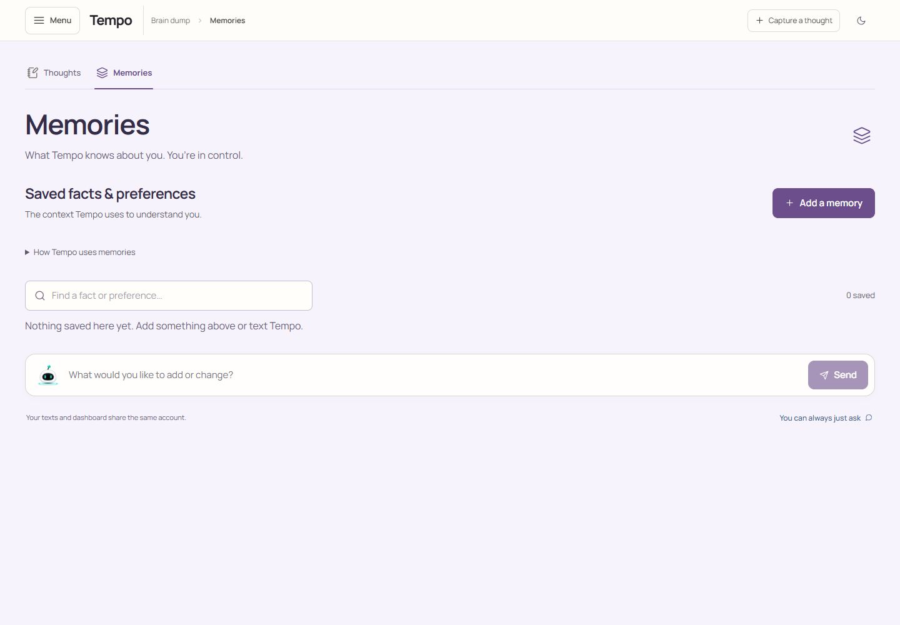

12. **Fitness saved plan and completed log — healthy.** “Completed movement” shows a 12-minute entry with a date and optional session notes. “Your saved plans” separately shows QA campus walk and its 15-minute session, with distinct Schedule and Log completed controls. This makes actual logged duration and planned session duration understandable without conflating them. The main agent reports that the future scheduled task remained not started and retained its original duration after logging; that functional separation is attributed to its checks. This scrolled screenshot does not show the entire Fitness page or the future task itself.

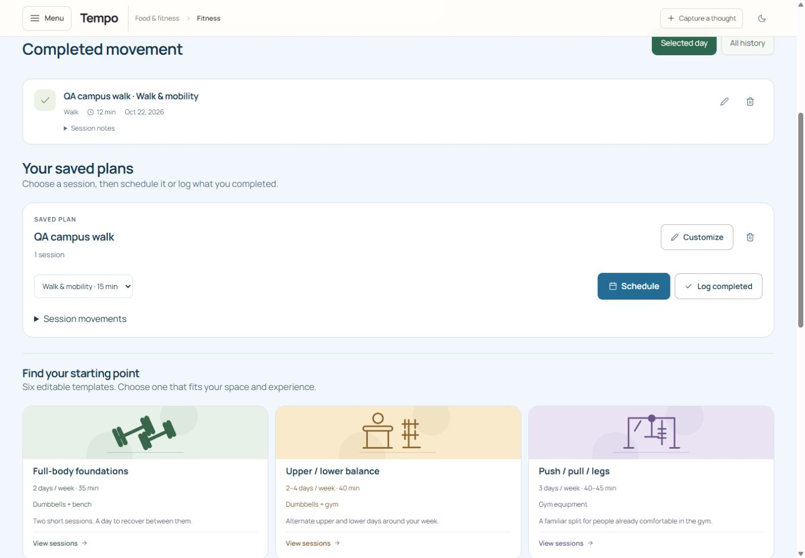

13. **Profile outage draft — clear recovery, minor navigation-spacing issue.** The status explains the last-known profile and retained draft, then supplies Try again. Inputs retain visible content; the textarea has a prominent focus ring and a character counter. Save profile is visually subdued in the refresh-before-save state, which is intentional recovery behavior rather than a failure to enable editing. The left-card link separation needs the small spacing correction above. The screenshot supports the visible draft and guidance, not successful refresh, save, cross-account isolation, or persistence after a reload.

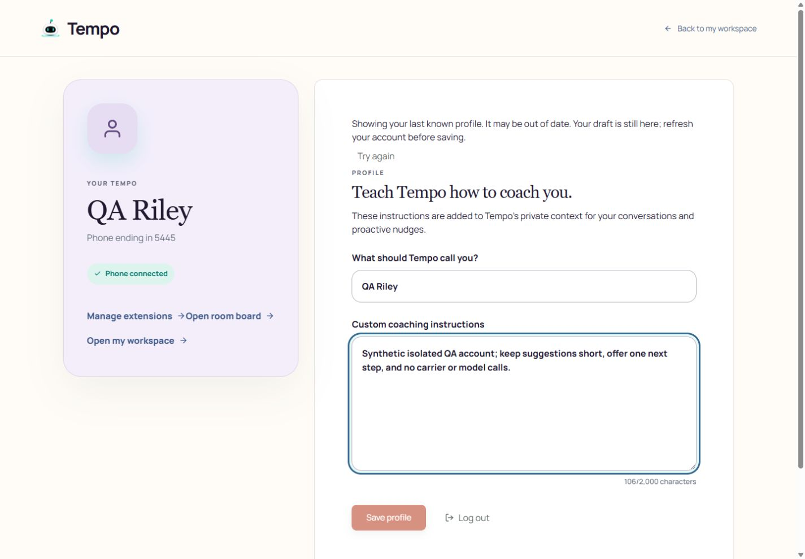

No mobile, keyboard, contrast-ratio, screen-reader, or touch-target measurements were added in this follow-up. The four images show no obvious clipped form fields or content, but they cannot establish responsive behavior beyond their captured desktop widths. Keep the established visual theme; the recommended correction is limited to spacing between the Profile links.

### Profile link-spacing resolution: captures 14–15

**The P3 link-spacing finding is visually resolved.** I opened both new original PNGs supplied by the main agent. Manage extensions, Open room board, and Open my workspace now appear on distinct, comfortably separated rows on desktop and phone. Their arrows stay associated with their own labels; no touching labels or clipped link text are visible. No additional rating is assigned for this narrow correction.

14. **Recovered Profile with separated links — healthy.** Each left-card link has its own row. The form retains the displayed coaching instructions and a 106/2,000 character count. A persistent “Saved. Tempo will use these instructions in future coaching” confirmation is visible below Save profile. The main agent reports that the outage preserved the 106-character draft, automatically recovered, then saved and reloaded successfully. I observed the resulting screenshot, not those browser actions or the underlying persistence.

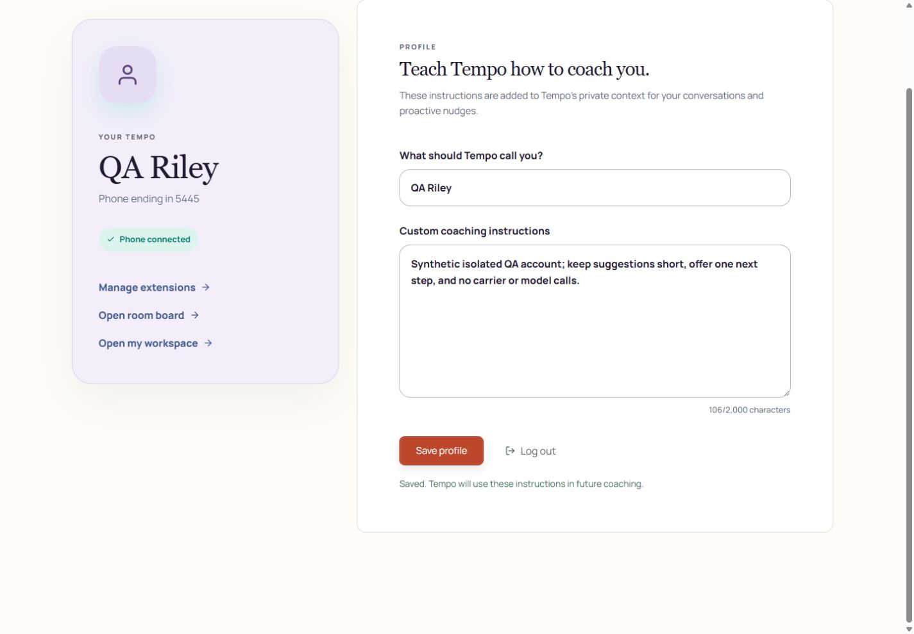

15. **Phone Profile links — healthy within the captured viewport.** The profile card stacks above the form. All three navigation links remain separate and fully readable, and the form heading wraps naturally below. The main agent reports a 390px viewport and CSS/DOM confirmation of flex rows with 44px minimum height; I did not independently measure target sizes or operate the phone layout. The lower form and saved notice are outside this phone viewport, so their phone rendering is not established by this image.

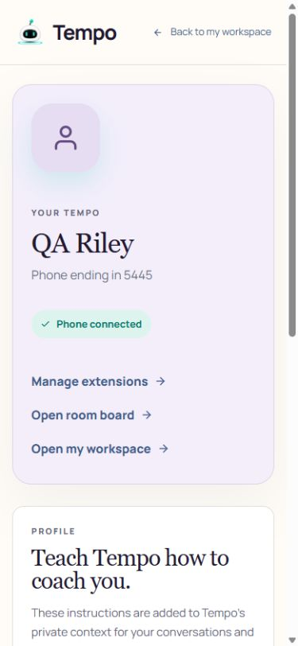

This resolution preserves the earlier attribution and accessibility limits. It establishes the visible spacing correction in the supplied screenshots, not independent keyboard, touch, provider, or account-isolation verification.

## Separate scoped addendum: first-run captures 19–24

**Visual/copy-clarity score: 8.2/10 for these six captured states.** This is a bounded review of reset signup, pending replacement number, expired-link recovery, optional onboarding, empty Home, and zero-activity Journey. I read the updated evidence README and opened all six original PNGs. The main agent performed the browser actions and captured the images; I did not operate the synthetic account. This score measures the displayed states, not carrier delivery, authentication security, durable setup, or whole-product readiness.

Two minor copy issues are confirmed by both the screenshots and narrow component inspection:

- **P3 — Journey implies earlier recorded activity at an all-time zero (24).** “A fresh start. Your earlier steps still count” is displayed alongside zero small wins and zero active days. Keep that encouragement for returning history, but use first-step language when total recorded completions are zero. This is a mismatch in state-specific copy, not a claim that the displayed zero counts are wrong.
- **P3 — Adjacent opt-out assurance repeats in the first setup step (22).** TimezoneSettings says “This does not turn on text check-ins”; GentleSetup immediately repeats “This setup won’t turn on text check-ins.” Retain one assurance in step 1 and preserve the existing assurance on later steps where the timezone section is absent. This reduces repetition while keeping the consent boundary explicit.

19. **Reset signup — healthy visible state.** The area-code and phone fields are blank, the text-consent checkbox is unchecked, and focus is visibly in the phone-entry area. The shared-account note remains clear. The main agent reports that Use a different number produced this reset; the screenshot alone does not establish revocation of the earlier signup claim.

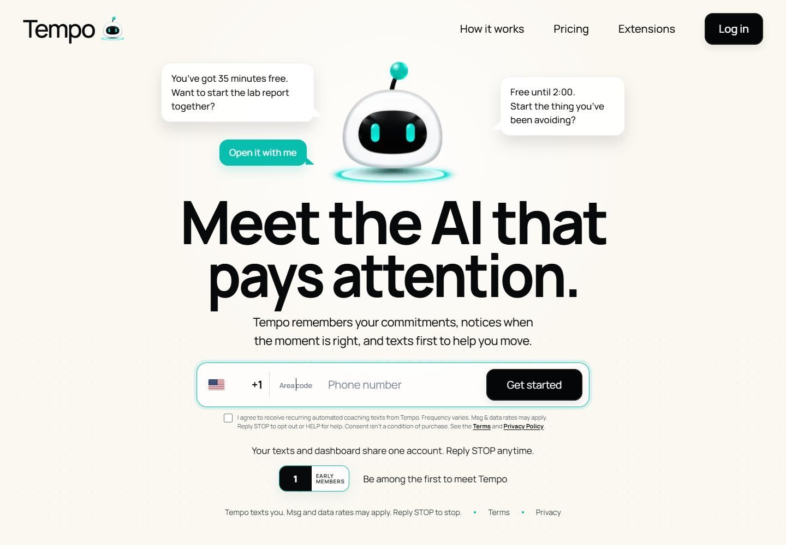

20. **Replacement number pending — healthy.** “One last step: start the conversation” and Text START to Tempo state the next action clearly. Use a different number and Back to sign in provide visible recovery routes. This does not show a text being delivered or the phone becoming activated. The general marketing headline is separate from the pending-state instruction.

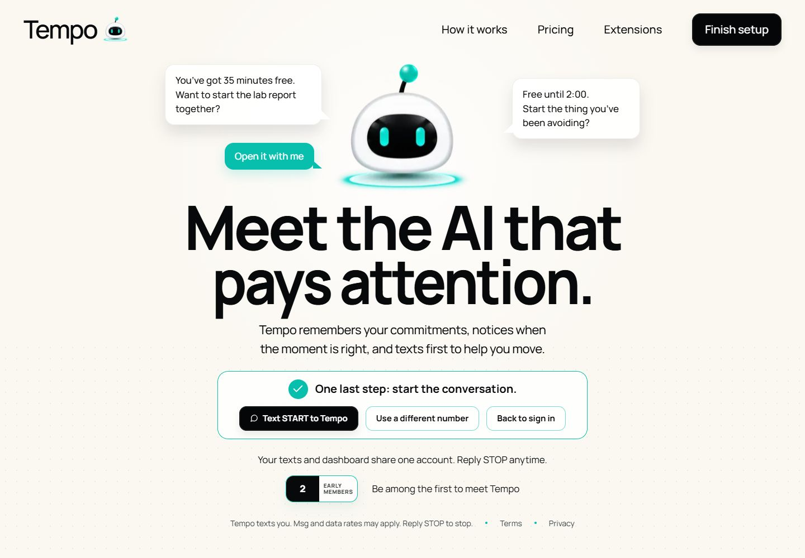

21. **Expired/used sign-in recovery — healthy.** A focused card explains the link is expired or already used and offers a large Back to sign in action. There is no raw transport/server message or visual dead end. The actual rejected abandoned claim and link behavior are main-agent-reported evidence, not independently tested here.

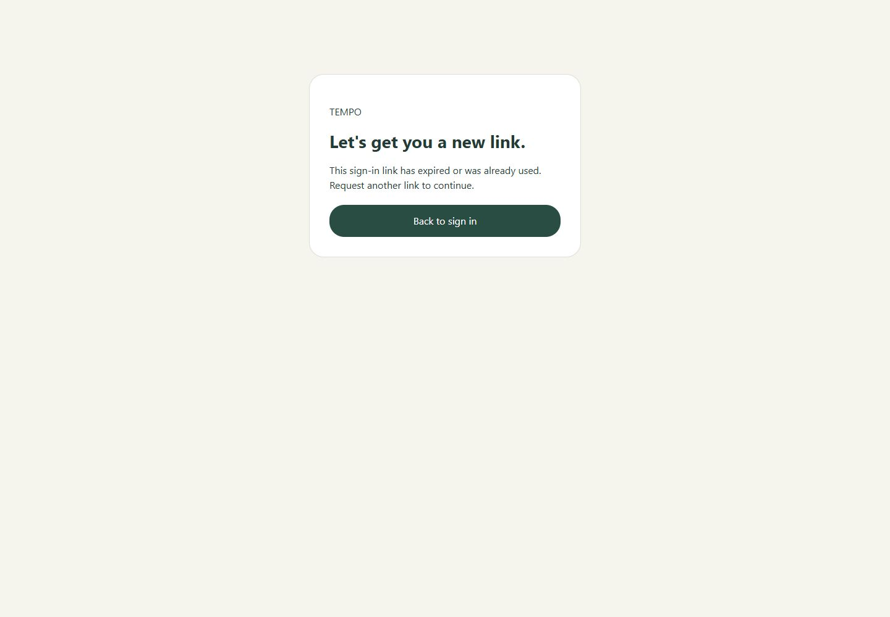

22. **First setup step — usable; copy repetition noted.** The optional name field, device-zone suggestion, explicit time-zone confirmation, Skip for now, and Continue are distinct. The dialog fits this desktop capture without clipped form controls. The two adjacent text-check-in assurances are redundant; see the scoped copy recommendation above. Later setup choices and persistence after reload are described by the main agent but are not visible in this screenshot.

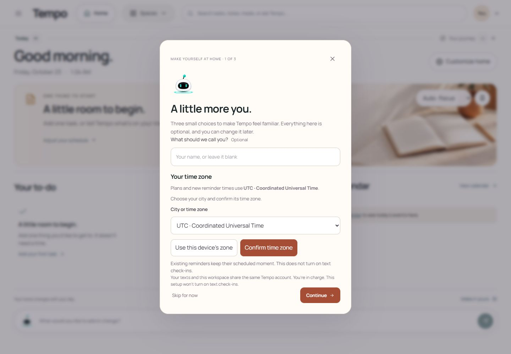

23. **Empty Home — healthy.** The hero and task area offer a concrete first task action instead of fictional activity. The Calendar clearly explains that a connection is needed. The Saved choices toast is visible. The screenshot establishes an empty task display; separate assertions reported by the main agent establish no inherited tasks/goals/life items and proactive messaging remaining off.

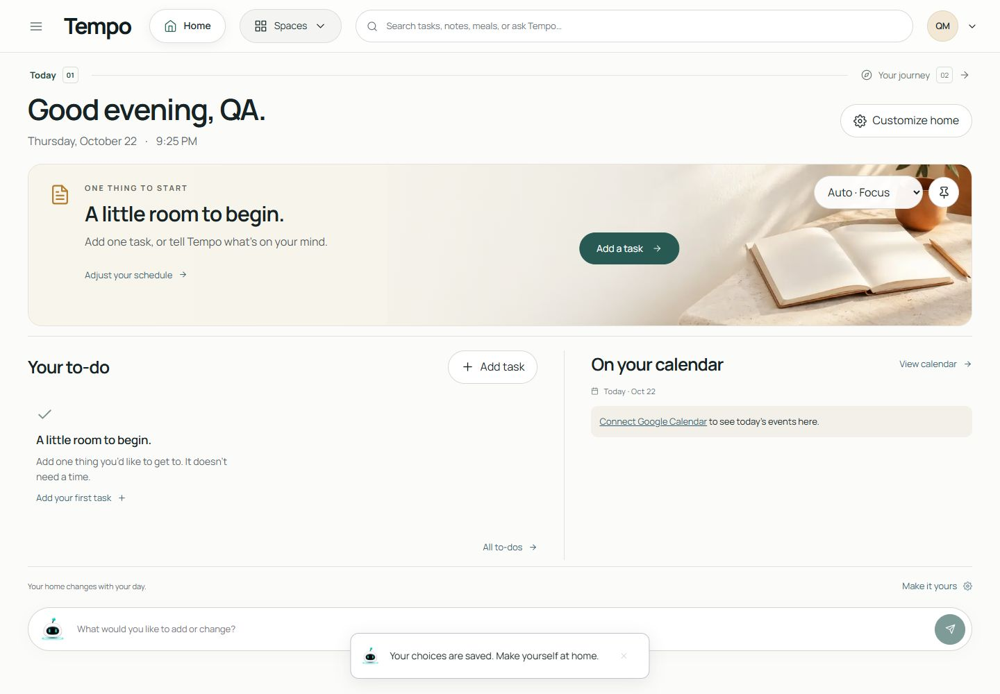

24. **Zero Journey — clear numeric state, first-use copy correction recommended.** Zero streak, zero wins, zero active days, an initial level, and future milestones visually agree. The disabled celebration control appropriately avoids celebrating an unrecorded completion; that disabled state is not a defect. “Your earlier steps still count” is mismatched to the zero-history state and should be conditional. The illustration, typography, and established theme need no redesign.

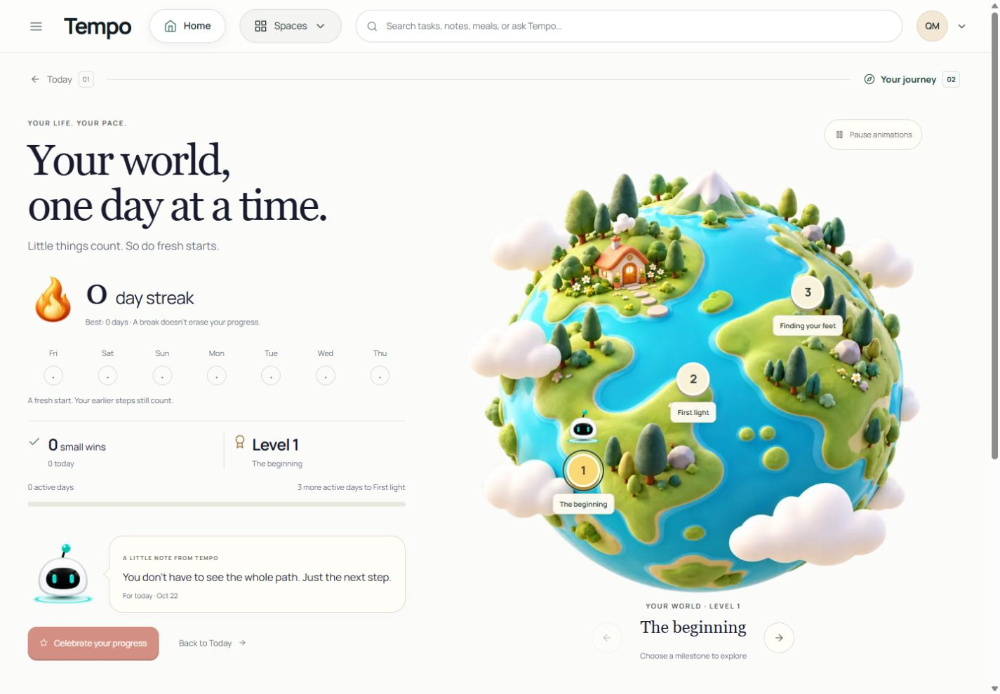

No new responsive, screen-reader, measured contrast, keyboard, or carrier checks were performed by this reviewer. Source inspection is limited to JourneyView, GentleSetup, their direct types/helpers, TimezoneSettings, and nearest tests. Any code correction and post-change browser capture will be documented separately; the images above remain pre-correction evidence.

### Narrow implementation follow-up, awaiting fresh captures

After the main agent confirmed its full validation run had finished, I implemented the confirmed corrections:

- `JourneyView.tsx` shows “Your first small step can start here” when total recorded completions are zero. The returning-history encouragement is preserved when earlier completions exist but the current streak is zero. Assertions added to the existing boundary test cover both states.
- `GentleSetup.tsx` retains the shared-account/agency note in the first step; TimezoneSettings supplies the single text-check-in opt-out assurance there. Later setup steps keep their existing assurance.
- A narrow signup readability inspection confirmed `.sms-consent` in `globals.css` was 11px. Under the main agent's explicit instruction, I increased it to 14px with 1.55 line height, a minimum 44px label row, 6px vertical padding, and a pointer affordance. The existing associated checkbox/label structure and all consent wording remain unchanged. No other visual redesign was made.

Before editing, I read the local Next.js client-component and CSS guidance. Validation run after these edits: nearest Journey/PhoneSignup suites, **3 files / 16 tests passed**; `npm run lint` passed; `npm run typecheck` passed. No provider calls, secret reads, or commits were performed. The existing captures 19, 22, and 24 still show the earlier rendering; these implementation checks do not substitute for a fresh screenshot. The 8.2 score above remains a score of those captured states until visual re-review.

### First-use Journey resolution and paused-focus capture: 26–27

I independently opened both original images supplied by the main agent. **The zero-history Journey copy finding is visibly resolved in capture 26:** “Your first small step can start here” now appears with zero wins, zero active days, and the initial milestone. The theme and illustration remain unchanged. No new score is assigned for this narrow correction; the earlier first-run score applies to its named pre-fix captures.

26. **Revised first-use Journey — healthy.** The first-step invitation agrees with the zero recorded activity. Future milestones remain distinguishable from the starting point, and the disabled celebration remains appropriate. The screenshot does not establish a later completion or persistence by itself.

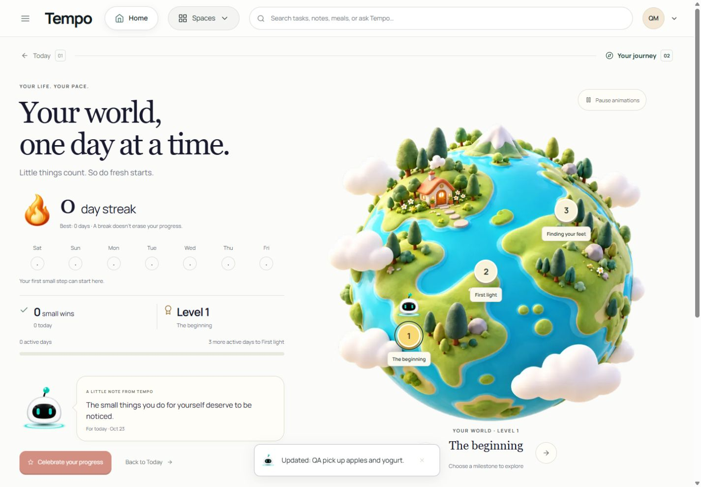

27. **Paused task timer — healthy visible state.** The task title, 1:48 display, “paused” status, Resume action, and separate I’m done action are clear. The visible focus ring is strong. The main agent reports the sequence of saving 30 minutes, editing to two minutes, starting, pausing at 1:48, reloading with that paused value, resuming, and explicitly completing the task. I did not reproduce those interactions, and a single PNG does not prove the full sequence.

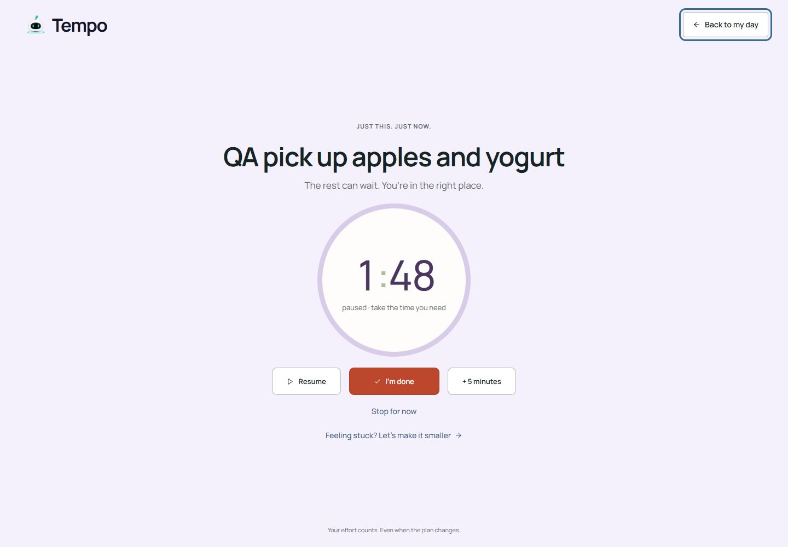

Two further bounded wording corrections were then requested by the main agent and implemented by this reviewer: Home's empty-list action now says “Add a task,” which also fits accounts with completed-task history; the inline focus timer in `WorkspaceClient.tsx` now pluralizes minute/second units from their counts (for example, “1 minute 48 seconds remaining”). This changes presentation only. The timer's accessible label cannot be verified visually from capture 27; fresh DOM or assistive-technology inspection remains with the main agent. The focused Home/workspace repository suites passed **2 files / 38 tests** after these changes; lint/typecheck completion is recorded separately below when available.

Final validation for those two presentation changes: `npm run lint` **passed** and `npm run typecheck` **passed**. No full-check rerun was requested for this bounded copy-only follow-up. Fresh signup-consent and onboarding images remain pending from the main agent, so their final visual rendering is not yet claimed here.

### Checkpoint: first-use copy and setup resolved

**Revised scoped visual/copy-clarity score: 8.4/10 for the two reviewed states in captures 26 and 29.** I opened both original saved PNGs for this checkpoint. This is screenshot inspection only; the main agent performed the browser actions and captures. It does not rerate signup, the other first-run screens, functional persistence, accessibility conformance, or the whole product.

- **26, revised zero-history Journey — resolved.** The first-step invitation now agrees with zero recorded wins and active days. It no longer implies earlier recorded steps. The starting-point and future-milestone presentation remain clear. The capture and image are recorded above.
- **29, revised setup with confirmed time zone — resolved.** The text-check-in assurance appears once below the time-zone controls. The following note supplies shared-account and agency context without repeating it. New York is visibly confirmed, and the subdued Time zone confirmed button correctly communicates that state. The name field, zone selector, device-zone action, Skip for now, and Continue remain legible and fit the captured dialog. This is a setup dialog reopened with saved choices, not proof of a fresh signup interaction.

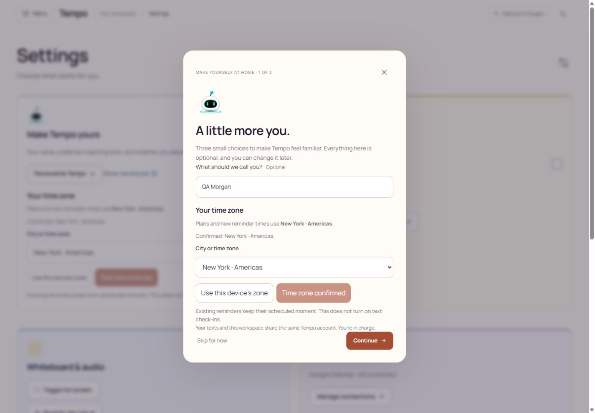

No further product changes are recommended for these two resolved findings at this checkpoint. The revised 14px signup consent still requires its own fresh screenshot before I claim visual verification. Existing limits on keyboard, screen reader, measured contrast, physical device, and provider behavior remain unchanged.

### Final signup rendering checkpoint: capture 32

**Desktop signup visual clarity: 8.3/10.** I opened the original `32-signup-after-runtime-refresh.png`, then rechecked captures 26 and 29. The final signup consent text is visibly larger and easier to read than capture 19, with comfortable line spacing, a distinct unchecked checkbox, and readable underlined Terms/Privacy links. The paragraph wraps without clipping and remains close to the phone form. No further visual fix is required in this captured desktop state.

32. **Signup after runtime refresh — healthy.** The main agent reports that a known local runtime restart replaced stale development CSS and that the current DOM computes 14px text with 6px vertical padding. I independently verified the resulting visible rendering, not the DOM measurement or restart. No new signup submission or provider call was performed for this checkpoint. Intermediate captures 30–31 showed stale CSS and are excluded from this final assessment.

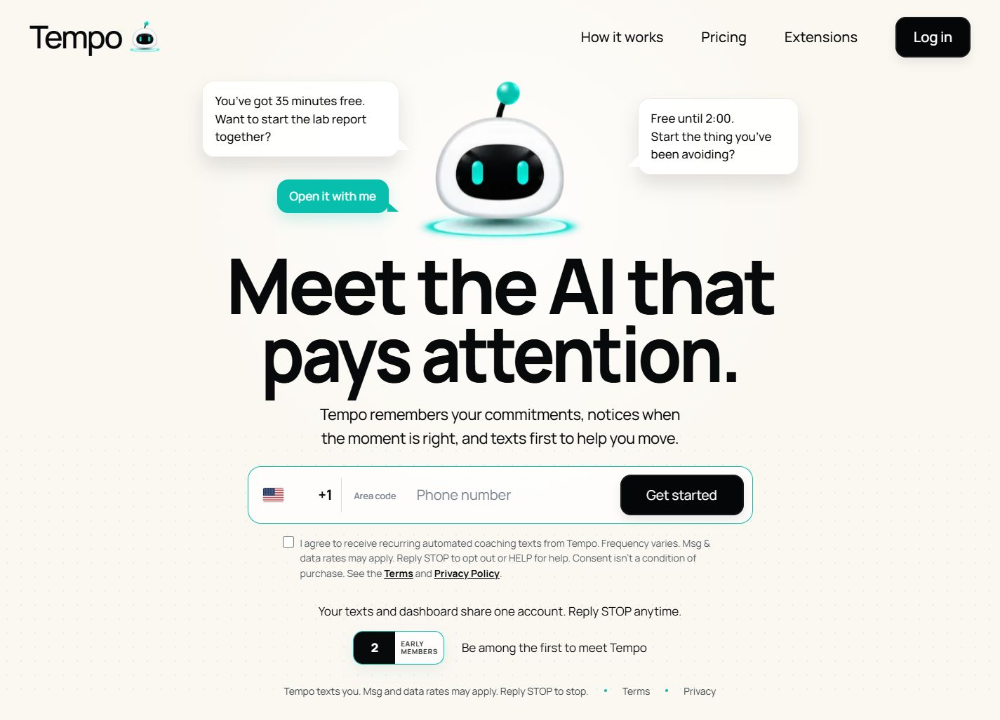

The resolved first-use Journey/setup score remains **8.4/10 for captures 26 and 29 only**. This final addition closes the earlier pending desktop signup-rendering check; it does not establish phone signup layout, checkbox interaction, measured contrast, screen-reader behavior, carrier delivery, or whole-product readiness. No product files were edited during this checkpoint.
